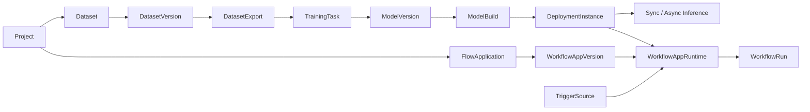

# 信息架构与业务路径

## 当前导航结构

```text
AMVAR + 动态词缀
├─ 项目
├─ 任务
├─ 数据集
├─ 模型
├─ 部署
├─ 推理
├─ 图编辑
├─ 应用
├─ 集成
├─ 节点
└─ 设置
```

左侧导航为平级列表，只包含当前可访问的工作台。顺序来自 [navigation.config.ts](../../../frontend/web-ui/src/config/navigation.config.ts)，显示名称使用当前 i18n。详情通过列表行、资源链接或当前上下文进入，不在导航中重复展开。工作台没有另一条全局顶栏。

## 目标导航结构（规划）

按 2026-10-23 最新要求，左侧导航采用与当前类似的简洁平级形式，不显示分类标题，不新增独立全局顶栏。撤销五入口合并与新项目选择器方案。旧图合理内容继续作为设计基础，右侧详情/配置区按展开抽屉理解。见[修订方案](frontend-redesign-plan.md)和[功能清单](navigation-and-page-plan.md)；不修改现有深链接与资源功能。

## 当前路由

| 页面 | 路径 | 主要对象 |
| --- | --- | --- |
| 启动检查 | `/` | API、会话、版本和连接状态 |
| 登录 | `/login` | 本地 UserSession |
| 离线 / 无权限 / 未找到 | `/offline`、`/forbidden`、fallback | 系统状态 |
| 项目 | `/projects` | Project |
| 任务 | `/tasks`、`/tasks/:taskId` | TaskRecord、TaskEvent |
| 数据集 | `/datasets` | Dataset、DatasetVersion、Import、Export |
| 导入详情 | `/datasets/imports/:datasetImportId` | DatasetImport |
| 导出详情 | `/datasets/exports/:datasetExportId` | DatasetExport |
| 模型 | `/models` | Model、ModelVersion、ModelBuild、训练与转换 |
| 训练详情 | `/models/:taskType/training-tasks/:taskId` | TrainingTask |
| 转换详情 | `/models/:taskType/conversion-tasks/:taskId` | ConversionTask |
| 部署 | `/deployments` | DeploymentInstance |
| 推理 | `/inference` | 同步推理、异步推理 |
| 流程应用 | `/workflows/apps`、`/workflows/apps/:applicationId` | FlowApplication、AppVersion、Runtime、Run |
| 流程编辑器 | `/workflows/graph/new`、`/workflows/graph/apps/:applicationId` | GraphTemplate、Node、PreviewSession |
| Runtime 运行监视 | `/workflows/runtime/:workflowRuntimeId/monitor` | 发布图的只读观察、运行结果 |
| Runtime 应用模式 | `/workflows/runtime/:workflowRuntimeId/app-mode` | 公开输入、选定的结果区域 |
| 触发源 | `/integrations/trigger-sources` | TriggerSource |
| 节点目录 | `/custom-nodes` | Core / Custom NodePack、NodeDefinition |
| 设置与诊断 | `/settings` | Service、Runtime、Device、Access |

旧的 Template / Application 编辑路径只做重定向，不是独立页面。实际路由以 `frontend/web-ui/src/**/routes.ts` 为准。

旧图中的项目概览、独立评估中心/评估详情、独立部署详情、数据集样本浏览页没有对应的当前独立路由。导入、导出、训练、转换等创建表单也不能因旧图画成向导就被当作新页面；出图应注明属于哪个现有页面的内嵌区域、对话框或抽屉。

项目查看已补充为[独立概览设计](project-overview-design.md)，目标路由 `/projects/:projectId`，由列表操作“查看”进入，仍归属“项目”导航。它是新增规划，不属于上表当前路由；项目信息和短编辑表单仍可使用可关闭抽屉，不能将完整概览压入抽屉。

## 对象层级



界面必须区分三种生命周期：

- 资源：版本化、可追溯，可被其他对象引用。
- 有限任务：从 `queued` 进入终态，完成后保留产物和事件。
- 常驻实例：具有 desired / observed 状态、健康、心跳和启动停止控制，不使用任务的 succeeded 语义。

## 端到端路径

### 数据、模型与部署

```text
Project
  -> 上传数据集 zip
  -> DatasetImport / DatasetVersion
  -> DatasetExport
  -> TrainingTask / Validation / Evaluation
  -> ModelVersion
  -> ConversionTask / ModelBuild
  -> DeploymentInstance
  -> 同步或异步推理
```

每个详情区域显示来源、版本、兼容性、产物和下一步入口。模型、任务、格式、运行时和设备选项由后端 capability 与 schema 约束，不在前端硬编码虚假组合。

### Workflow 发布与调用

```text
流程编辑器
  -> PreviewSession
  -> 发布不可变 WorkflowAppVersion
  -> 创建或切换稳定 WorkflowAppRuntime
  -> 绑定 TriggerSource
  -> HTTP / WebSocket / ZeroMQ / Modbus / directory adapter
  -> WorkflowRun / 同步响应
```

编辑草稿不会改变已运行 Runtime。Runtime 通过 revision 与 generation 选择不可变 AppVersion，Trigger 继续绑定稳定 Runtime id。

## 全局上下文

- Project 是数据、模型、Workflow 和任务的主命名空间。
- Project 通过项目页及业务表单上下文选择，不因修订设计新增全局项目选择栏。资源归属、授权、未保存保护和正在执行的工作不随样式修改而改变。
- ID、版本号和 generation 在详情与诊断中使用稳定格式并支持复制，不在应用列表或运行画布顶部重复堆叠。
- 无 Project 时，业务页面显示明确空状态，不自动创建虚构资源。
- 资源和控制状态来自 REST 快照与相应状态流；Preview 临时图片/值由 WebSocket 交付，不能被理解为可永久从 REST 或磁盘恢复。
- 根地址 `/` 沿用登录回跳与浏览器个人启动偏好；导航品牌不直接跳转 `/projects`。启动偏好不等于 Runtime 自启动配置。

## 页面组织规则

- 列表负责检索、筛选、分页、状态和进入详情，不承载完整配置表单。
- 详情负责对象关系、当前状态、事件、产物和控制动作。
- 工作台型页面可以在同一路由内组织列表、创建面板和详情抽屉；不得因此伪造不存在的独立路由。
- 原始 JSON、日志、契约指纹和低频诊断放在次级面板，主视图先展示工程决策需要的信息。
- 写操作必须显示前置条件、影响范围、处理中状态和失败后的恢复动作。

## 事实边界

本文件的当前路由表只登记已注册页面。新页面先在[目标规划](navigation-and-page-plan.md)记录职责、状态与依赖；Vue Router、权限门禁、服务契约和浏览器测试落地后，再加入当前路由表。数据集完整管理、异常检查和 3D 结果等目标能力可提前设计，但不能混入当前事实。
