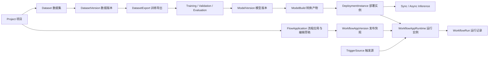

# 产品与设计总纲

设计范围以未来完整产品能力为目标，不以当前页面、API 或字段是否存在为上限。合理的用户流程先形成完整规格，缺少的契约、存储和权限能力另列实现任务。该原则不改变本地优先、Vue 3、通用节点与行业扩展包边界，也不表示规划功能已经实现。

## 1. 产品定位

AMVision 是本地优先的工业视觉服务平台。它负责管理视觉数据、训练和评估模型、转换模型、部署推理服务、调试推理结果、编排视觉流程，并通过 HTTP、WebSocket、ZeroMQ 等协议与上位机、MES、PLC 网关或设备代理系统协作。

平台不是相机或 PLC 的直接控制系统，不是通用 SaaS 管理后台，也不是单一模型训练工具。界面需要同时表达三类对象：

- 可追溯资源：Project、Dataset、DatasetVersion、DatasetExport、Model、ModelVersion、ModelBuild。
- 有开始和结束的任务：导入、导出、训练、验证、评估、转换、异步推理。
- 长期运行实例：DeploymentInstance、WorkflowAppRuntime、TriggerSource。

设计必须让三类对象在视觉上和操作语义上保持清楚，避免把长期运行服务错误表现为普通后台任务。

## 2. 主要用户

### 2.1 视觉算法工程师

关注数据格式、数据版本、模型系列、训练参数、指标曲线、checkpoint、评估结果、模型转换和运行时兼容性。需要快速比较、定位失败原因和复现实验。

### 2.2 现场实施与调试工程师

关注部署实例、设备、运行时、精度、输入输出契约、同步或异步接口、预热、健康状态、时延、吞吐、日志和结果回传。需要在弱网或离线环境中稳定操作。

### 2.3 流程工程师

关注节点目录、端口类型、参数、流程模板、应用版本、运行实例、触发源、运行记录和错误定位。需要在大画布上完成节点编排、试跑、发布和观察。

### 2.4 运维与管理员

关注服务状态、worker、Python 运行时、GPU/NPU、磁盘、权限、项目和节点包。需要明确区分可恢复警告、阻断错误和危险操作。

### 2.5 现场操作员

主要使用已发布 Runtime 的应用模式，关注本次结果、必要输入、图像/点云、产量与异常原因。默认不进入配方、标定、模型或节点参数编辑；允许的操作由账号权限决定。结果无效、尚未执行、断连和业务 NG 必须分开，不能用上一帧 OK 掩盖当前不可用。

## 3. 核心体验目标

### 3.1 一眼知道当前所在层级

当前导航、资源名称和返回入口共同说明所在层级。需要项目范围的操作显示当前 Project；完整资源 ID、generation 和诊断信息放在详情或复制入口，不强制在所有列表、图画布和应用模式顶部重复显示。

### 3.2 一眼区分资源、任务与运行实例

- 资源使用中性图标、版本号和来源关系。
- 有限任务使用实际进度、阶段、开始和结束时间；队列状态仅在该任务链路确实存在时显示。
- 运行实例使用健康灯、运行时长、心跳、端点、设备和启动/停止操作。

### 3.3 状态不只依靠颜色

所有状态同时使用文字、图标和必要的结构差异。运行中显示动态进度或心跳，失败显示错误摘要和下一步操作，已完成显示产物入口。

### 3.4 复杂能力逐层展开

首屏只显示当前决策需要的信息。高级参数、原始 JSON、日志、元数据和审计信息放入可展开区域、标签页或右侧检查器。

### 3.5 视觉结果优先

推理、数据集样本、评估和流程试跑页面要为图片、mask、keypoints、OBB、边界框、热图和测量叠加保留足够空间。未来深度/点云使用相应查看器，不能仅以二维截图替代。结果画布不是表单附件，而是核心工作区。

## 4. “人工、洁净、未来感”的可执行定义

### 4.1 人工

- 使用准确、直接、克制的中文界面文案。
- 保留清楚的手工控制：选择、确认、试跑、发布、回滚、停止。
- 展示来源、版本、操作者和时间，体现工程过程可以被人理解和追溯。
- 允许局部不完美的真实工业图像、标注叠加、日志和数据，而不是使用品牌化空洞插画。
- 使用少量带有触感的细节：精细分隔线、实心按钮、紧凑表格、微弱纸张或金属灰层次，但不使用拟物皮革、夸张阴影。

### 4.2 洁净

- 12 列网格、稳定对齐、清晰的主次区域。
- 主要页面最大内容宽度按业务决定；表格和工作台可全宽，表单内容控制在可读宽度。
- 避免每个信息块都套卡片。优先使用区域标题、细分隔线和表格。
- 颜色数量受控，品牌绿只用于主要操作、选择态、运行正常和视觉锚点。
- 文案短而准确，字段名和字段值严格对齐。

### 4.3 未来感

- 来自实时状态点、微型趋势图、精密图像叠加、节点连线、结构化数据和快速反馈。
- 使用深墨色与冷白双主题，搭配统一的品牌绿 `#00D992`。
- 可以使用极轻的网格、扫描线或坐标刻度作为功能性背景，只出现在图像画布、流程画布和运行监视区。
- 动效短、明确、有物理感：状态切换、面板展开、节点连接、进度更新。
- 禁止大面积霓虹光晕、彩虹渐变、悬浮玻璃球、太空背景、无意义 HUD 装饰。

## 5. 产品信息层级

## 6. 支持能力边界

模型、任务、数据格式、转换目标、runtime 和设备组合会持续随实现变化，不在设计文档复制静态矩阵：

- 当前模型与任务组合见 [模型支持矩阵](../../reference/models/support-matrix.md)。
- 当前数据格式见 [数据格式参考](../../reference/datasets/README.md)。
- 当前部署选项见 [模型部署运行时](../../architecture/models/deployment-runtime.md)。

界面必须读取后端 capability、parameter schema 和设备探测结果约束选择器，不提供不支持的组合，也不把长期产品范围显示为当前可执行选项。

## 7. 全局页面框架

### 7.1 工作台外壳

- 当前外壳由左侧导航和内容区组成，导航展开 `220px`、收起 `64px`；没有全局顶部搜索或项目栏。
- 导航顶部使用 AMVAR 动态品牌，用户菜单位于底部；项目选择沿用各业务页入口。
- 普通页面、流程编辑器、运行监视和应用模式均遵循亮色/暗色外观；图片查看区可使用中性深底突出图像。
- `.page-header h1` 和设置二级导航的顶部标题保持隐藏，页面操作区不保留空的标题高度。详情、对话框和节点的必要名称继续显示。
- 列表详情使用共用右侧抽屉；节点属性面板和图形编辑对话框按各自职责布局，不强制与资源抽屉同宽。

### 7.2 导航与概念分组

当前导航是 11 个平级入口，顺序见[信息架构](information-architecture.md)。修订继续参考这种简洁平级形式；功能域不变成侧栏分组，不增加独立顶栏。以 `bak1` 合理页面为基础统一风格，右侧详情按抽屉理解；撤销五入口合并和固定分栏方案，详见[修订要求](redesign-brief.md)。不按行业无限扩张导航。

## 8. 设计边界

- 不设计内建标注平台首页；数据标注通过外部工具协作，平台只展示样本和标注结果。
- 不设计相机、PLC 或传感器的核心驱动配置中心；直连能力仅作为受控 custom node 配置出现。
- 不设计营销首页、订阅套餐、团队协作社交流或通用 SaaS 数据大屏。
- 不把所有复杂表单塞进一个页面；创建流程使用侧滑面板、分步对话框或独立向导。
- 不把日志和 JSON 当成主视觉；它们是必要的工程细节，放在辅助层。
- 连接器二维检测通过通用节点、专用扩展包、节点 UI 和 Workflow 示例提供，不另建连接器业务系统或独立导航。通用控件不含 PIN/托盘等行业规则。
- 异常/瑕疵与 3D/点云沿用同一节点和工作流框架；新增媒体、坐标与结果类型在共享组件中扩展，专用能力归属对应节点包。三维渲染与后台测量分离，不把显示抽样结果用于生产判定。
- 尚未实现的数据集样本管理、质量检查、版本派生、评估页面可以完整规划；设计中标记依赖与状态，产品菜单按真实能力开放。生产 JSONL、临时预览与训练数据集保持独立语义。
- 编辑 Preview 的逐节点反馈与 Runtime 完成后的结果观察分开表达；不得为界面展示给同步 Runtime/Trigger 加入业务队列、等待或自动重试。

## 9. 实现与评审约束

- 界面语言默认简体中文，模型名、格式名、runtime、API、ID 保留英文。
- 使用真实业务示例，如 `VOC2012 Detection`、`YOLO11-s Detection`、`OpenVINO IR`、`TensorRT FP16`。
- 设计应可由 Vue 3、常规 CSS、SVG、Canvas 和 Vue Flow/LiteGraph 类组件实现。
- 不实现无法维护的三维全息界面、漂浮粒子或持续视频背景。
- 图标使用统一的简洁线性图标系统，避免混用彩色插画图标。
- 长资源列表考虑筛选、状态、空状态和分页；排序、批量动作、保存视图只在实际支持时提供，不向短参数表强加列表工具栏。
- 有限任务考虑其契约定义的排队、运行和终态；不能把概念状态直接当作所有 API 的枚举值。
- 常驻实例区分启动、可用、停止和故障；正在推理、长工作流执行和明确容量拒绝不等于未就绪。连接不可确认时显示未知/断开，不伪造失败或绿色健康。
