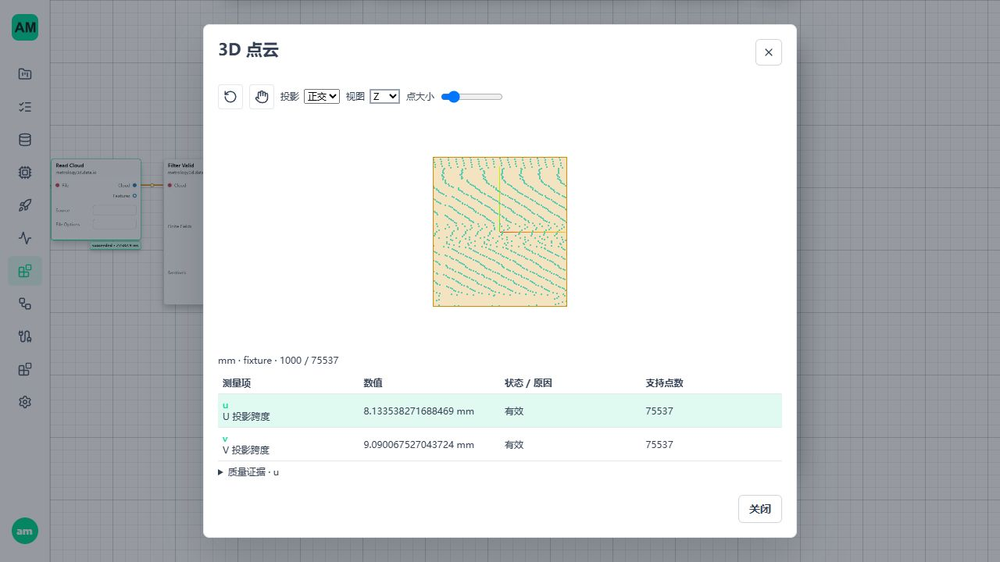
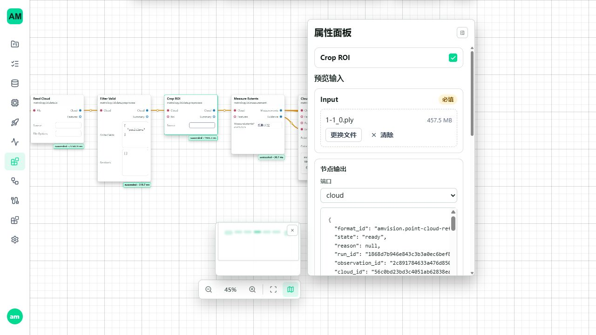

# 3D Metrology 真实工件审计与修正计划

日期：2026-10-24。审计代码基点：`2179cae7`，开始时工作区干净。
本轮为需求复核、代码审计、真实数据与页面验证、修正设计；不修改生产算法，不启用隐藏节点，不调整质量门禁，不提交 Git。

## 1. 结论与优先级

总体架构仍符合原目标：通用三维算法包，复用既有 Workflow、不可变 AppVersion、独立 WorkflowAppRuntime、Scope、LocalBuffer、计量资源和 Vue 界面，没有必要重新建立运行时、资产或发布系统。

**十八节点内部接通，不等于现场完整测量配方已经可用。此次不能得出“没有错误、全部功能完成”的结论。**

| 编号 | 优先级与性质 | 已确认事实 | 对实际使用的影响 |
| --- | --- | --- | --- |
| A01 | P1，前端接线错误 | 联合 schema 被识别为字符串，先于专用编辑器渲染；真实页面 Crop ROI Source、Read Cloud 复合参数显示为空文本框 | 预置配方能执行，但工程师不能按设计正常创建、查看和修改这些配置 |
| A02 | P1，测量配方能力与验收缺口 | 当前 target 选择整个连通边界，不能表达同一闭合轮廓的局部直边/圆弧选择；实际 12 个钢片与 2 个半圆未完成预期尺寸链 | 后续拟合、边间距、孔径的真实工件有效结果尚未验收；不能用合成圆或任意小窗口代替 |
| A03 | P2，测量定义待修订 | 当前平面支持域约束同时施加于参考面与被测面；手工高度使用邻近基准面延伸 | 现有约束符合此前不外推决定，但不能表达已确认需要的基准延伸；须显式区分两类角色 |
| A04 | P2，输入错误分类 | 二进制 PLY 使用 ASCII profile 时严格拒绝正确，但原始 ValueError 被包装为通用“workflow 节点执行失败” | 现场无法清楚区分格式配置错误、坏文件与系统配置错误 |
| A05 | P2，状态文档漂移 | ADR 仍称六节点未接入；基线依赖仍列 trimesh `.1`；开发索引仍称 M3.3 未实现 | 容易误判进度或安装错误依赖；本轮修正文档，不改历史测试数据 |
| A06 | P3，结果可读性 | 页面数值直接显示大量浮点尾数；本次大 Z 范围 ROI 线框遮挡局部点云 | 显示位数不代表精度；后续统一显示格式、图层和取景，不舍入测量数据 |

A02 不表示圆拟合或长宽公式已经被证明错误。已证明的是选择能力有限、测量定义不同、真实端到端结果未通过。本轮参数下的拒绝不能推导为任意参数下都失败，也不应通过任取连通分量或补洞变成成功。

## 2. 原始需求与当前实现

目标仍是通用行业处理流程：完整输入 → 单位/有效性/ROI → 定位与基准 → 特征 → 尺寸 → 质量与公差 → 结果交付。样本是验证工件，不是产品硬编码。

| 阶段 | 已实现的内部节点 | 当前边界 |
| --- | --- | --- |
| M1 | read-cloud、normalize-units、filter-valid、cloud-preview、save-cloud、export-cloud | 文件与同机数组、版本化运行引用、资产/交换导出、有界三维显示已有实现；生产发行仍未验收 |
| M2 | crop-roi、fit-plane、build-frame、transform-cloud | ROI、SVD/RANSAC-SVD、显式基准系和刚性变换已有实现；本轮发现 ROI 编辑入口被公共控件拦截 |
| M3.1 | height-query、measure-step | 局部查询、表面支持检查、区域统计和双面测量；基准延伸须修订角色契约 |
| M3.2 | extract-boundary、fit-line、fit-circle | 局部投影/截面/等高、有序与生成来源、拟合及质量；真实局部边段选择与配方仍有缺口 |
| M3.3 | measure-extents、measure-edge-pair、measure-hole | 包络/最小矩形、有限支持的边距、消费 CircleFeature 的孔径；不是重新拟合圆 |
| M3.4/M3.5 | 尚未完成 | 公开 OK/NG/INVALID 与全部消费者、完整现场配方验收未完成 |
| 后续范围 | 尚未全部实现 | 通用去噪、复杂定位、平面度/GD&T、体积、CAD 偏差等不能宣称已覆盖 |

已核对的边界没有发现需要重建：核心层承载契约和资源，包内 shared 承载算法，handler 负责调用；有序源点继续保留原始行号，生成点记录插值来源；显示抽样不参与尺寸计算。当前样本仍用 float32 保存/传递，局部算法使用 float64。不引入 CloudCompare 生产依赖。

## 3. 数据与环境证据

- 完整源文件：`W:\doc\项目\锂电测量检测\资料\3d轮廓\1-1_0.ply`，479,677,235 字节，14,745,099 点。
- 文件 SHA256：`ff2b9e0ef2d6c45af02c4bf8d474cd82f77f86ad92bd371a4c0f71b1b90d116b`。
- 完整 float32 XYZ SHA256：`956927f058ba4a0170b1c1b93b1411b613fbe21fcbfc278ad0a7fc3cf621a1c6`。
- 手工对照：`C:\Users\tanga\Documents\Codex\2026-10-21\referenced-chatgpt-conversation-this-is-an\outputs`。核对 measurement_config、measurements、dimensions、标注测量端点，以及 pointcloud_measure、steel_dimensions、semicircle_dimensions 等脚本。原文件不修改。
- 手工结果是独立分析参考，不是标定标准件真值；不能仅靠两个软件接近就宣称工业计量精度达标。
- 使用隔离 Python 环境及当前受控 trimesh `5.1.1+amvision.2`、pypcd4 `1.5.1+amvision.2`。没有修改主环境或依赖锁。
- 显式测试配置：工作预算 4 GiB、存活数组 1,000,000,000 字节、独立脚本显示上限 20,000 点；页面使用自己的 1,000 点显示配置。均不是生产默认值，具体参数归档在结果 JSON。
- 本机 CloudCompare v2.14.beta 窗口仅作原云显示与边界检查，未执行独立数值测量，不把观察结果写成尺寸验收。已有 BIN 云显示宽度约 X=97.02、Y=148.47、Z=9.368；这是包围盒，不是工件展开尺寸或手工测量值。

[结构化结果与逐节点参数](assets/metrology3d-audit-20261024/results.json)保留执行结果、原因、质量项、参数和手工文件摘要，不保留原始大文件或显示正文二进制。

## 4. 本轮真实执行结果

### 4.1 完整输入、保存与运行

| 项目 | 本轮结果 | 不代表的范围 |
| --- | --- | --- |
| 完整 ASCII PLY 读取、单位、有效点过滤 | 14,745,099 点全部有限，完整数组摘要一致 | 不是只读前缀或显示抽样 |
| 12 个实际钢片窗口 ROI/投影包络 | 能执行并返回有限量值 | 窗口含底面与边距，不等于钢片高度阈值轮廓尺寸 |
| 12 个实际核心 ROI 与邻近底面中值高差 | 全部 valid，与同一完整支持集的独立 NumPy 中值差一致，最大绝对差 0 | 不是手工中心位置的双平面高度 |
| 实际 A_top_L 核心 ROI 保存后重读 | 坐标和原始 source_indices 完全一致 | 本轮没有再保存整个 479 MB 原件做资产往返 |
| 同一核心 ROI 导出 binary LE PLY 后重读 | 坐标完全一致 | 交换 PLY 不承诺保留平台专有追溯元数据 |
| 浏览器完整 PLY 上传与 Preview | 成功，5 节点，三维图非空、可切 Z 投影 | 配方由隔离测试初始化，不能算从空白页面完成配置 |
| 真实发布版本 → 独立 Runtime → 完整 multipart 文件调用 | 成功，停止 API 返回 200，desired/observed 均 stopped，worker PID 清空 | 本轮不包含新的 Trigger/.NET/Ubuntu 验收 |
| 三次完成的样本脚本 Scope 关闭 | cleanup_errors 为空，账本 retained_bytes=0 | 不是操作系统 RSS/泄漏长稳证明 |

真实版本：`workflow-app-version-f54aad98a1984b13ae4a9efacac8dc27`。
Runtime run：`workflow-run-a8bf2a846f41461d86ecec61d0148e31`。
页面 Preview：`1868d7b946e843c3b3a0ec6bef880da8`。
调用输出 U=8.133538271688469 mm、V=9.090067527043724 mm，和页面一致；这是配置窗口包络，不称为手工 L/W。



中值高差结果（显示至六位，仅用于读表，完整值见 JSON）：

| 区域 | L/mm | R/mm |
| --- | --- | --- |
| A_top | 1.119360 | 1.063763 |
| B_top | 1.234124 | 1.168787 |
| A_bottom | 1.176030 | 1.152602 |
| B_bottom | 1.151918 | 1.112988 |
| C_top | 1.171579 | 1.198931 |
| C_bottom | 1.134116 | 1.284808 |

另将已结束 Preview 的临时文件引用用于 Runtime 调用，得到 `workflow_input_object_reference_invalid`，这是正确拒绝；改用正式 Runtime multipart 上传后成功。临时引用不是持久资源，不应增加兼容分支延长其寿命。

### 4.2 实际基准、钢片轮廓与半圆

五个手工基准 ROI 的全支持 SVD，在本轮显式 0.03 mm 残差条件下全部 `geometry_quality_failed`；最大残差约 0.09、0.07、5.16、0.07、0.08 mm。说明直接全点最小二乘不能替代手工鲁棒基准处理，不是 SVD 算法错误的证据。RANSAC-SVD 因新隔离环境缺少 Open3D 未完成；下载无进展后已停止，没有用替代算法冒充原生验收。尺寸试算使用手工报告的显式评价坐标系，不是新拟合的平台基准。

钢片截面使用手工阈值高度和显式诊断配置：alpha_radius/max_edge_length/max_normal_step=0.3 mm、min_projected_area=1e-12、数值容差 1e-8，目标要求闭合外轮廓。这些量与手工脚本的邻域支持参数不具有自动等价关系。

| 截面结果 | 区域 |
| --- | --- |
| no_intersection | A_top_L、A_top_R、B_top_R、C_top_L、C_top_R |
| target_not_found | B_top_L、A_bottom_L、A_bottom_R、B_bottom_L、B_bottom_R、C_bottom_L、C_bottom_R |

两处实际半圆使用手工圆弧窗口包围框和 0.25 mm 截面，结果均 `target_ambiguous`；B_bottom 有 13 个候选，C_top 有 56 个候选，匹配不唯一。fit-circle 与 measure-hole 正确传播无效、值为 null，没有产生虚假孔径。这里验证了失败传播，不是验证了真实孔径准确度。

### 4.3 为什么不能直接与手工数值相减

1. 手工钢片长宽先做 0.03 mm 栅格中值、阈值分割、闭运算/填洞，再取 2%/98% 分位边界；缺少较低邻点时使用栅格边界。当前 `measure-extents` 计算已提供点/边界的投影极值或最小面积矩形。测量对象与处理规则不同。
2. 手工直边宽先筛选局部直边再鲁棒拟合；当前 target 筛选整条连通候选，不能直接从闭合轮廓截取指定直边。不能靠修改尺寸公式弥补上游选择缺口。
3. 手工高度在钢片中心评价邻近基准面延伸；当前双面路径对两侧均查实测覆盖。中值差与中心位置双面差也不同。
4. 手工半圆只使用部分有观测的角度，部分区域存在明显角度缺测；拟合残差小不等于完整孔边界或足够角度支持。

因此修正方向是明确测量语义、支持域和可选择的边段，而不是追着手工值调参、默认填洞、任取最大连通域或把所有 invalid 当代码错误。

## 5. 根因与源码位置

### A01：公共参数分发覆盖了专用编辑器

[useWorkflowNodeParameters.ts](../../frontend/web-ui/src/workflows/workflow-editor/parameters/useWorkflowNodeParameters.ts) 的 `isStringParameter` 把顶层 `type === undefined` 视为字符串。`oneOf/anyOf` 联合对象通常没有顶层 type。

[WorkflowNodeParameterWidgets.vue](../../frontend/web-ui/src/workflows/workflow-editor/components/WorkflowNodeParameterWidgets.vue) 第 90 行附近先判断 `isString`，第 109–122 行附近才进入 cloud-source/cloud-target 和 trustedParameterEditor；[trusted-editors.ts](../../frontend/web-ui/src/workflows/workflow-editor/parameters/trusted-editors.ts) 已注册 RoiEditor，因此不是缺少编辑器，而是选择顺序和 schema 类型判断错误。

实际页面可见 Source 空文本框。直接挂载 RoiEditor 的组件测试没有经过这条分发路径；现有通用控件测试中的 mock 也不能证明真实联合 schema 分发正确。不能用新增第二个 ROI 编辑器解决。



### A02：完整连通候选不等于局部测量边段

[extract_boundary.py](../../custom_nodes/_metrology3d_nodes/shared/extract_boundary.py) 第 143–159 行附近，以 `candidate.closed == target.closed` 和目标 ROI 对整条候选的 `all()` 选择；零个或多个直接拒绝。这是当前明确语义，但缺少从一个闭合轮廓选择局部直边/圆弧的通用表达。

[boundary_surface.py](../../custom_nodes/_metrology3d_nodes/shared/boundary_surface.py) 使用投影 Delaunay 与显式 alpha、边长、高度跳变过滤；[boundary_section.py](../../custom_nodes/_metrology3d_nodes/shared/boundary_section.py) 只对留下的实际支持三角面求交。没有支持的截线不会自动补全。十二个无效结果的直接原因已由输出定位，但本轮没有证明调整哪一项表面参数即可得到合格真实轮廓，不把这种未完成的因果验证写成结论。

### A03：参考角色与被测角色没有区分延伸策略

[measurement_result.py](../../custom_nodes/_metrology3d_nodes/shared/measurement_result.py) 对两侧调用 [measurement_support.py](../../custom_nodes/_metrology3d_nodes/shared/measurement_support.py) 的 `plane_coverage`。此前要求双方支持域外无效，代码没有擅自偏离此要求。

2026-10-24 已确认后续方向：**区分基准平面的延伸与被测表面的外推，单独设计审核**。本轮不修改算法，不把该确认解释为允许任何拟合面无限外推。发布契约、基准质量、延伸证据和现场显示仍须明确后实施。

### A04：严格解析失败没有转换成输入错误

[io/formats.py](../../custom_nodes/_metrology3d_nodes/shared/io/formats.py) 第 51 行附近直接抛出 `ValueError("PLY encoding does not match profile")`；既有读取清理会释放资源，但没有转换为平台类型化输入错误。
[graph_executor.py](../../backend/service/application/workflows/graph_executor.py) 第 592–613 行附近将非 ServiceError 包装为 ServiceConfigurationError。严格拒绝正确，错误分类和可操作信息不完整。

审计过程中曾把 binary LE 导出配上 ASCII 读取参数；这是诊断脚本配置错误，不能算项目导出失败。正确 profile 的最终往返通过；错误路径仍暴露上述信息丢失问题。

## 6. 验证覆盖与限制

本轮 Windows 定向回归 **41 passed，9.22 秒**，模块如下：

```text
tests/integration/metrology3d/test_boundary_extraction.py
tests/integration/metrology3d/test_boundary_section.py
tests/integration/metrology3d/test_boundary_nodes.py
tests/integration/metrology3d/test_dimension_nodes.py
tests/integration/metrology3d/test_measurement_nodes.py
tests/integration/metrology3d/test_geometry_nodes.py
tests/integration/metrology3d/test_nodes.py
tests/integration/metrology3d/test_dimension_assets.py
```

真实样本通过真实 Catalog、GraphExecutor、handler 和 Scope；隔离页面通过正式 API 发布、正式准入及独立 Runtime，没有替换算法或伪造执行结果。使用既有测试环境构造器只用于隔离服务、显式测试配置与注册隐藏包，不作为生产启用。

本轮没有完成实际数据上的 build-frame/transform-cloud/height-query/fit-line/measure-edge-pair 全部有效量值验证；相关代码和定向测试不能替代这些真实场景。也没有新执行 WSL、.NET、Trigger、Open3D 原生、离线发行或长期资源验收。历史双平台 362 项及前端记录见 [M3.3 实施记录](3d-metrology-m33-acceptance.md)，不累计为本轮结果。

既有 full_sample 回归多用于读取、生命周期和特定小区域的自一致性，部分使用很宽的测试质量条件或故意无效拟合；例如 44 点窗口、同面零高差不等于本工件十二钢片与两半圆验收。后续必须补“真实测量定义一致”的配方，不能只增加通过测试数量。

## 7. 修正实施顺序

以下是本次只读审计时的安排。后续 R1/R2/R3 修复、双平台回归、完整文件页面发布运行和 R4 设计结果见[修复记录](3d-metrology-repair-20261024.md)；本报告不混入后续实现的测试计数。

### R1：先恢复真实页面配方编辑

- 只修既有控件分发：明确 x-ui-widget/trusted editor 的优先级，按结构识别联合 schema，不把未知复合类型当字符串。
- 保留现有 enum/数字/布尔/端口绑定规则；审计所有调用者，不只为 crop-roi 增加特例。
- 回归使用真实 Catalog schema 和实际分发组件，不 mock 掉关键分类器；覆盖 file/asset/array、ROI 参数/端口、color、nullable、只读模式。
- 页面验收必须从空白配方配置、应用/取消、保存重开、Preview、发布并调用；检查切任务、异步晚返回和卸载，不残留旧配置或连接。

### R2：明确输入错误，保持严格拒绝

- 在 I/O 适配边界把已知头部、profile、截断、字段错误转为稳定输入错误码，附预期/实际格式和字段信息；不泄露无关服务器路径。
- 取消、超时、预算、缺依赖和内部错误分别保留；不在 GraphExecutor 全局吞掉 ValueError 或换解析器重试。
- 覆盖 PLY/PCD/XYZ 坏文件、文件/Preview/Runtime 三入口及失败后的 Scope 释放。

### R3：冻结真实测量定义，再补有限边段选择

- 用通用配方分别定义可见投影包络、实测截线、局部直边间距和部分圆弧直径，不能共用一个模糊“长宽”标签。
- 在现有 extract-boundary/selection 契约中设计局部有序段选择：明确 ROI 内保留哪一段、端点来源、闭合变开放、跨缺口分段、多候选歧义及取消/预算。复用 CloudRuntime 和已有源点/生成点来源，不增加资源系统。
- 不能按连通域数组序号或任取最长段识别工件；选择依据须可保存、可重放、可由现场解释。需要新增公开字段时显式版本化并同批更新读写/显示。
- 分开验证“表面过滤导致没有交线”与“交线存在但选择失败”，记录候选、过滤原因和支持范围；不靠放宽质量阈值验收。
- 如果需要栅格高度边界方法，先审核其真实定义与来源质量，复用既有 NumPy/OpenCV，不直接复制本工件脚本，也不把填洞边界伪装为实测截线。
- measure-extents、fit-line、fit-circle、measure-edge-pair、measure-hole 复用现有计算，不重复拟合或另建近似算法。

### R4：单独审核基准延伸契约

- 显式标识参考基准与被测表面；仅参考基准允许经审核的平面延伸，被测表面仍必须命中真实支持，不跨孔洞、不延长缺测面。
- 保留基准拟合支持 ROI、残差、法向、评价位置和延伸状态；显示基准延伸与实测端点，不暗示交点处采集到了基准点。
- 参数包括角色、评价点/方向、基准来源及质量规则；延伸距离或质量阈值是否需要约束须由适用测量定义决定，未经确认不填数值。
- 检查共面/近乎平行、法向翻转、坐标变换、支撑不足、多基准组合和旧发布语义；沿用审核重发，不维护隐式旧算法分支。

### R5：真实配方与双平台验收，再推进公开三态

- 独立几何真值先覆盖姿态、噪声、异常点、缺口、短弧、局部选择、并列矩形、方向/单位变换，误差容限来自解析真值与数值分析。
- 完整 PLY 建立十二钢片与两半圆配方，逐项记录输入/支持、定义、值、质量、失败原因；仅对同定义手工结果做差异分析。不把手工数值当测试常量硬调算法。
- 修复后在 Windows 与 WSL Ubuntu 原生文件系统执行；准备锁定 Open3D 和受控 wheel 的离线环境，避免测试中临时下载阻断结论。
- 从真实页面建立发布版本，再执行 Preview、Runtime 文件上传、同机数组/Trigger/支持范围内 SDK、保存恢复、停止/失败释放；不使用预置 JSON 绕过编辑交互。
- 三维显示验证端点、坐标、单位、来源、invalid 原因及历史只读；格式化显示值不修改导出精度。CloudCompare 仅作同坐标/同 ROI/同方法对照工具。
- 上述有效配方与异常路径通过后，继续 M3.4 公开三态及所有消费者，再做 M3.5 现场配方验收。现场公差、标定和重复性由真实生产要求确认；生产容量、timeout 与发行 profile 仍不猜测。

## 8. 交付与清理

本轮仅更新本报告、结构化证据/截图、基线与文档索引，未修改生产 Python/TypeScript、数据库、节点启用配置或模型链路。
隔离运行位于 5620/5621，不修改现有 5600/5601 业务环境。本轮服务已停止：按测试命令/解释器核对进程数为 0，5620/5621 无监听，测试浏览器页已关闭，`.tmp` 剩余项为 0。原始 PLY 清理后 SHA256 与上述值一致；手工报告以及已有业务数据不删除。已载有原云的 CloudCompare 窗口保留，不将其作为测试服务强制关闭。

性能与工业使用判断：本轮没有性能门禁证据，不能据此声称高性能/长期稳定已验收；没有发现此次只读审计改变精度或运行行为。现阶段主要阻断是配方可编辑性和真实测量定义/支持能力，节点继续不对生产启用。
