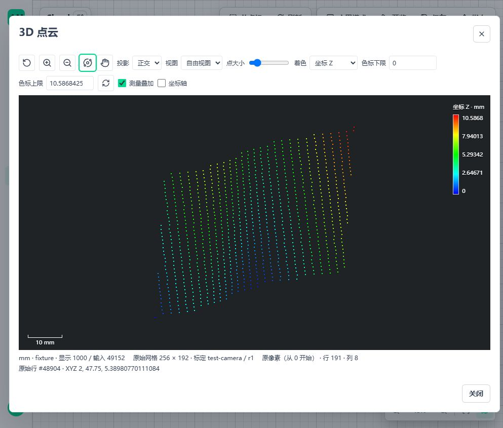

# B06 审计与后续实施步骤

## 1. 核对范围与当前位置

2026-11-05，已提交基点 `91a41fab`，另包含工作区未提交的 B06。当前源码节点包 `0.1.29`，25 个可执行节点；不是已装配离线包的版本声明。第 2–3 节保留修复前审计证据；随后已完成第 6 节的来源和摘要修复，不能再将旧复现失败作为当前结果。没有重新运行节拍/长稳验收。

项目目标仍是通用工业三维测量。当前完整工件是首个应用配方，不是节点的硬编码对象。既有 111 节点、317 条边、50 项结果配方没有接入 B06，也没有因新增栅格入口而改算法或质量条件。

| 范围 | 当前状态 |
| --- | --- |
| B01–B03 | 去噪、三种重采样、法向估计及定向，公开节点、来源、存读和界面已接通 |
| B05 | 位姿组合/求逆已接通，沿用原有坐标与质量追溯 |
| B04 | 显式初值 SE(3) 局部、FPFH 多批候选粗定位、显式双基准 SE(2) 台面局部约束已接通；台面内自动粗搜索仍未实现 |
| B06 | 标定栅格完整接线已有；跨代来源丢失与重复摘要扫描已修复，Windows/WSL 定向组合和真实发布通过 |
| B07/B08 | B07 已确认定义并实现参数、双方法转换、严格 NPZ/mmap 输入内核，尚未公开接线；B08 尚未实现 |
| B09–B23 | 仍按唯一剩余清单推进，不被本轮重新命名为新的前置条件 |

## 2. 确认的缺陷

### 2.1 重读资产再次派生保存丢失可直接使用的标定来源

等级：P2，影响保存追溯和像素来源显示。并非本轮证明了投影坐标计算错误。

使用 3×4 float32 NPY 和已有轴向深度测试标定，执行：

1. Raster to Cloud；零深度像素保留无效状态，完整原始像素数为 12。
2. 分别以原件 `raster-original`、完整转换结果 `array-blocks` 保存，两种路径独立验证。
3. Read Cloud 重读，再由 Filter Valid 筛出 11 个有效点；此时仍可取得完整标定。
4. Save Cloud 保存派生结果，再次 Read Cloud。
5. 原始总数仍为 12，原始行号仍为 1–11，但 `runtime.raster_source()` 返回 None，而不是原标定。

代码原因：

- `shared/cloud_assets.py` 在索引及生成来源中遇到运行根来源为 asset 时写入 `{"kind":"derived"}`，不再保存原有标定来源快照。
- `point_cloud/runtime.py` 登记资产时只从当前资产的 lineage/indices/source 读取直接标定描述；运行父链只覆盖本次 Run，不会从历史父资产自动还原该快照。
- 父资产引用仍存在，因此不能表述为原始文件永久丢失。但下游来源显示无法继续获得原网格和标定信息，且现有存读契约作出了更强的保留承诺。

已有测试验证了首次转换、派生、保存、读取，没有覆盖“读取保存资产后再派生再保存”。这是同一个根因的两种保存入口，不是两个独立缺陷。

### 2.2 已确认的重复计算，尚非性能瓶颈结论

`raster_conversion.py` 转换分块时已汇总全部 `sample_status`，返回 `ConvertedRaster.counts`；登记路径没有传出该摘要，公开 `raster_handler.py::_summary` 再扫描一次完整状态字段。

建议沿现有转换返回结果传递同次小型摘要，不增设跨 Run 缓存或资源管理器。取消和失败不能返回部分计数。此项未做耗时对照，不能承诺具体收益，也不能把它当原工件十秒超限的根因，原工件并未使用 B06。

## 3. 本轮证据与影响判断

Windows 本轮运行既有转换/Runtime 测试与新增临时复现：**37 通过、2 失败**，用时 3.37 秒。两项失败均为 2.1 所述问题；原有 37 项通过。复现探针仅用于本轮审计，修复时应将该测试正式加入现有 Runtime 回归文件。

```powershell
conda activate amvision
python -m pytest tests/test_metrology3d_raster_conversion.py tests/test_metrology3d_raster_runtime.py .tmp/b06-audit/test_resave.py -q --basetemp=.tmp/b06-review-final
```

该命令是本次执行记录，临时探针在任务清理时删除；独立复现步骤见 2.1，不将临时目录作为交付依赖。

前轮双平台 B06 输入组合各 133 项、真实发布 Windows 6 项/WSL 5 项及 1 项平台跳过、Windows 页面等结果仍是历史证据，见[输入记录](3d-metrology-raster-input.md)。本轮没有重跑 WSL、浏览器或发布服务，不将历史数量累加为新覆盖。

| 关注项 | 本轮可作出的判断 |
| --- | --- |
| 几何正确性 | 已核对三种投影、完整像素身份、模式互斥与标定来源；针对性测试通过。新缺陷发生于持久化追溯，未证明它改变几何坐标；不能因此宣称所有输入/方法均无错误 |
| 性能 | 发现重复状态扫描；未重新测正式图，不改变十秒未通过的记录 |
| 生命周期 | 复用现有 guard、预算、Scope 和不可变文件快照，未发现需要第二套生命周期系统的证据；本轮短测不等于长期资源认证 |
| 发布使用 | 新增节点已有真实发布记录，但本轮未修复缺陷，B06 不能按“全部保存路径已完整”交付 |
| 实体精度 | 解析真值、同云结果不能证明采集标定或实体准确度；没有虚构外部参考值 |

## 4. 固定实施顺序

### 4.1 先修 B06 来源保留

复用现有资产 source/indices/lineage 和 CloudRuntime 的可信来源边界，登记资产时冻结经权限、摘要和内容契约校验的原始观测；再次保存时沿用该快照。不能只补前端，也不能仅从一个标定 ID 猜测参数、绕过项目权限读取任意父资产或新建全局来源缓存。

保存的原始观测至少保持完整标定、原网格总数、原始输入身份和摘要；运行引用/租约不能写入持久资产。当前坐标经过变换后仍属当前坐标系，原始标定只说明采集来源，不得被当成可覆盖当前坐标的变换。生成点保留其已有来源语义，不冒充唯一原像素。

完成条件：

- 文件原件与数组块资产，首存、重读、过滤/变换、再存再读，多代循环均保留来源。
- 原始行号、source_point_count、字段 dtype/原值保持；空结果、旧运行引用、源身份/网格数量不符明确拒绝或按现有空结果规则处理。
- 重采样源点及生成点各覆盖一条保存路径；生成点不能凭标定快照伪造 row/column。
- 原有文件/数组/非栅格资产回归不变；失败、预算不足、取消、引用过期无残留。
- Windows 与 WSL 原生文件系统运行同一组合，再验证单资源 ZIP/配方包空环境导入后来源显示。

### 4.2 移除同次重复状态扫描

在现有读取/转换返回边界携带小型状态摘要，handler 直接消费，不改变公共量值或对原始数组额外复制。独立断言计数总和等于完整像素数，覆盖 mask/哨兵/非有限/越界优先级。修复前后数组及摘要完全一致；性能只做该路径小型对照，不扩展成反复节拍测试。

### 4.3 B06 代表链路收口

同一源码候选验证文件和同机数组进入发布版本、独立 Runtime、保存重读和像素显示。真实 Windows 页面只补本次缺陷影响路径：重读、再次处理、保存、重开、拾取原像素；不重做已有工作区。WSL 验证后端和原生存储，不冒称 GUI。

B06 专用大载荷各角色峰值、取消和最新离线装配分别归 A09/A13；真实标定采集对照归输入适用性/实体精度。它们不阻塞 B07，原 B06 来源错误修复则应先完成，避免下一输入再次继承同一问题。

### 4.4 B07 扫描轮廓：先定来源，再完成一个完整公开节点

原基线要求已标定轮廓、显式扫描位移，不是读取相机 SDK 或从原始激光图片解算标定。用户已确认固定步距/逐行编码器两种方法及 NPZ/同机数组入口，完整定义和实际进度见 [B07 轮廓输入](3d-metrology-profile-input.md)。下表保留总体接线顺序：

| 步骤 | 实现/设计内容 | 复用与验证 |
| --- | --- | --- |
| 参数定稿 | 固定步距、逐行编码器位置作为显式二选一；轮廓内坐标已是物理值；明确原点、轴、单位、行身份和缺行规则 | 与现有正交栅格适用范围区分；稠密规则高度数据优先使用 B06，不新增同义转换 |
| 来源契约 | 变长轮廓采用明确行边界/偏移及原采集行身份；原始 record 行号不随筛选重排；缺行不补点、不按剩余行重新编号 | 复用 source_indices/source_point_count；不能把变长轮廓强套 width×height |
| 几何内核 | 显式轮廓平面加扫描位移；位置与方向由标定给出，不推测等间距，不自动排序或补偿倒序 | 独立解析点、倾斜坐标轴、非均匀位移、缺行/重复位置、无效样点、单位变化真值 |
| 文件/数组 | 核定首批成熟文件载体和二进制字段布局，文件参数与数组载荷的标定权威来源保持互斥 | 复用不可变文件快照、LocalBuffer、预算、Scope、取消；不自写通用解析器或实时流服务 |
| 保存读取 | 原值/行身份/标定/无效规则与派生来源一并保存；跨代及资源包回读一致 | 复用现有资产与 4.1 修正后的来源边界，不新增保存节点 |
| 公开接线 | handler/catalog/参数编辑、Preview、Trigger、Python/.NET 与发布同批实现 | 配置、编辑取消、保存重开、错输入、运行切换、客户端退出和回收 |
| 显示 | 原轮廓行、样点身份、标定和缺测摘要；三维旋转/缩放沿用 CloudViewer | 不重复查看器；生成点与实测点明确区分，未采集区域不画成实测面 |
| 验证 | Windows/WSL 同源码独立真值及正式发布；具有明确标定/采集身份的实采数据另作对照 | 当前完整 PLY 可验证后续节点不受影响，但不能冒充轮廓采集输入 |

逐行任意 SE(3) 位姿不在首批；编码器尺度/零点必须显式填写，不推测往返或补偿顺序。固定步距保留原采集行号和缺号间距，变长轮廓保留原始记录编号。

### 4.5 B08 及后续

B08 在现有 CloudRuntime/空间预算上公开点云转高度图：显式投影坐标、网格原点/步距/范围、聚合方法、真实覆盖/空格、多层冲突和来源。第一步是核定聚合与缺测语义，不能直接把已有包络内部格网当作通用高度图交付。保存格式、读取方和 B06 反向连接应保留单位/轴定义，并明确聚合不可逆、不证明原点恢复。

随后按剩余清单原顺序推进 B09–B14 特征/关系、B15–B18 形位/缺陷、B19–B23 面积体积/比较/报告；台面内自动粗搜索作为 B04 明确独立方法保留，不借本轮重新实现 ICP。

## 5. 不阻塞开发的交付限制

| 编号 | 具体剩余内容 |
| --- | --- |
| A01 | 当前正式工件图的受控双平台十秒验收；历史纯数值图、单次诊断不能替代。本轮不重复跑 |
| A04 | 独立实物参考、重复扫描和不确定度证据，仅限制计量认证声明 |
| A09 | 各具体最大载荷布局与算法组合的进程树峰值/回收；已有精确 1 GB 主链路与显示索引不重新列作未开发 |
| A12/A13 | 已有 CPU 离线发行有效；新增 UI、索引、B01–B06 尚需同一候选重新装配验证，不把旧包当最新源码包 |
| B04 | 台面内自动粗搜索及更多实测遮挡/对称场景，不以有限搜索声称全局唯一 |
| B06 | 本文 2.1 已修复，专用配方包空环境存读已覆盖；最大载荷角色资源、实采标定和最新发行单独保留 |

首轮审计收尾已清理临时探针，当时没有启动服务或安装依赖。后续修复验证另按第 6 节记录，不把此历史描述当作本批运行状态。

## 6. 来源修复与同次摘要复用

### 6.1 修复边界

- 资产契约统一提供 `original_observation()`，返回内容中已经保存的 source 和最初记录总数。CloudRuntime 登记与再次保存复用同一判断，不各写一套 lineage/indices 分支。
- 保存派生资产时，经既有项目权限和内容校验读取当前已绑定根资产的观测。保留文件/数组的完整标定、原始身份和总数；不将其替换成 `kind=derived`，不追查任意历史父链，不增加全局缓存。
- 生成来源同样校验标定网格总数；现有原始索引、体素成员、字段精度和当前空间坐标均不改变。旧已丢失观测的开发资产需从仍有完整来源的输入重建，不猜测补写。
- `read_raster_reference/local` 向 handler 返回同次 `ConvertedRaster.counts`，删除 handler 的完整状态重扫。公共摘要字段和状态优先级不变，没有新的计数器或跨 Run 缓存，也不宣称具体耗时收益。
- 区分提交载荷与解码内存：文件实际字节及同机数组载荷仍受 1,000,000,000 字节限制；文件标定不再用解码后的原始数组大小替代输入限额。解码/输出继续受显式 decoded、working、live 预算和格式读取器自身限制约束，未取消大图限制，也不据此宣称压缩大图容量已验收。

### 6.2 本批验证

Windows 最终组合 **309 通过，54.70 秒**：B06、点云资产、三种重采样、变换及配方包 234 项，B07 输入 73 项，启用边界 2 项。覆盖文件/数组、原件/派生、三代保存、空环境依赖闭包导入、生成点来源、变换后采集 frame 与当前 frame 区分，以及取消/容量拒绝/项目不符后无半份资产。另真实发布组合 **7 通过，79.74 秒**，包括多代持久保存和最终运行响应标定。前端栅格编辑/显示 3 项及 Vue 类型检查通过。

Windows 验证使用 `--capture=sys`。定向复现发现默认 fd 输出捕获下，OpenCV 在生成 compression=32946 的 TIFF 测试数据、输出旧 Deflate 标识警告时出现 `0xc0000008` 原生句柄日志，进程仍返回 0；相同 25 项在 sys 捕获下正常输出警告并通过。最终 309 项组合未出现该异常。未禁用 faulthandler、删除压缩格式或修改生产读取器；这一对照定位了测试输出捕获条件，不等于完成 OpenCV 原生句柄内部缺陷的调试。

真实发布回归遵守现有恢复准入：移除文件输入属于不兼容输入契约，旧实例切版返回 409，创建新实例后再运行；后续兼容派生版本在同一实例切换。没有放宽发布准入来让测试通过。

隔离 Windows 页面验证第三代保存资产的真实 Preview：49,152 个原始网格记录、1,000 点显式预览，仍显示 256×192、标定 `test-camera/r1`；拾取记录 #48904 对应原第 191 行、第 8 列，缩放旋转保持身份。该数据是解析标定网格，不冒充完整工件或实采深度。页面截图如下：



Ubuntu 最终同候选组合 **315 通过、1 跳过，65.42 秒**，即同一 309 项组合及 6 项真实发布；Windows 专用 net472 调用按既有平台规则跳过。原生几何与 I/O 依赖实际加载 NumPy 2.4.4、SciPy 1.18.0、Open3D 0.20.0、trimesh 5.1.1+amvision.2、pypcd4 1.5.1+amvision.2、Pillow 12.2.0、Pydantic 2.13.4。发布补充依赖固定 filelock 3.29.0、httpx2 2.5.0、pycocotools 2.0.11；未修改项目依赖锁或安装到系统环境。

首次 Ubuntu 组合为 308 通过/1 失败，缺少 `filelock`；补齐后发现 API 导入链还缺 `pycocotools`。两者均在运行测量断言前失败。完整依赖导入检查通过后重跑原组合与正式发布，不删除用例、不替换 API 或 worker。最终源码快照包含全部已跟踪和未提交文件，6,177 个文件内容与本轮归档逐项摘要一致；测试源码及运行数据均在 Ubuntu 原生目录。保留一条 Starlette 对 anyio 旧别名的弃用警告，不涉及本轮测量失败。

本批清理完成：Windows 隔离 API/Vite 已退出，5620/5621 无监听，仓库 `.tmp` 中本轮测试、下载和缓存清空；Ubuntu 隔离 Python、源码快照、测试数据及下载临时文件已删除，发行版恢复停止，其他 WSL 发行版未停止。未改变已有业务 5600/5601、系统显示设置或生产配置。没有重跑完整 PLY 测量、十秒和长稳；本批真实页面使用上述解析标定网格，不冒充完整工件或 Ubuntu GUI。
