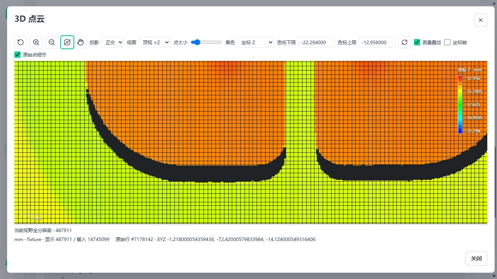
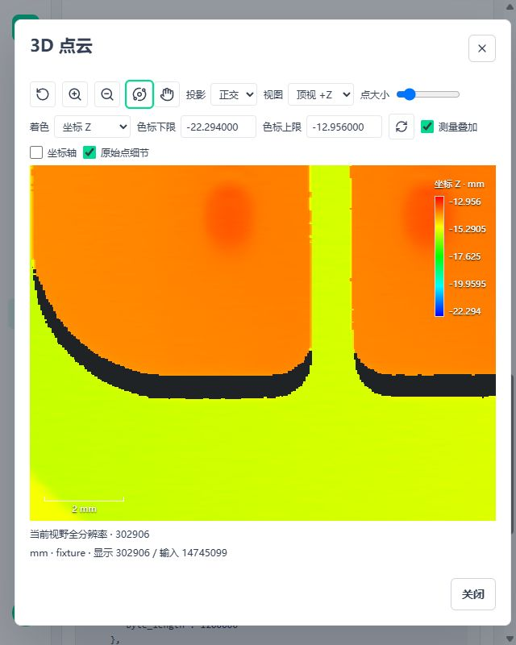

# 点云有界显示索引实施与验证

## 当前交付

2026-11-03，完成剩余清单 7.1 的 A09 有界显示索引及受影响 A08 读取/页面验证。复用已有资产、CloudRuntime、ObjectStore、项目资源锁、Cloud Preview、generation 和 Three 查看器，不新增节点、资源系统、后台服务或调度器。不改变工件算法、点数、字段精度、配方、质量条件、串行执行或输入准入。

本批之前的 Preview、前端来源生命周期、资源采样及验收修改仍保留在工作区；没有回退、混称为本批新修复或自动提交。HEAD 为 `01587765`，本批源码没有重新装配到前序 CPU 离线包中。A13 随交付维护身份和受影响证据，不阻塞后续功能。

## 根因与实现

原构建器为全云生成 float64 坐标、行号及 KDTree，并按 `point_count * 192` 预留；1 GB 本次容量输入需要 11,999,996,928 B，仅预留便超过 4 GiB 工作预算。叶记录另固定附带两个 uint64，普通几千万点也支付不必要的身份位宽。这是确定的结构成本，不是放宽限额可以解决的问题。

现在按现有 chunk 扫描，过滤不可显示的位置，只将逻辑行号写入本次 generation 临时文件。最长轴中点逐层分盘后，仅对符合块预算的行集合调用 SciPy KDTree。全坐标重合时按行数分块，极端浮点/无内部中点也有明确分离规则，不无限拆分、不删点。

| 边界 | 实现位置 | 保持的语义 |
| --- | --- | --- |
| 行号分区 | `detail_partition.py` | 有界读取、取消、精确范围；只移动逻辑行号 |
| 局部树与打包 | `detail_builder.py` | 全字段原 dtype、精确来源身份、预算先于分配 |
| 事务与读取 | `detail_index.py` | 旧索引保留到新索引完整提交；失败删除本次目录；API 不建树 |
| 描述与解码 | `CloudDetailIndex` / `asset-details.ts` | 显式宽度、偏移、长度、摘要、原始点/生成点身份核验 |

`logical_dtype` 按逻辑点总数、`identity_dtype` 按来源总数分别选 uint32/uint64，最大合法编号不截断。计数等于 2^32 时最大行号仍可用 uint32；更大才使用 uint64。子集原始行号不改成局部编号；生成点身份不伪造来源行号。源数据中已有的 uint64 属性不缩窄。

三维开发格式仍为 v1，但不保留旧派生索引读取分支。旧描述缺少位宽字段时明确拒绝并要求通过 Cloud Preview 显式重新准备。原云资产和数据不删、不迁移；交付新后端时必须同步静态前端、重启相关 worker，不能混用新旧解码器。

## 资源账本

沿已有 1 GB 工程示例，不提高生产或客户默认值：

- 当前块工作预留为每行 `1024 + 4 * row_bytes`，覆盖局部原生树及 Python 包装、float64 坐标/行号/掩码/全字段 gather/记录/bytes 副本。块行数受 chunk_rows、工作预算及活跃数组余额共同限制；描述及序列化对象额外逐块计费。
- 叶大小同时受 preview 点数、单块字节和工作预算约束，描述受 max_body_bytes 限制，完整叶数据受 max_asset_bytes 限制。
- 临时盘只有行号；父子拆分最多两份，叶记录宽度至少足够覆盖两份逻辑身份。深度优先删除已拆父文件后，当前 generation 的临时行号和已写叶数据合计不超过 `point_count * row_bytes` 的有效载荷上界。
- 该磁盘上界不包括源资产、之前已提交的 generation、文件系统元数据和 JSON 描述。重建时新旧代次会并存，max_asset_bytes 不是整个磁盘用量限制。
- 所有临时文件句柄在异常清理前关闭。取消、分盘失败、写叶失败和提交失败均保留旧 generation；成功后再删除旧代次。硬退出残留仍由既有后续准备/资源删除回收，不添加另一套回收器。
- 浏览器继续使用原 CPU/GPU 账本、相机请求取消和完整块集提交；视野超预算显示概览状态，不冒充当前视野全分辨率。

## 本轮证据

### 完整工件

完整 ASCII PLY 14,745,099 点通过真实发布版本、WorkflowAppRuntime、Read Cloud、Cloud Preview、HTTP Response 和鉴权资产 API。Windows 使用本机原生目录，Ubuntu 使用 WSL 原生文件系统，源码和输入可以来自 Windows 挂载盘。

| 内容 | Windows | WSL Ubuntu |
| --- | --- | --- |
| 有效点/块数 | 14,745,099 / 256 | 相同 |
| 叶数据 | 294,901,980 B | 相同 |
| 全部坐标、字段、来源身份、无重复遗漏 | 精确一致 | 精确一致 |
| API 摘要、旧 generation 拒绝、禁止缓存 | 通过 | 通过 |
| 显示准备调用 | 18.582 秒 | 13.750 秒 |

原布局叶数据为 412,862,772 B，本次减少 28.57%，来自身份字段无损缩窄，不是少传点。显示准备时间**不属于工件检测十秒计时**；准备默认关闭，不能默认加入正式数值测量图。

证据：[Windows](assets/metrology-bounded-details/full-windows.json)、[Ubuntu](assets/metrology-bounded-details/full-linux.json)。

### 精确 1 GB

复用已有容量生成、正式资产保存读取和独立逐行核验工具，实写 1,000,000,000 B binary PLY，不使用稀疏文件或伪造长度。62,499,984 点，每点 XYZ float32 与 uint32 属性均保留，叶记录 24 B，1,024 块共 1,499,999,616 B。

| 内容 | Windows | WSL Ubuntu |
| --- | --- | --- |
| 构建后所有字段/原始行号/去重完整性 | 通过 | 通过 |
| 第一叶完成后取消，旧代次继续可读 | 通过 | 通过 |
| 第一叶写入后 ENOSPC 注入、回滚及再次成功重建 | 通过 | 通过 |
| 最终 Scope 活跃预算 | 0 | 0 |
| 测试主进程 RSS 基线 | 369,491,968 B | 200,220,672 B |
| 测试主进程 RSS 峰值 | 2,519,937,024 B | 2,281,197,568 B |
| 测试结束 RSS | 389,591,040 B | 218,812,416 B |
| 首次索引构建 | 97.288 秒 | 65.291 秒 |

ENOSPC 是正式写路径的故障注入，没有填满系统盘。RSS 包含测试生成、保存、构建及独立校验，不是独立 worker/Broker/浏览器合计，也不是最低机器 RAM 或长稳结论。该 1 GB 布局的构建已通过，不扩写成所有编码/字段组合都能完成任意算法。

证据：[Windows](assets/metrology-bounded-details/capacity-windows.json)、[Ubuntu](assets/metrology-bounded-details/capacity-linux.json)。

### 回归与页面

- Windows/Ubuntu 最终相同组合各 **81 项通过**，覆盖显示索引、资产、运行引用、连续视图和来源。包含全点逐行真值、局部树行数硬断言、重复/共线/极端/相邻浮点、原始子集、生成点、float64/uint64、预算、坏描述/字节、取消、分盘/叶/提交失败及回收。
- 前端显示/资源组合 **30 项通过**，新增独立 32/64 位宽、生成顶点身份与旧描述拒绝；已有摘要、精度、晚返回、真实 Three 几何和账本释放继续通过。Vue 类型检查通过。
- 隔离 5620/5621 页面使用真实发布结果。桌面加载 487,911 原始点，拾取行号 7,178,142，XYZ 为 `-1.218000054359436, -72.42000579833984, -14.124000549316406`。关闭重开恢复概览，再加载原始细节正常。
- 640×800 窄屏加载 302,906 原始点；页面宽度/滚动宽度均 640，画布 578×441，无横向溢出。控件可见，控制台没有捕获到 error/warn。未改系统显示缩放。
- 当前页是完整样本的资产显示图，不拿它代替十八节点所有方法页面验收或五十项尺寸性能测试。此次不做模型 P99、长稳或 S2 旧诊断。





Ubuntu 使用任务隔离 venv 与受控 wheel，算法依赖按现有版本核定；为真实 API 发布补齐文件锁、COCO、HTTP 等既有依赖。此环境不是新离线发行物，不混称 A12 重新验收。

收尾审计补强了小叶预算：SciPy 1.18.0 的 innernode Python 对象、dict 和 cKDTreeNode 包装实测分别为 48/96/120 B，此外还有原生节点及坐标。每点 256 B 的最初估算不能覆盖叶大小为 1 的最坏树，已改为 1024 B 加字段副本，并补单点叶回归后双平台重跑上述 81 项。完整工件与 1 GB 实测配置的块/叶仍为 65,536 行，算法、文件布局、摘要及执行路径不变；没有再次刷完整容量计时。容量报告保留审计前实测时间/RSS，不冒称预算系数调整后重新取得一组性能数据。最终源文件身份见[摘要清单](assets/metrology-bounded-details/source.json)。

## 复现与下一项

```powershell
conda activate amvision
python -m pytest tests/test_point_cloud_details.py tests/test_point_cloud_detail_partition.py tests/test_point_cloud_assets.py tests/test_point_cloud_runtime.py tests/test_point_cloud_contiguous_view.py tests/test_point_cloud_lineage.py -q --basetemp=.tmp/detail-combined
python -m pytest tests/integration/metrology3d/test_capacity_details.py -q --cloud-capacity-bytes=1000000000 --cloud-report-dir=.tmp/detail-reports --basetemp=.tmp/detail-capacity
python -m tests.integration.metrology3d.detail_acceptance --root .tmp/detail-full --sample <完整样本路径>
```

Ubuntu 将 basetemp/root/report 改为原生文件系统路径。容量参数省略时仅为日常小载荷，不记为 1 GB 通过。

固定顺序继续：A08 尚未覆盖的固定资产保存/版本冲突/导出、方法错误和代表语言主题操作；合并记录 A09 backend/Broker/worker/调用方/浏览器分角色资源。之后独立执行一轮 A01 热点优化，再进入 B01–B03。A13 维护每次实际候选，不能反复作为后续开工门槛。

B01–B23 本轮没有新增公开能力；A01 十秒未重测、状态不变；A04 仍缺外部实物证据，只限制认证声明。已通过的索引容量不再安排整套重复验收，只有修改影响到该责任链时复验。

## 收尾审计

Ruff、Vue 类型检查、文档本地链接门禁和 `git diff --check` 通过。桌面/窄屏截图画布区域分别有 66,104 / 15,945 种 RGB 值，非空检查通过；不以截图代替计量或显存峰值证明。

本轮 API、Runtime/Broker 和前端已退出，5620/5621 无监听，临时页面关闭；业务 5600/5601 仍保留。仓库 `.tmp/` 已空，Ubuntu 本轮原生数据与隔离 venv 已删除，发行版恢复开始前的停止状态，未停止其他发行版。仅将 JSON/截图及源文件摘要归档至文档目录，没有保留完整原云副本或自动提交 Git。
