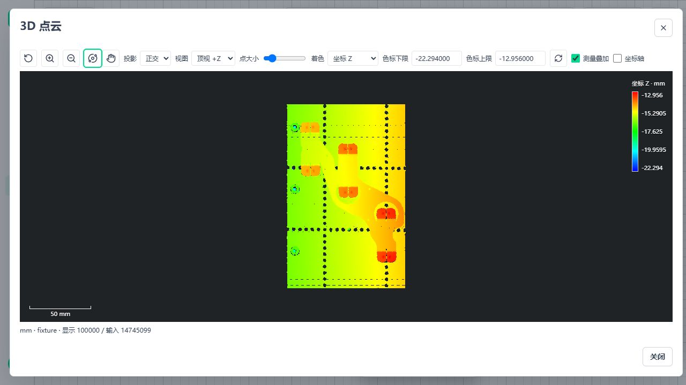
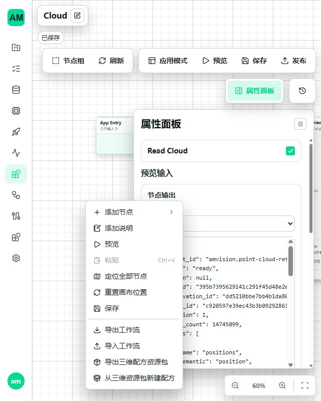

# A10 三维配方携资源实施与验证

日期：2026-11-02。范围为当前三维节点与工件的配方搬运，不修改测量算法、质量门禁、任务队列或进程管理；前序未提交工作保留，本轮没有自动 Git 提交。

## 实现边界

- 新增 `amvision.workflow-cloud-package.v1` 契约及管理面传输，复用编辑器 App/Template JSON 和点云资产 ZIP。依赖父项优先、完整引用去重；缺项、额外项、错摘要、跨源项目、重复资源和不可搬运引用明确拒绝。
- 资源在原 App bundle journal 下暂存，完整校验后沿现有 ObjectStore 移动。新 App/Template/资源不覆盖已有对象；父来源与节点参数同步映射，字段和二进制不重采样、不降精度。
- journal 预登记资源所有权，恢复顺序为文档后资源；提交前失败/取消回滚，提交后保留完整结果。审计补齐清理阶段 `BaseException` 的提交标记保护，避免中断后误删已提交资产。
- 两个 API 沿现有鉴权、Project、生命周期准入、资源非等待锁、有界上传、断连取消与文件响应。没有新增资源数据库或发布管理。
- 图编辑器空白菜单增加两个资源包命令；普通 JSON 入口保留。导入后打开新配方，已有未保存内容单独确认。转发层事件、路由复用后的重新加载、旧异步请求晚返回和卸载保护同批修复。

公开格式、限制、请求键及失败语义统一见 [API 说明](../api/workflow-cloud-packages.md)，不在本文件维护第二套字段表。

## 回归验证

| 范围 | 本轮结果 |
| --- | --- |
| Windows 后端最终组合 | 36 项通过：配方包 21、API 1，加既有 bundle/资产 API 14 |
| WSL Ubuntu 后端 | 同 36 项分批通过：29 + 新增边界 5 + 提交后中断 2；不重复累计同一测试 |
| 前端最终组合 | 5 文件 32 项通过，含原 JSON 操作、菜单转发、容量/取消、切换及晚返回保护 |
| 静态验证 | Vue 类型检查、A10 Python Ruff、`git diff --check` 通过；本批涉及的 6 份文档共 329 个本地链接存在 |

回归覆盖 float64 坐标、uint64 字段、派生源行号、父资产闭包和重读；字节完整性不只检查点数。覆盖移入后、Template/App 写入及提交标记失败；失败清理被文件占用阻止时保留 journal，解除后恢复。真实 `spawn` 子进程分别在标记前/后硬退出，前者恢复空目标，后者保留完整资产及 App；另验证 active/completed 清理阶段中断均不回滚成功提交。

主要命令（开发环境先 `conda activate amvision`）：

```powershell
python -m pytest tests/test_workflow_cloud_package.py tests/test_workflow_cloud_package_api.py tests/test_workflow_application_bundle_save.py tests/integration/metrology3d/test_resource_api.py -q --basetemp=.tmp/package-final-audit
node frontend/web-ui/node_modules/vitest/vitest.mjs run --config frontend/web-ui/vite.config.ts tests/frontend/workflows/test_cloud_package.ts tests/frontend/workflows/test_document_loader_context.ts tests/frontend/workflows/test_workflow_document_controls.ts tests/frontend/workflows/test_workflow_app_document.ts frontend/web-ui/src/workflows/workflow-editor/components/WorkflowGraphContextMenu.test.ts
```

Vitest 从仓库根目录运行。WSL 运行时、数据库、资产、journal 和 pytest 临时目录均位于 Ubuntu 原生文件系统；源码可从 `/mnt/w` 读取。本轮是 WSL Ubuntu 源码环境，不是 A12 离线发行包验收。

## 完整样本与页面

使用原完整 ASCII PLY 的 14,745,099 个点生成持久资产，导出 176,945,414 字节包。同一包分别导入空 Windows 与空 WSL Ubuntu 项目，执行正式发布 API、WorkflowAppRuntime、独立 worker 和实际调用，均 `succeeded`。导入后无需访问源资产目录。包 SHA-256 为 `1da143eea38d6ba666a2e32435c1c8d520c4e44c0d5014de05e7a862e3c8af22`；完整源资产内容摘要保持 `c9566ae231f30a4b55226673d8644346eb6a58d8bafb66130784596c2da345ed`。

原始摘要：[Windows](assets/metrology-package/windows.json)、[WSL Ubuntu](assets/metrology-package/ubuntu.json)。复现入口 [package_acceptance.py](../../tests/integration/metrology3d/package_acceptance.py) 支持 `--source` 导出或 `--package` 空目标导入。完整大包跨平台方向为 Windows 导出至两平台；父子闭包小资产往返则两平台分别验证，不混称所有大包方向均实测。

隔离 `5620/5621` 页面完成：初始化空项目、已有配方导出下载、ZIP 导入新 App、切换到新资源、保存/发布 v1、Preview 成功和点云显示。完整点数 14,745,099，显示使用显式 100,000 点概览；这是搬运正确性验收，不冒充全分辨率或测量节拍。控制台无本轮 error/warn；640 px 视口中菜单文字完整可操作，结束恢复原视口，没有修改系统显示缩放。





## 审计结论与后续

A10 既定三维范围已接通依赖闭包、映射、失败回滚、空环境导入、页面入口及真实发布运行。搬运包不等于发布物，不携带模型、硬件配置、节点代码或外部系统凭据；不扩大成所有平台资源的一揽子备份功能。最终候选仍需把本轮与前序修改一起执行 A13 组合，不用分批通过替代最终冻结验收。

固定下一步为 A12 Windows/Ubuntu CPU 离线发行，复用已完成 A11 工具装配；十秒节拍、近 1 GB 显示索引和独立实体精度证据保持原状态，不阻塞该工作，不重复旧 S2 诊断。本轮未重跑性能、近 1 GB 显示或长稳，不改变工件量值和质量条件。

收尾：隔离 API、Vite、Runtime/worker 和 Broker 已退出，5620/5621 无监听；本轮浏览器页关闭，视口恢复。仓库 `.tmp` 已空，下载的临时配方包和 WSL 原生临时 venv/数据删除；Ubuntu 恢复停止状态，其他 WSL 发行版及业务 5600/5601 未操作。只保留本目录小型报告和截图，原点云与用户业务数据不删除。
