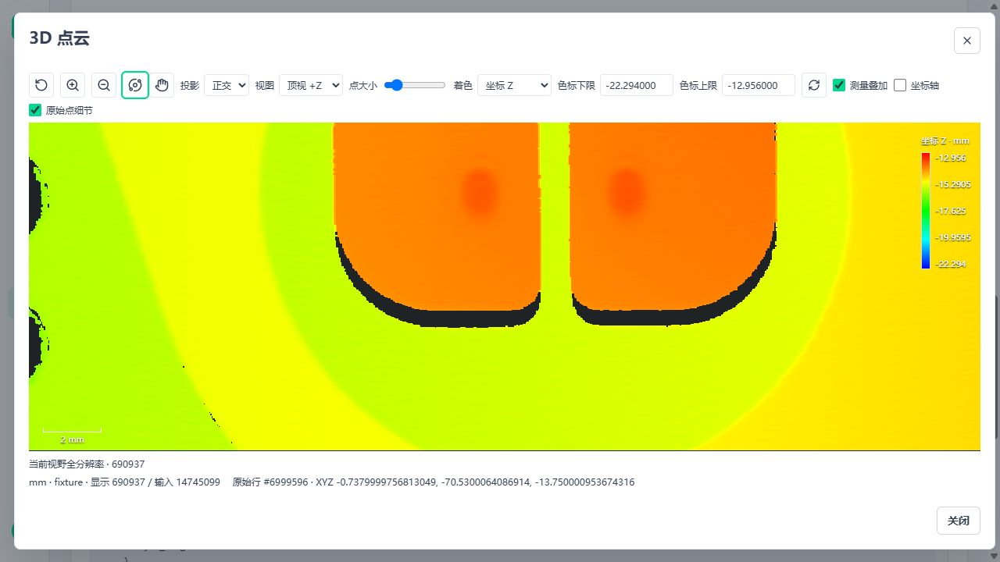
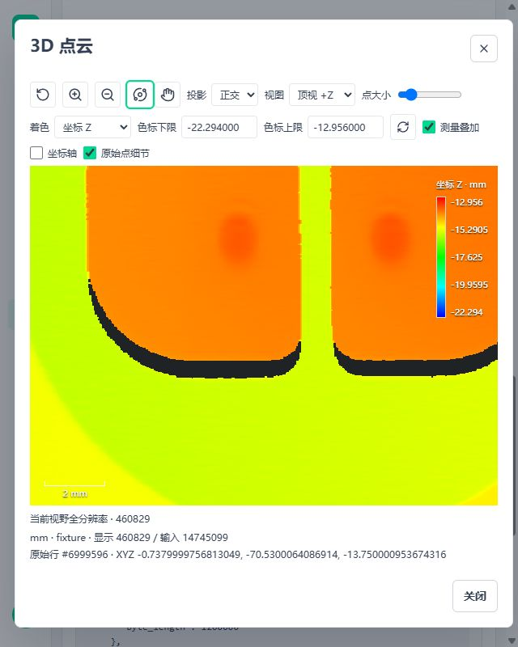

# 点云资产原始细节显示

## 状态

2026-11-03 更新：大容量索引已改为有界行号分区和局部 KDTree，原始字段不变，逻辑行号和来源身份独立选择无损 uint32/uint64。双平台精确 1 GB、完整工件真实发布和 Windows 页面读取通过，详见[有界索引实施记录](3d-metrology-bounded-details.md)。下方验证表保留首批历史证据，当前布局与预算以本文件更新内容为准。A10/A11/A12 已交付，不再按底部历史“下一步”重新开发。

2026-11-02，A08 已接通现有 Cloud Preview、计量资源 API 和 Three 查看器的资产分块显示。没有新增节点、资源系统、运行时或调度器；计算算法、配方质量条件和数值输出不变。A01 十秒仍未通过，A12 离线发行与 A13 最终候选验收仍独立进行。

本轮实现的是“有界概览 + 视野原始叶块”两层显示，不是 CloudCompare 全功能复制，也没有宣称整云同时进入显存或任意 1 GB 资产均可建立索引。原始大点云不放进内嵌 base64 正文。未保存完整输入的历史结果仍只能查看原有有界证据。

## 使用路径

1. 在现有 Save Cloud 显式保存需要复查的完整点云，或选择已导入的点云资产。
2. Read Cloud 读取该资产；Cloud Preview 显式设置 `prepare_details=true`。默认仍为 false，不增加普通测量图的扫描、磁盘或索引成本。
3. Cloud Preview 在 worker 内准备索引并生成原有有界概览。结果增加 `asset_details.source`，只引用已有不可变资产身份，不带本地路径、运行引用或 Broker token。
4. 页面沿原“查看点云”入口打开。勾选“原始点细节”，相机停稳后按当前视野加载全部相交叶块。超过显式点数/字节/CPU/GPU 预算时保留概览并标明容量状态，不能显示为全分辨率成功。
5. 查看器仅在所有选中块校验并安装完成后显示“当前视野全分辨率”。显示点数为实际加载叶块点数，可能包含视锥边缘之外的同块点；不是精确可见像素数。

变换、裁剪输出不能冒充完整来源资产。需要显示这些派生云时，沿原路径显式保存并重读。动态输入不自动保存，Scope 结束仍回收原云。当前每次显式准备都会重建索引，应作为独立显示准备支路使用，不默认加入数值节拍图。

## 数据与所有权

| 层 | 本轮扩展 | 复用边界 |
| --- | --- | --- |
| 运行视图 | `CloudView.gather(logical)` 限定每块行数，返回只读字段和来源身份 | CloudRuntime、原始 `source_indices/source_point_count`、生成顶点语义、Scope、数组预算 |
| 空间索引 | 分块扫描并分盘逻辑行号，有限分区使用 SciPy KDTree；重合点按容量分块 | 已有 SciPy，不另写空间树；只做显示，不参与测量 |
| 持久文件 | 源资源版本目录下 `display-index/index.json` 与 generation 子目录 | 现有 ObjectStore 不可变 blob、摘要、Project mutation、源资产删除 |
| API | 只读 manifest 与有限二进制块 | 现有 Reader 权限、项目可见性、ResourceReference 与 SHA256 |
| 前端 | 解码、视野请求控制与 Three 叶层 | 原查看器、颜色/相机/拾取、CPU/GPU 预算、几何与测量叠加 |

索引为 `amvision.point-cloud-detail.v1`，三维契约仍统一 v1。字段如下：

- `source`：现有 project/resource/version/kind/sha256，必须与概览 `source_asset` 相同。
- `generation`：索引提交代次；前端取得最新索引后，每个块请求带同一代次，切换期间拒绝旧块，不能混用两次构建。
- `spatial`、`vertex_kind`、`point_count`、`source_point_count`：沿用源资产语义。
- `valid_count`、`excluded_count`：有限坐标且有效标记允许显示的点数，以及被排除点数；完整资产不因显示过滤而改变。
- `bounds`：全部有效显示点的精确范围，独立于概览的抽样范围。
- `fields`：原字段名称、语义、dtype、components、unit 及紧密行记录偏移。数据统一 little-endian，保留原值与精度。
- `logical_dtype`、`identity_dtype`：分别由逻辑总点数及身份对应总点数决定，计数不超过 2^32 时使用 uint32，否则 uint64。两者不必相同；生成点身份按生成点总数选择。
- `row_bytes`、`logical_offset`、`identity_offset`：每行原字段后附上述两个显式宽度的整数，分别为资产逻辑行和来源身份；生成点使用顶点身份，不伪造原始行。旧描述缺少宽度字段时明确拒绝，须显式重新准备派生索引，原资产不删、不迁移。
- `blocks`：连续块编号、点数、精确范围、长度和 SHA256；点数总和必须等于 valid_count。

原 float64、uint64 字段不会经 JSON 浮点往返。前端只将相对局部原点的渲染坐标变为 float32，沿既有误差门禁拒绝失真；拾取返回保留的原始值与身份。坐标 Z、原色可用于原始叶块；仅在采样证据中存在的支持/残差着色不伪造全云属性，切换这些模式仍显示原证据。

完整块先写入，最后原子提交索引；取消/失败删除本次未提交目录，保留之前已提交索引。新索引提交成功后回收旧代次及崩溃残留，源资源删除也回收全部显示索引。预算缩小不能导致重建失败时删掉旧索引。后台进程被强制停止后的残留沿后续成功准备或源删除回收，不延长运行 lease。

前端相机变动取消旧加载并清理旧块，150 ms 停稳检测仅是显示交互防抖，不是 Workflow 输入等待队列。请求晚返回、换资产/项目、卸载、隐藏、WebGL 丢失均沿现有生命周期释放。未完成块集不替换概览；失败状态保持到显式重新加载，缩放、resize 或显隐不自动重试。重载沿原 load 释放旧控制器并重新校验来源与代次，按钮固定占位避免布局反馈。旧相机回调不能取消新资产的请求。真实缺失/损坏索引及 WebGL 验证见[显示故障记录](3d-metrology-viewer-faults.md)。

## 预算

本轮沿 [1 GB 工程示例](../../custom_nodes/metrology3d_nodes/workstation-1gb.example.json) 验证，不修改业务配置或客户默认值。

- 工作块按 `1024 + 4 * row_bytes` 字节/行保守预留，包含小叶情况下的原生树节点和 Python 包装对象；块行数不超过现有 chunk_rows 及可用工作/活跃预算的一半，剩余空间供逐块描述对象使用。只对有限分区建立 KDTree，取消检查覆盖源扫描、分盘、局部树前后及叶写出；原生调用内部仍由既有节点超时/整组停止约束。
- 叶容量取 chunk_rows、preview.max_points、单块字节预算、块工作预算四者最小值，不填新的生产常量。
- 全部叶字节受 max_asset_bytes 限制；描述正文受 max_body_bytes 限制。完整构建前后会暂时并存新旧代次，不将该值宣称为磁盘总占用硬限制。
- 浏览器概览与叶块共享同一 CPU/GPU 账本；解码原字节、展示数组、颜色副本和显存均计费。超预算先拒绝，已加载数据完整释放。

全云 float64 坐标和全云 KDTree 已删除。临时盘只存逻辑行号；一次拆分父子最多两份行号，每行叶记录至少含 XYZ，宽度足以覆盖这两份临时身份。深度优先处理时，新代次的行号临时数据与已写叶数据合计不超过 `point_count * row_bytes` 的有效载荷上界；该证明不包含文件系统元数据、新旧代次并存及源资产。描述 JSON 独立受 max_body_bytes 限制。双平台精确 1 GB XYZ/序号输入已验证，不能扩大为任意字段、压缩倍率、图密度或整云驻留 GPU 均通过。

## 验证

完整样本沿真实发布版本 -> WorkflowAppRuntime -> Read Cloud -> Cloud Preview -> HTTP Response 运行；API 读取真实资产，不用替代准入的模拟执行。Windows 和 WSL Ubuntu 使用各自原生运行数据目录，源样本可来自 Windows 挂载盘。

| 项目 | Windows | WSL Ubuntu |
| --- | --- | --- |
| 全样本点数 / 有效显示点 | 14,745,099 / 14,745,099 | 相同 |
| 块数 / 全部叶字节 | 256 / 412,862,772 B | 相同 |
| 所有行去重、完整字段、坐标、原始行号 | 全部精确一致 | 全部精确一致 |
| 真发布、API 块摘要、旧 generation 拒绝 | 通过 | 通过 |
| 定向后端回归 | 43 项通过 | 43 项通过 |

完整扫描原始报告：[Windows](assets/metrology-details/windows.json)、[Ubuntu](assets/metrology-details/ubuntu.json)。其中 prepare_seconds 是显示准备调用，不是工件 50 项检测节拍。本轮补充了预算缩小保留旧索引、损坏字节、描述截断/缺失读取边界和旧回调隔离，并在当前代码复验双平台完整资产发布读取；不冒称已经完成 A13 冻结发行验收。

后端回归覆盖 float64、超过 2^63 的 uint64、重复坐标、无效点、跨项目拒绝、生成顶点保存恢复、原始行号、删除、取消、重建代次、坏摘要/截断、容量拒绝和 Scope 归零。前端六文件 **51 项通过、1 项条件跳过**；跳过的是本轮未提供 I2 捕获正文的旧专项，不计为通过。新增解码、预算、迟到响应、资产切换和真实 Three 几何释放检查；Vue 类型检查、Ruff 通过。

隔离真实页面使用 5620/5621，未修改 5600/5601 业务环境。桌面视野加载 690,937 个原始点；640×800 窄屏按实际视野加载叶块，页面宽度无横向溢出。核对了概览/容量/全分辨率状态、Z 色标、缩放、3D 标准视图、原始行拾取和关闭重开。没有改变系统显示缩放。

真实页面发现并修复两项显示接线问题：新叶块首次加载未继承 Z 色标；拾取后状态文字换行使画布高度变化，状态切换反复触发细节加载及 ResizeObserver 告警。现在状态行有稳定尺寸，相同尺寸的通知不刷新视野；真实拾取和窄屏复验不再产生该循环，回归覆盖尺寸通知、色标与释放。最终只读 API 发布复验检查了禁止缓存响应头和旧代次拒绝。

## 下一步与保留项

1. A08 当前完整样本的资产原始点显示主链路已接通。接近 1 GB 的显示索引、完整故障矩阵、浏览器峰值观测、CloudCompare 同视角定量核对尚未验收。现有概览 + 叶块是两层方案，未实现任意层数的渐进树；不将 EDL 等显示增强纳入本轮完成项。
2. 固定顺序继续 A10 配方携三维资源闭包导入/映射/失败清理，A11 将现有客户端和工件工具装配入发行包，再做 A12 Windows 与 Ubuntu CPU 离线包。复用已有装配器、启动器与进程管理。
3. A01 十秒和 A13 最终组合保留原门禁；不因显示准备耗时而重启算法/P99/长稳测试。S2 已授权工程方法不再阻塞，实体精度仍不冒称独立计量认证。

## 收尾审计

最终 5620/5621 隔离服务和 Runtime 已停止，相关 worker/子进程及监听端口均未残留；临时页面已关闭。仓库 `.tmp/` 已清空，WSL 本轮原生数据与隔离 venv 已删除，Ubuntu 恢复任务前的停止状态，其他发行版与业务服务未停止。截图、报告只保留在上述文档资产目录，不保留完整原云副本。

最终截图画布区域分别有 16,515 / 14,803 种 RGB 值，非空像素核对通过；截图不能代替测量精度或 GPU 峰值验收。相关文档 304 个本地链接存在，`git diff --check` 通过。前序未提交修改未回退，本轮没有自动提交。
