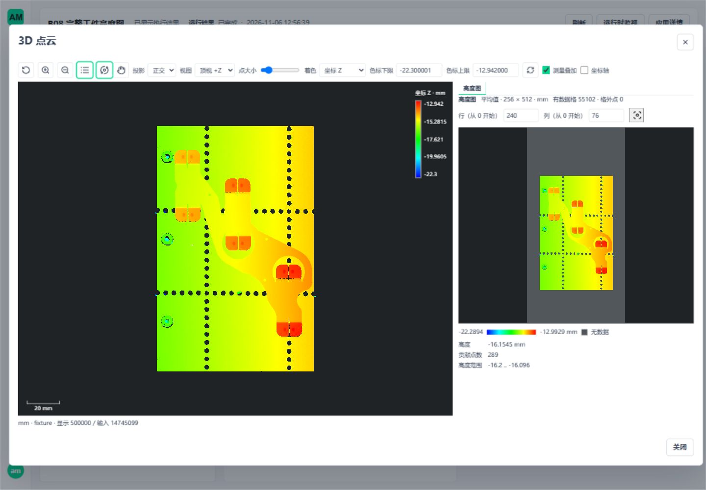

# B08 通用高度图

## 1. 当前范围

2026-11-06 最新实现已提交为 `0b774320`，其内核基点为 `2660e5f7`。**B08 已接通高度图输出保存/读取、来源追溯、Cloud to Height Map 公开节点、参数工作区、二维/三维联动和真实发布运行**；源码包为 `0.1.31`、27 个公开节点。第 2–4 节保留前批计算定义与历史内核验证，第 7 节记录本批公开链路和实际覆盖。B06/B07 已提交，不重复实现输入、标定或资源系统。下一项为[B09 实体边与扫描缺口](3d-metrology-edge-evidence.md)，不重复 B08 已验链路。

新增代码沿用 CloudRuntime、OwnedCloudArrays、ResourceScope、位姿质量/支持校验和既有输入。没有新增上传服务、资源注册表、后台进程、第三方依赖或等待队列。现有工件测量图、包络算法、B06 投影、生产配置与质量规则不变。

## 2. 已确认的计算定义

本批两项用户确认：固定格中心和左闭右开；最小值、最大值、平均值、中位数四种显式聚合，空格不补洞。

| 参数 | 定义 |
| --- | --- |
| `frame.kind=current-frame` | 使用输入当前坐标，`frame_id` 必须一致，不能同时传入 Pose |
| `frame.kind=pose-frame` | 显式 `pose_id/target_frame_id`；复用本次 Pose 的运行、观测、源坐标、单位、质量和完整支持校验。失败位姿返回原因，不回退当前坐标 |
| `length_unit` | 与输入相同的 m/mm/um，不隐式换算 |
| `grid` | 复用 B06 的 OrthographicHeight 几何定义：原点是第 0 行、第 0 列的零高度中心；列、行、高度方向为正交右手单位轴；行列步距独立且显式 |
| `width/height` | 列数/行数，完整格数参与预算，含空格；不是显示尺寸或原始点数 |
| `aggregation` | `minimum/maximum/mean/median`，无默认替换，不自动选取上层或下层 |

将当前点转换到选定坐标后，减去网格原点并投影到列、行、高度方向。第 c 列范围为 `[(c-0.5)*column_step, (c+0.5)*column_step)`，行同理；格编号为 `row*width+column`。最外侧上边界也排除，格外点明确计数。格不随本次包围盒移动。网格中心是输出采样位置，不能伪装成原始点位置。

分箱复用 NumPy searchsorted，避免“先加半格再 floor”把紧邻边界的浮点值舍入到另一格。min/max 使用 NumPy 归约；mean 逐格缩放并使用标准库 fsum，避免求和溢出或正负抵消丢掉小量；median 使用格内排序与中间值，不删除不利点。格外点不参与统计，但输入的非有限坐标/validity=0 明确要求先经 Filter Valid，不能悄悄过滤后冒称完整输入。

每格保留点数、最小/最大高度和选定聚合值。高度范围是证据：倾斜表面也可能有较大范围，不能据此断言存在多个表面。当前不提供分层识别、插值或自动补洞，不产生产品 OK/NG 判定；后续规则通过已有判定器显式配置。

## 3. 精度、来源与生命周期

| 内容 | 当前实现 |
| --- | --- |
| 精度 | 输入位置 float32/64 不变；分块投影与聚合局部使用 float64，三个高度输出回写输入坐标 dtype，检查有限性并记录最大回写误差，不填写误差阈值 |
| 空格 | `counts=0`，heights/minimum/maximum 为 NaN；NaN 仅存在二进制数组，不进入 JSON 数值。没有把无数据转为 0 |
| 格到输入 | `member_offsets` 为 uint64 CSR；`input_rows` 是本次输入逻辑记录号。每条格内输入贡献一次，不把格编号当原始行号 |
| 原始点输入 | 另保留 `source_rows`，通过已有源点子集映射得到最初行号；原总点数仍由 Runtime 的原始观测确定 |
| 生成点输入 | 记录实际参与计算的生成顶点逻辑号，父引用保留原 surface/grid-profile/voxel 来源；不伪造唯一 source_rows，不展开质心成员重新计权 |
| 原字段 | 父点云仍由 Runtime 保留全部字段；高度聚合不平均颜色、强度、法向等属性 |
| 预算 | 分配前检查完整格、全部成员、排序副本与工作块；输出交给已有活跃数组预算。预算不是 RSS 上限；没有调高本机配置 |
| 取消 | 块边界、排序/归约前后、逐格求和、所有权交接后均检查；异常原样传播，释放本次 owner，不释放输入父资源 |
| 作用域 | 整个计算在现有 `runtime.producing()` 中；结果借用同时保护父引用和只读输出。关闭后或跨 Runtime 不能继续借用 |

HeightMapResult 是内部运行对象；本批公开 `height-map-ref.v1` 只传同次运行身份和参数证据，数组仍由现有 Scope 持有，不内嵌到 Workflow JSON。持久保存同时保留实际输入点云的字段、原始行号或生成来源，不能只保存失去父来源的临时逻辑号。

## 4. 验证与审计

专项覆盖四方法、float32/64、不同块长、格边相邻可表示值、外上边界、负高度、空格、空子集、全部格外、原始行号和生成点成员。倾斜解析平面经真实 Fit Plane/Build Frame 验证 Pose 投影；失效/错误运行位姿拒绝，不使用旧矩阵。逐个取消位置、登记后取消、活跃借用、超预算和回收均有回归。

本节前批保存读取对照指**输入点云资产**。高度图输出本身的持久化与三种生成来源保存已在第 7 节另行验证，不混合两批计数。

完整 ASCII PLY 仍为 479,677,235 字节、14,745,099 点，文件 SHA-256 为 `ff2b9e0ef2d6c45af02c4bf8d474cd82f77f86ad92bd371a4c0f71b1b90d116b`。测试先校验文件与完整 XYZ 摘要，再运行四方法。固定测试格为原点 `(-64,-192,0)`、步距 0.5 mm、256 列×512 行；根据该文件实际 X/Y 范围选定，不是生产默认值。

全部原始行只出现一次、格外数为零；另外以独立半开区间扫描核对选定七格的全部成员及统计。测试预算为活跃数组 1 GiB、工作 4 GiB，未修改生产配置。单算子耗时不代表 111 节点工件图的十秒验收。

| 验证 | 结果与覆盖 |
| --- | --- |
| Windows 组合 | **163 通过，109.13 秒**；49 项 B08 专项、共享 Runtime/重采样/Pose/B06/B07 及完整样本。样本助手移动后，162 项非完整样本组合再次通过，32.68 秒，不相加计数 |
| WSL Ubuntu 原生文件系统 | **163 通过，144.17 秒**；同一生产代码和原组合，运行数据/资产/临时文件均位于 Ubuntu 原生目录；源码和只读输入可以位于 Windows 挂载盘 |
| 完整原云 | 两平台四方法均为 55,102 个有数据格，格外 0 点；格内成员/原始行守恒，四组结果数组与来源 SHA-256 完全相同 |
| 数值回写 | min/max 最大误差 0；mean/median 最大 float32 回写误差 `9.5367431640625e-7 mm`；不是实体精度认证 |
| 静态核对 | 新增生产代码与受影响测试 Ruff、差异空白检查；共享样本助手移动前后 AST 相同 |

完整运行报告：[Windows](assets/metrology-height-map/windows.json)、[Ubuntu](assets/metrology-height-map/ubuntu.json)。四种单算子计算分别为 Windows 3.656/3.698/4.357/6.994 秒，Ubuntu 1.607/1.340/1.755/2.829 秒；不含文件读取、独立核对、页面和正式图调度，且非独占环境，不能充当 A01 性能验收。

Ubuntu 隔离环境最初缺共享测试助手的数据集依赖及 Open3D 的 libusb，不能将对应失败记为算法通过。补齐后原组合重新执行通过；libusb 仅从 Ubuntu 官方包解压到隔离目录，通过本进程环境加载，没有安装系统包。未删测试、改门禁或改生产运行时加载方式。

前批生成点专项覆盖体素质心输入与保存恢复；本批补齐 surface/grid-profile/voxel-aggregate 的高度图输出持久化。近 1 GB 输入的 B08 特定输出容量、峰值及停止仍未验收，不能由其他算法的 1 GB 成绩替代。

完整样本读取助手从发布测试模块移至 `tests/integration/metrology3d/full_cloud_sample.py`；旧函数与新函数 AST 一致。测试不再因调用该助手而加载全部 API/数据集路由，未复制解析器或改变解析、摘要与长度校验。

前批内核阶段没有公开 API、资产持久结构或生产配置变更。当前输出扩展的发布、存读与生命周期以第 7 节为准；未改业务端口、原始文件或生产配置。

## 5. 本批实施顺序与出口

| 顺序 | 具体实现 | 验证出口 |
| --- | --- | --- |
| B08.3 已完成 | 复用资产内容、blob、摘要、流式读取与失败回滚；保存固定格/方法/本次 Pose 证据、空格、统计及贡献关系 | 输出保存/重读、再次保存、三种生成来源、篡改、取消、原子失败及 A10 空环境搬运 |
| B08.4 已完成 | 原目录公开节点；坐标来源互斥；复用工作区/查看器，按物理比例显示完整网格，空格与零值区分，选择格定位三维范围 | 参数防错、取消/晚返回、实际完整样本、桌面/窄屏和拾取聚焦 |
| B08.5 已完成既定范围 | 正式 AppVersion/Runtime/Trigger，文件/同机点云接新节点，持久/显示契约同批接通 | 双平台完整样本、停止恢复与破坏性切版拒绝；Windows 页面发布运行通过，Ubuntu 不冒称 GUI 验证 |
| 后续 B 项 | B08 公开链路完成后继续 B09；B04 台面内自动粗搜索仍单列 | 不重做已有 B01–B07，不让十秒或实体参考缺失阻塞后续代码 |

当前 27 节点；本工件 111 节点图及 50 项测量不自动加入高度图。B06/B07 实采标定与最大载荷、B08 特定最大容量、A01 十秒、A04 独立实体证据、最新离线发行和最终组合仍按[唯一剩余清单](3d-metrology-remaining.md)记录，不阻塞 B09。

## 6. 参考边界

CloudCompare 的 [Rasterize](https://www.cloudcompare.org/doc/wiki/index.php?title=Rasterize) 将点云投影到二维格，并将高度聚合与空格填充作为明确选项。本项目参考其交互概念，不复制其源码；本批按已确认的四方法和不补洞边界实现，边界归属以第 2 节为准，不声称与 CloudCompare 所有默认参数或全部方法逐位相同。

## 7. 输出、公开节点与真实页面（2026-11-06）

### 7.1 保存与来源契约

沿用点云资产的可选 `height_map` 内容和 `height-map.bin` blob，不新增资源类别、上传服务或运行注册表。无高度图资产省略该字段，原摘要不变；三维格式仍为 v1。已有文件不迁移或删除。节点包实现版本递增，受影响发布仍使用原有依赖指纹和审核重发，不增加旧执行分支。

二进制固定小端顺序：heights、minimum、maximum（输入坐标精度）、counts（uint64）、member_offsets（uint64 CSR）、input_rows（uint64）；源点另有 source_rows（uint64）。完整格数包含空格。每格的空值、贡献点数、范围、参数、方法、格外数与最大回写误差均保留。保存实际输入云的全部属性和来源，生成顶点不伪造 source_rows；来源关系可从格成员追到输入点云及既有生成证据。

保存仅允许显式 derived。高度图与 cloud 的完整运行引用必须相同；中途裁剪/重采样后不能把旧图挂到新云。原件资产读回再附加高度图时，沿已有派生块写出，不丢字段别名或原始身份。写入、校验、摘要和版本提交复用同一原子事务。取消/失败不出现半个资源，也不关闭上游所有者。

重读先验证资产归属、长度、摘要、格统计、CSR、成员唯一性及原始行号，再登记只读数组。历史 Pose 只用于解释当时结果和显示逆变换，不成为新 Run 的有效 Pose。保存核验分块按实际属性宽度计算，并及时释放随机读取副本。

### 7.2 接线与操作

1. 文件或既有同机点云入口 → Filter Valid → Cloud to Height Map；必要的单位转换保持显式。
2. 当前坐标模式填写 frame_id；Pose 模式填写本次 pose_id/目标坐标并接 pose 端口。原点、三个轴、行列步距、行列数、单位、聚合方法均显式提供。
3. 节点的 `cloud` 是输入直通；`cloud` 与 `height_map` 两端口同时接 Save Cloud 或 Cloud Preview。Save Cloud 使用 derived。
4. Read Cloud 从固定资产恢复 `cloud` 和可选 `height_map`；两端口直接接 Preview/Save，不需要重新聚合。普通点云没有高度图时可选输出为空。
5. 查看器在原三维证据区域增加高度图：完整有界网格、物理宽高比、色标、空格、行列选择、点数与高度范围；点击或键盘选格后可聚焦三维格范围。统计来自全部输入，不从显示采样计算。

前端只接收高度统计格，不传大 CSR；完整来源保留在无损资产。完整网格超出显示容量时给出不可显示状态，不抽格、补洞或修改结果。高度图、点云和 I2 调试附件共用正文/二进制预算，先预留失败状态。退出、切换数据和异步晚返回均释放显示账本，旧选择不能作用于新云。

平台资产 ZIP/A10 配方包保留高度图和依赖闭包；PLY/PCD/XYZ 交换导出仍只导出点云字段，不能冒充保留高度统计或成员 CSR 的格式。没有新增相机/PLC 驱动，也没有改变 Trigger/SDK 点云输入协议。

### 7.3 验证记录

最终 Windows 组合 **160 通过，183.05 秒**，WSL Ubuntu 同组 **160 通过，389.17 秒**；A10 配方包空环境补验两平台各 **1 通过**（19.99/41.77 秒），不与前批测试数相加。前端高度图/查看器生命周期/I2 组合 **42 通过、2 项既有条件跳过**，Vue 类型检查、变更 Python Ruff 和 `git diff --check` 通过。所有平台均使用同一算法与存读代码；WSL 数据库、输出、锁、共享内存及临时文件位于 `/home` 原生文件系统，源码和输入样本只读使用 Windows 挂载盘。执行时长是整个测试组合，不是生产节拍。

本轮早期保存对照的原始记录：[Windows](assets/metrology-height-map/output-windows.json)、[Ubuntu](assets/metrology-height-map/output-ubuntu.json)。四方法摘要逐一相同，平均值输出保存后的摘要与计算摘要相同；这些记录不是最终组合重新计时或 A01 十秒成绩。最终组合另在同一完整样本上重新验证守恒与恢复。

| 项目 | 覆盖 |
| --- | --- |
| 正确性与持久化 | 四方法、float32/64、倾斜真值、半开边界、原始行、三种生成来源；关闭原 Scope 后逐字节恢复；坏长度/摘要/空格/CSR/重复成员拒绝；写失败和逐取消点回收 |
| 显示组合 | 高度格与 I2 附件统一预算；正文刚满时仍能容纳失败状态；不改变计算数组 |
| 发布链路 | 正式目录/依赖准入 → AppVersion → 独立 Runtime → Trigger → 计算/保存/显示；停止恢复、新 worker、旧资产重读；删除公开输入的切版返回冲突，不静默改变调用合同 |
| 完整工件 | 全部 14,745,099 点，四方法每次 55,102 个有数据格，格外 0；保存恢复包含完整贡献成员；Windows/WSL 原始数组摘要一致 |
| Windows 真实页面 | 隔离 5620/5621：上传 457.5 MiB 原始 PLY、Preview、参数错误/取消、保存发布、停机切版、App Mode 完整文件运行、格拾取/键盘编辑/聚焦、1440/680 宽视口；无横向溢出，控制台无错误 |
| 前端生命周期 | 损坏数据/姿态矩阵/超预算拒绝；空格不是零高度；晚返回、换任务、卸载账本回收；普通点云查看器不调用高度格接口 |

页面第二次发布显示为应用版本 v2，仅为既有发布序号，三维数据协议仍全为 v1。截图显示点云概览 500,000 点、统计输入 14,745,099 点，这两个计数不能混同。显示范围是完整工件；全分辨率细节继续使用原有显式资产索引能力。

图像核对：1440×1000 页面中三维区域含 27,959 种像素颜色，高度网格区域含 12,505 种，非空白；选择格后可见三维格框和比例尺变化。680 像素视口正文宽度仍为 680，无横向溢出，统计通过原证据面板滚动可达。前端测试最初受到受限临时目录原子改名权限影响，未执行用例；正常用户隔离进程重跑上述组合通过，不计为算法或业务失败。

[窄屏统计可达性](assets/metrology-height-map/published-ui-narrow.jpg)。未调整操作系统缩放，没有用窗口缩放冒充平台算法验收。

审计收口：原件资产附加高度图按派生数据写出；来源核验按字段宽度分块；高度图/I2 使用共享显示预算并预留失败状态；普通点云不调用高度格渲染接口。回归覆盖原 Scope 关闭后的历史 Pose 只读恢复、生成来源和原始行号，未改变量值算法或放宽门禁。测试窗口使用的容量缺口已按显式测试配置修正，生产配置未改。

清理核对：页面 Runtime 已 stopped/stopped，5620/5621 不再监听；本轮 API/Vite、独立 worker 与测试进程退出。仓库 `.tmp` 本轮缓存/资产/报告全部移除，必要结果与页面证据已转存本文档目录；Ubuntu `/home/am/amvision-b08-output` 已删除并恢复停止。原 5600/5601 服务及其他 WSL 发行版保留。三份更新文档的 137 个本地文件链接存在。未重装/修改系统 Python，未手改发行目录。该批验收时尚未提交，随后已提交为 `0b774320`；本段为当时的验证与清理记录。

### 7.4 剩余范围

- B08 既定主链路已接通；不把后续分层识别、插值补洞或独立高度图资源系统加入本批。
- B08 接近 1 GB 输入对应的高度输出/全部成员峰值、最大格网显示与停止仍需专项容量验收；既有全容量输入证明不能直接替代。
- B06/B07 真实采集标定和实体参考证据仍需现场材料；本批完整 PLY 是真实工件，但不是标定精度证明。
- 源码新增节点还需在下次发行时随既有 assemble-release 装配；未手改旧发行目录。本批不重跑原 111 节点图节拍或长期 soak。
- 下一功能是 B09 实体边与扫描缺口区分；复用现有边界/来源/质量/查看器，不重建输入、发布和资源系统。B04 台面内自动粗搜索另列，不把局部约束配准当自动粗搜索。
