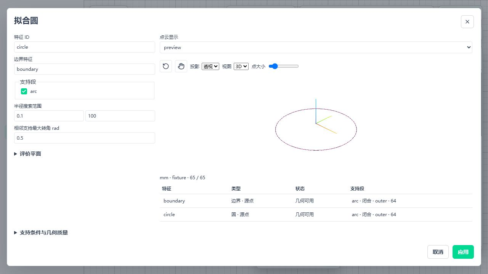
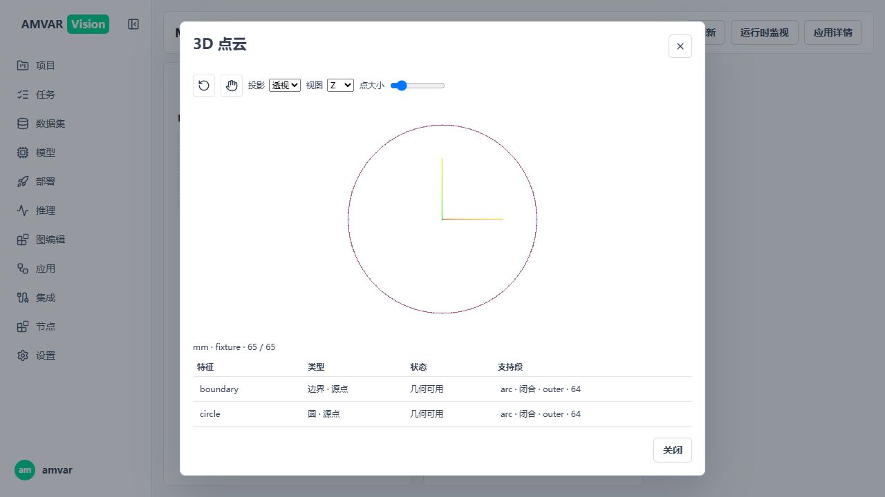
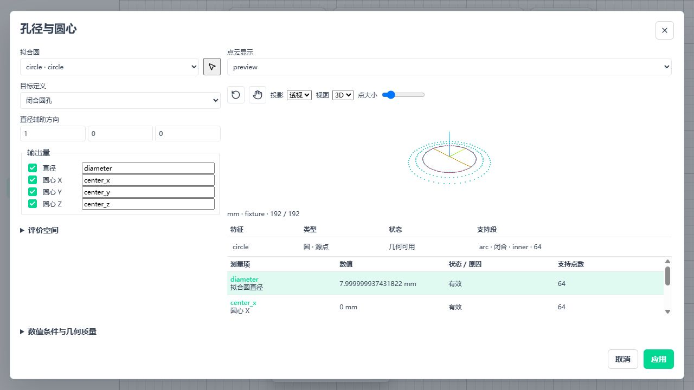
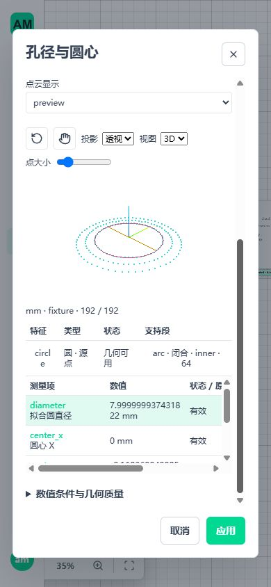
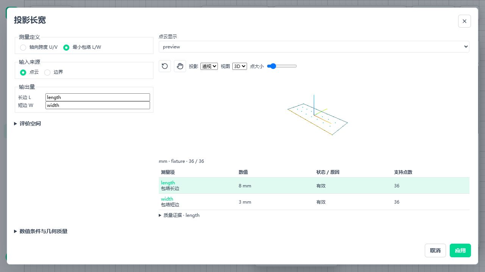
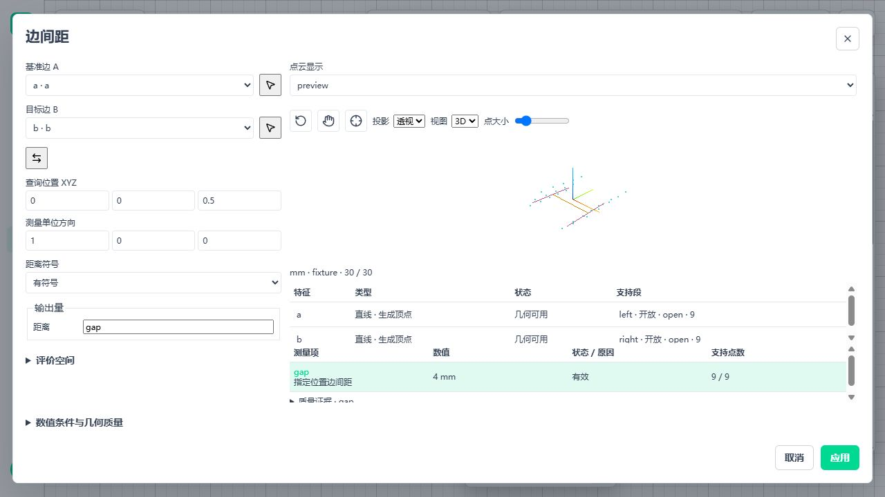
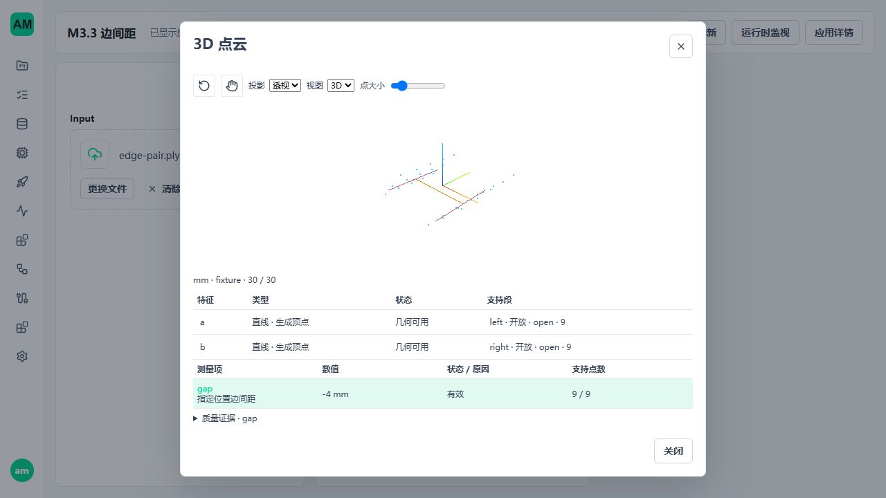

# M3.3 实施与验收

后续 2026-10-24 工件审计修复见[参数与有限边段修复](3d-metrology-repair-20261024.md)：当前内部包 `0.1.10`，extract-boundary 方法 v2。下文保留 M3.3 当批验收，不累计后续测试数量；生产仍隐藏，完整现场尺寸未宣称通过。

更新：2026-10-24。实施基点 `a5f19018`，本批实现后续已提交至 `2179cae7`。
承接 [M3.3 设计](3d-metrology-m3-dimensions.md)。第 2–7 节保留前置批次记录；第 8 节记录三个尺寸节点、证据 v2 和前端的本批实施。历史测试不与本批重复累计。

后续 [真实工件审计](3d-metrology-audit-20261024.md)发现公共参数编辑分发错误及真实边段选择/测量定义缺口。本文件的定向通过结论仍按原测试范围理解，不表示从空白页面配置十二钢片/两半圆测量已验收完成。

## 1. 当前状态

| 范围 | 本批结果 |
| --- | --- |
| M3.2 真实发布链 | 合成独立真值和完整样本均经过正式发布、准入、独立 WorkflowAppRuntime、Trigger；不是 FakeRuntime 或测试 handler |
| 完整页面 | 隔离登录、真实圆边界配方编辑、Preview、取消/应用、保存/发布、Runtime 启停和 App Mode 已操作；发现并修复未知 MIME 文件被误拒绝 |
| 最小矩形依赖 | 受控 trimesh `.2` 已构建，双平台严格 I/O 和独立矩形测试通过；没有另外编写凸包/矩形算法 |
| M3.3 三节点 | measure-extents、measure-edge-pair、measure-hole 已完整内部接线；Catalog 十八节点 |
| 测量证据 | v2 严格分支，旧高度/高差输出、Preview、Catalog、前端读取方同批更新；v1 明确拒绝 |
| 生产启用 | 隐藏目录、无生产 manifest；timeout、容量及生产质量参数均未代填 |

本批不重跑模型 P99 或长期 soak，不修改模型训练、推理数学、进程管理或恢复准入。

## 2. 页面发现及修复

`FilePicker.vue` 原来按 `File.type` 与 `accept` 精确比较。浏览器对 PLY/PCD/XYZ 常返回空 MIME，
但 Workflow 文件输入声明 `application/octet-stream`，因此文件已选中却未写入输入状态，Preview 无法取得文件。

修复范围：

- 与既有上传序列化一致，将空 `File.type` 按通用二进制处理；不靠扩展名推断点云内容。
- 通用二进制无法由浏览器原生文件筛选枚举，原生 `accept` 不设置该筛选；选择后仍使用原类型/扩展名规则检查。
- 已知非匹配 MIME 仍拒绝，图片专用入口不因此接受无类型点云；服务端严格解析、大小限制不变。
- 新增八项选择/拖放/过滤回归；现有 Preview 上传测试继续覆盖晚返回、取消和上传状态。

实际完整页面使用独立真值圆样本（中心加 64 个圆周点），不是完整现场样本的截图。
执行了非法半径范围禁止应用、取消不污染原参数、应用后旧 Preview 失效、发布新版本、
App Mode 完成一次真实 Runtime 调用及 3D/Z 视图切换；最后通过页面停止 Runtime。
页面运行期间未记录 console error/warn，三维内容可见。





范围限制：未把该圆配方页面验收写成所有直线编辑器、窄屏和所有拾取路径都已验收；
截图及可见交互也不替代后续新尺寸层的 canvas 像素、响应式和资源释放验收。

### 隔离入口修正

初次启动只配置 Vite 环境变量，页面读取已有 runtime-config 模板后仍指向业务 API 5600。
登录后从列表发现目标错误即停止；当时只登录和读取列表，没有编辑业务配方或资产。
之后使用测试专用 `published_ui.mjs` 显式提供三种 runtime-config 路径，核对目标 5620 后重新登录。
该入口拒绝 5600/5601 和 UI/API 相同端口；没有修改生产配置优先级、认证或运行时代码。

复现页面时使用全新隔离目录：

```powershell
conda activate amvision
python -m tests.integration.metrology3d.published_ui --root .tmp/m33-ui --port 5620
node tests/integration/metrology3d/published_ui.mjs 5621 5620
```

解释器须安装当前受控 wheel；本次实际在临时独立环境运行，未修改开发主环境。

## 3. 真实链路及完整样本

新增 `test_boundary_published.py` 使用真实 Catalog/manifest 和正式 API 发布合成线、圆配方。
矩形依赖更新后重跑的最终组合包含以下十个模块，共 140 项：

```text
tests/integration/metrology3d/test_boundary_extraction.py
tests/integration/metrology3d/test_boundary_section.py
tests/integration/metrology3d/test_boundary_surface_topology.py
tests/integration/metrology3d/test_boundary_fitting.py
tests/integration/metrology3d/test_boundary_nodes.py
tests/integration/metrology3d/test_boundary_runtime.py
tests/integration/metrology3d/test_file_read.py
tests/integration/metrology3d/test_asset_export.py
tests/integration/metrology3d/test_boundary_published.py
tests/integration/metrology3d/test_boundary_published_full_sample.py
```

最后一项复用原真实生命周期测试，不另外实现 Trigger/.NET 协议。
原样本 479,677,235 字节、14,745,099 点；全文件与完整 float32 XYZ SHA256 均校验后输入，
不是读取前缀。原样本 SHA256 见实施基线；XYZ 为
`956927f058ba4a0170b1c1b93b1411b613fbe21fcbfc278ad0a7fc3cf621a1c6`。

完整输入内显式测试 ROI 取得投影 44 点和截面 20 个生成顶点，执行真实提取、直线/圆拟合。
测试使用明确的 mm/fixture 配置，不声称原样本已有可追溯标定。
该 ROI 的直线 RMS 为约 0.015526，超过原测试质量上限 0.01；圆也未满足原质量条件。
测试要求无效拟合不返回有效模型/区间，并保留两条有效边界，不将质量拒绝误称为流程错误或伪造实体孔真值。

Preview 总预算仍为 1000 点；配方点云显示分别配置 500/250 点，预留已有曲线证据容量。
初次将点云本身用满 1000 导致 `preview_size_limit`，已修正测试配方，没有放宽显示总预算。

覆盖：运行中切版拒绝、停止后调用拒绝、启用 Trigger 时切版拒绝、禁用后切版、旧 generation 拒绝、
writer 持有租约时异常退出、执行中客户端异常退出、执行中停止并确认 worker PID 退出、重新启动后调用成功。
每次调用后的任务、准入、借用、租约、已分配/撤销/隔离容量归零。

| 平台 | 最终组合 | 完整输入客户端 |
| --- | --- | --- |
| Windows 11 x64 / Python 3.12.13 | 140 passed，92.60 秒 | 正式 .NET SDK 的 fill 与 bytes |
| WSL Ubuntu / Python 3.12.3 | 140 passed，134.72 秒 | 真实 Python 同机协议；不声称 Ubuntu .NET 已通过 |

Ubuntu 数据库、ObjectStore、mmap 和临时目录在原生文件系统；Windows 盘仅提供源码与只读样本。
报告：[Windows](evidence/metrology3d-m33/boundary-windows.json)、
[Ubuntu](evidence/metrology3d-m33/boundary-linux.json)。报告的状态快照采于调用完成、服务关闭之前，
`failed_request_count` 含故意发出的停止/旧路由拒绝，不是未解释的正常请求失败。

运行上述列表使用 `python -m pytest <模块列表> -q --cloud-sample <完整样本路径>`，
Windows 的 `--basetemp` 在仓库 `.tmp/`，Ubuntu 的该参数与报告目录在原生临时根目录。

## 4. 受控矩形扩展及审计

沿用 trimesh 5.1.1 的 `ConvexHull(QbB)` 与凸包边方向投影，局部修改 `oriented_bounds_2D`：

1. 候选证据入口要求 float32/float64、显式工作预算、取消回调及面积绝对/相对容差。
2. 按预算分块投影；第一遍求最终最低面积，第二遍返回所有符合该最低值比较条件的候选，避免顺序相关集合。
3. 纳入输入/潜在转换、凸包返回数组、边方向、投影块和候选结果数组；预算不足明确失败。
4. Qhull 之前/之后与分块边界检查取消；不声明可抢占 Qhull 内部，也不把数组预算当作原生 RSS 上限。
5. 不默认 QJ 扰动，不补 PCA 框，不返回部分候选冒充全部；空/非有限/退化输入拒绝。
6. 返回的候选含轴符号/交换等价表示，节点仍须依据显式角度条件归类；未提前声称方向唯一或尺寸一致。

独立测试覆盖解析旋转长方形、正方形、等面积不同长宽的三角形、逐边独立枚举、
输入乱序、预算分块相等、取消、非有限/共线、精度及 1e-6/1/1e6 尺度。
前置批次当时未接节点；本批已在节点内接入局部规范化、并列方向归类、全体 L/W 一致性与前端，见第 8 节。

与固定上游归档逐顶层 AST 比较，只有 `oriented_bounds_2D` 改变，其余几何函数未改；
原 PLY 修复文件及共享记录校验文件哈希未变。上游 MIT 版权/许可仍随源码与 wheel 保留。
读取、导出、截面三个消费入口一起锁到新版本，不保留 `.1` 降级分支。

| 固定身份 | 值 |
| --- | --- |
| wheel | `trimesh-5.1.1+amvision.2-py3-none-any.whl` |
| wheel SHA256 | `1f71a37601d7a38139a5fba1336618a0ffcdbb785f32d550e64362ee0c18c6c1` |
| bounds.py SHA256 | `b92d33a345e2d73dddc34502f5050c156f55398d00340329c8d3e1570b133457` |

[构建记录](evidence/metrology3d-m33/trimesh-5.1.1+amvision.2-py3-none-any.build.json)与
`runtimes/python_patches/wheels.lock.json` 一致；wheel 放本地运行时资产目录，不入 git。
生产 release profile 未启用三维依赖，本批未组装发行包或修改主 Python 环境。

## 5. 最终候选验证

| 检查 | 实际结果 |
| --- | --- |
| `tests/integration/controlled_io` | Windows 123 passed / 5.21 秒，Ubuntu 123 passed / 4.46 秒；含 15 项矩形用例及原两返回值入口一致性断言 |
| 第 3 节十模块组合 | 两平台各 140 passed，包含完整样本；不是在前述结果之外重复累计完整样本 |
| `tests/frontend/workflows` | 22 文件、134 项通过；包含八项新增 FilePicker 用例 |
| `vue-tsc --noEmit` 与 Vite build | 通过；产物在 `.tmp/m33-dist`，未覆盖业务前端产物 |
| 前端警告 | 原 WorkflowEditor 约 500.38 kB、CloudViewer 610.70 kB 分块警告仍存在，未放宽警告阈值 |
| 变更 Python Ruff | 通过 |
| 隔离页面入口 | Windows、Ubuntu 各五项拒绝业务/非法端口、拒绝已存在目录回归通过 |
| 文档与启用边界 | 文档本地链接及生产节点仍隐藏检查，两项通过 |

一次前端启动在沙箱系统临时目录发生 rename EPERM，未执行测试；指定仓库内临时目录后同一套件通过。
这是环境权限失败，不修改测试断言规避，也不计入通过数量。初期候选轮次不与最终候选重复相加。

## 6. 前置批次之后的实施顺序

1. 收口三个参数 DTO 和严格测量证据 v2；沿现有 Contract/Schema，保留高度/高差数学语义，同批消费者升级。
2. measure-extents：完整支持的轴向跨度、局部规范化最小包络、并列尺寸/方向判定、极值来源与构造尺寸证据；再接节点与前端。
3. measure-edge-pair：精确 LineFeature 选择、几何共面、解析求交、有限区间并集及缺口拒绝、位置方向交互。
4. measure-hole：只消费 CircleFeature；闭孔/开放弧角色、上游质量、直径/圆心项与显式辅助方向，不重复拟合。
5. 三节点独立真值、保存恢复、完整样本及正式发布链；桌面/窄屏、迟到结果、卸载和资源回收验证。

以上步骤的当前交付见第 8 节，不能把内部实现完成等同于工业计量达标。生产预算、目标发行和现场标准件验收仍为独立条件。

## 7. 前置批次环境收尾

页面 Runtime 已显式停止，隔离 API/Vite 已退出。最后只读检查未发现本轮 Windows/Ubuntu
测试进程，5620/5621 无监听；关闭了本轮可操作的验收浏览器标签。
已清空仓库 `.tmp/` 的本轮缓存、虚拟环境、数据库、共享内存、构建目录与中间报告，
Ubuntu 原生隔离目录也已删除并确认不存在。保留原始输入样本、业务资产、当前受控 wheel
及本文件链接的正式验收证据。没有停止或删除用户业务环境。

## 8. 三个尺寸节点及证据 v2

### 8.1 实现与边界

| 部分 | 当前实现 |
| --- | --- |
| 严格契约 | `dimension3d_parameters.py` 定义三节点参数、显式输出身份及质量指标；`dimension3d_evidence.py` 定义有限几何、来源、候选及支持快照；原 MeasurementEvidence3d 以 kind 分发五种测量 |
| measure-extents | cloud/boundary 显式二选一；完整支持分块投影、局部 QR 退化检查；轴向 U/V 不交换，最小矩形按受控 trimesh 返回全部候选解释 L/W 和方向歧义；没有显示采样、PCA 替代或隐式降级 |
| measure-edge-pair | 消费两个明确 LineFeature；先核对评价面及实际支持端点，再解 p+t·v=a+s·d；检查三维残差和有限区间并集，缺口/域外无效；有符号与绝对值独立配置，不重新拟合 |
| measure-hole | 只消费 CircleFeature；闭孔要求唯一闭合 inner，开放弧要求 open；保留原模型、质量、支持弧和求解终态，直接计算 2r 与坐标；零坐标有效，不调用拟合器 |
| 所有权 | 继续使用 CloudRuntime/Scope、只读支持、预算和取消；只生成有限证据，不创建新资源服务、线程池、等待队列或常驻原云会话 |
| 保存恢复 | 沿 save-cloud 的 boundary features → 关闭原 Scope → read-cloud → 原 fit-line/fit-circle → 尺寸节点；生成点保留插值来源，源点保留最初行号 |
| 前端 | 三节点注册到同一可信编辑器；候选来自当前连线，恢复资产只取该源端口本轮输出；模式切换清空旧量身份，A/B 交换、显式候选拾取、应用/取消；共享 CloudViewer 显示尺寸与质量 |

测量证据为 `amvision.measurement-evidence3d.v2`，不改变 NumericTable v1、Features3d v2、点云资产/引用 v2、
LocalBuffer 或 .NET 传输布局。高度/高差仅增加严格 kind 和版本；原几何数学不变。
同一参数组的全部启用量必须齐全，支持、质量和几何完全一致；NumericTable 由相同证据生成。
错接、单位/观测/运行身份不符、预算不足和取消仍是执行错误；正常几何缺测保留全部 item_id，value/geometry 为空。
受影响旧测量配方审核重发，不自动改旧资产、旧结果或业务数据。

生产节点包仍在隐藏目录、无 manifest；内部 pack 版本 0.1.9。测试安装到隔离副本并配置明确预算/超时，
不代表批准生产参数。普通模型训练、推理算法、进程归属和恢复准入均未修改。

### 8.2 实际发现及修复

1. 生成截面顶点的 source_edge 为 NumPy uint64，严格 JsonCount 拒绝。极值证据封装现在显式转为 Python int；不改变原始行号语义。保存、关闭、恢复后的生成边界长宽回归已覆盖。
2. 尺寸质量字段/单位原先只在结果阶段核对。现参数 DTO 与前端提前拒绝未知指标和错误单位；结果继续核对完整集合、范围、候选和几何的一致性。
3. 取消扫描时异常 traceback 可能保留局部数组。复用既有 release_exception_frames，新增保留异常对象仍释放数组块的回归，未新增资源管理器。
4. 隔离库重建使浏览器旧 token 失效，暴露已有 Preview WS 握手后抛鉴权异常进入 HTTP handler 的问题。该入口现在以 4401/4403 关闭，在订阅/分配前返回；不放宽授权、不改变认证服务。新回归使用真正撤销的 token 和真正受限身份，不用全权限默认账号模拟权限不足。

### 8.3 最终后端候选

两平台执行同一组 362 项，包含：

```text
tests/integration/controlled_io
tests/test_metrology3d_dimension_contracts.py
tests/test_metrology3d_extents.py
tests/test_metrology3d_edge_pair.py
tests/test_metrology3d_dimension_runtime.py
tests/test_metrology3d_measurement_contracts.py
tests/test_metrology3d_height_step.py
tests/test_metrology3d_measurement_preview.py
tests/test_metrology3d_boundary_contracts.py
tests/integration/metrology3d/test_boundary_extraction.py
tests/integration/metrology3d/test_boundary_section.py
tests/integration/metrology3d/test_boundary_surface_topology.py
tests/integration/metrology3d/test_boundary_fitting.py
tests/integration/metrology3d/test_boundary_runtime.py
tests/integration/metrology3d/test_boundary_nodes.py
tests/integration/metrology3d/test_file_read.py
tests/integration/metrology3d/test_asset_export.py
tests/integration/metrology3d/test_nodes.py
tests/integration/metrology3d/test_publication.py
tests/integration/metrology3d/test_measurement_nodes.py
tests/integration/metrology3d/test_dimension_nodes.py
tests/integration/metrology3d/test_dimension_assets.py
tests/integration/metrology3d/test_dimension_published.py
tests/integration/metrology3d/test_dimension_full_sample.py
tests/integration/metrology3d/test_published_ui.py
```

命令为 `python -m pytest <上述列表> -q -x -o faulthandler_timeout=180 --cloud-sample <原样本> --basetemp=<隔离根目录>`。
Windows：362 passed / 97.57 秒。WSL Ubuntu 原生文件系统：362 passed / 161.01 秒。
独立真值包含旋转矩形、正方形方向不唯一、等面积不同尺寸三角形、共线退化、薄形大平移、源精度、
解析边对方向/符号、缺口/域外/面外及真实圆孔角色；不是用自身输出生成预期数值。
保存恢复回归比较真实重新拟合后的距离 4、直径 8，并核对生成来源/源行号。

完整样本仍为第 3 节的 479,677,235 字节、14,745,099 点，先核对全文件及 float32 XYZ hash。
沿原人工 ROI，投影边界的 U/V 可用；既有线/圆未通过原质量条件，边距及孔径/圆心输出明确无效，
没有放宽质量门槛、捏造实体孔或用测试拟合模型替换样本拟合。两个有效长宽量加五个无效量共七项。
完整链为真实发布 → WorkflowAppRuntime → Trigger → Windows .NET fill/bytes；Ubuntu 为实际 Python 同机协议。
覆盖停止、旧 generation 拒绝、切版、writer/client 异常退出及重新调用，资源断言沿既有完整生命周期测试。
未声称 Ubuntu .NET、任意 1 GB 形状容量、原生 RSS 硬上限或现场精度已验收。

补充 Preview WS 回归列表为 `test_workflow_preview_session_auth.py`、`test_workflow_preview_session_api.py`、
`test_preview_file_inputs.py`、`test_published_ui.py`。Windows 19 passed / 20.26 秒；WSL Ubuntu 19 passed / 110.23 秒。
该集合与 362 项中五个入口测试重合，不重复累计为独立总数。

### 8.4 页面、前端与剩余限制

前端工作流回归 24 文件、147 项通过，覆盖尺寸注册、候选类型/重复 ID、错误单位/面外方向、
模式切换、旧结果失效、卸载、尺寸三种显示几何及 CPU/GPU 缓冲释放。Vue 类型检查和 Vite build 通过。
构建输出写入 `.tmp/m33-final-dist`，未覆盖业务产物；WorkflowEditor 520.52 kB、CloudViewer 615.12 kB
仍触发 500 kB 分块警告，未放宽阈值。测试实际使用本机 Vite 8.3.4 / Vitest 4.1.11，不改变依赖锁文件。

实际页面使用 5620/5621 隔离库。孔径独立真值 8 mm，页面值约 7.9999999374 mm，圆心零值正常；
长宽独立真值 8×3 mm；边间距 4 mm，交换 A/B、应用并显式 Preview 后为 -4 mm，Z 视角切换正常。已验证模式切换不会复用旧 item_id、非法方向禁用应用、取消不污染原参数。
桌面 1280×720、窄屏 390×844 检查共享三维显示；窄屏无页面横向溢出，面板可滚动。
孔径截图画布区域彩色像素分别 597/541，确认非空白，不把截图测试称为算法精度证明。
边间距画布区域彩色像素 377，切换 Z 视图后改变 11,145 个像素；几何真实绘制且视图操作生效。
隔离页面经保存、发布 v3、创建并启动 Runtime、App Mode 上传文件调用，显示同一 -4 mm 结果和三维证据，
随后停止到 stopped/stopped。此流程结束时浏览器错误/警告日志为空；旧库 token 的历史错误及其回归修复见 8.2，
不将未重启服务中的旧鉴权处理代码冒充已做浏览器修复验收。








M3.4 公开三态及消费者、M3.5 含最终规则的整套配方、生产参数批准、bundled 双平台发行和可追溯标准件验收
仍未交付。本批不运行 P99/soak，不宣称全项目没有任何错误或已满足工业计量标准。

### 8.5 本批环境收尾

本批 Runtime 已由页面停止；关闭本批浏览器标签并恢复视口后，隔离 API/Vite 均以中断退出。
随后核对 Windows 进程命令行，无本批隔离环境/启动器残留；5620/5621 无监听。
WSL 无本批 Python 进程。确认无占用后，删除仓库 `.tmp/` 和 Ubuntu 原生路径
`/home/am/.cache/amvision-m33-nodes`；两处均验证不存在。
源码、受控依赖资产、原始完整样本及本文截图保留；未操作 5600/5601 业务环境。

最终变更 Python 文件 Ruff、`git diff --check` 通过；七份文档的本地链接和代码围栏检查通过。
生产代码检索没有遗留 measurement-evidence3d.v1 读取分支；未新增生产 manifest、后台任务池或算法兼容分支。
独立样本和完整样本覆盖的是本批明确列出的测试边界，不构成任意工件、任意容量或长稳保证。
