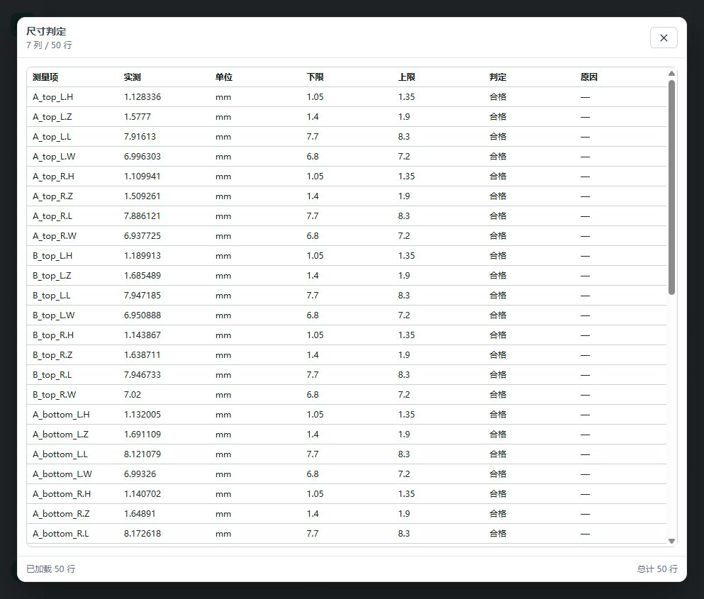
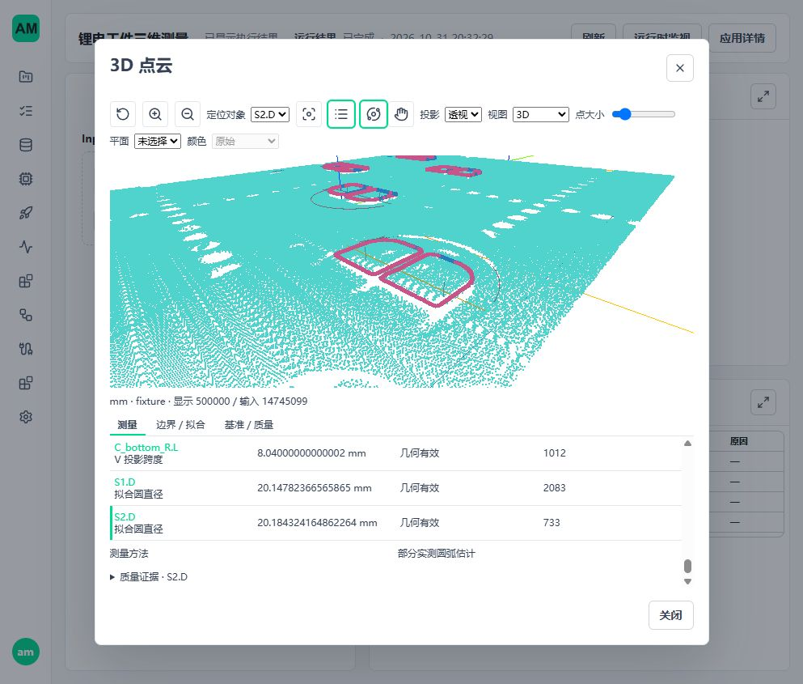
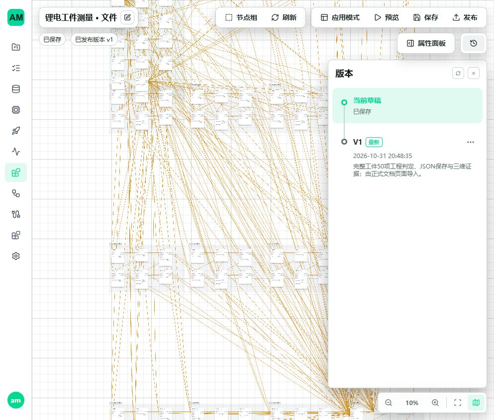

# 三维工件主流程交付

日期：2026-10-31。对应剩余清单 A07、A08、A11，以及 A03 最新使用边界；不新增阶段编号。

## 交付范围

当前工件的完整输入、十二钢片 H/Z/L/W、两半圆直径、50 项必检判定、结果 JSON 保存、正式发布调用及三维证据显示已接通。S2 现有部分弧方法按用户本次确认作为工程可用项，原 0.03 mm 重采样诊断不再阻塞，不重复试验，也不把历史数值改写为通过。

正式入口为[工件使用说明](../examples/workflows/lithium-workpiece.md)、[图文档](../examples/workflows/lithium_workpiece.template.json)和[应用文档](../examples/workflows/lithium_workpiece.application.json)。`python -m scripts.metrology_workpiece` 生成既有 `amvision.workflow-app-document.v1`，无需测试目录。完整文件图为 111 节点、317 条边，按基准、14 个对象和交付区域组织。

复用既有 Check Limits、Result Record、Value Preview、Save JSON、Response Envelope，不新增工件专属算法、调度器、资源系统或发布管理。数组入口直接接 Filter Valid；数值视图仅显式移除三维显示分支，所有计算、判定和保存不变。没有失败时自动降级。

## 工程判定

按已授权的工件参数决策，固定名义量 H=1.20、Z=1.65、L=8.00、W=7.00、D=20.00 mm，对称工程带分别为 0.15、0.25、0.30、0.20、0.30 mm。完整参数及来源随配方和结果保存。

这些数值是明确标识的工程配置，不是未知图纸的公差，也不声称由 ISO 自动给出。50 项全部必检；几何无效、缺项、单位不符产生 INVALID，有效越限产生 NG，其余为 OK。原算法质量门禁、原始行号、目标归属和测量值未修改；不因用户接受 S2 就强制写入 valid=true。

独立真值、同云对照、软件规则正确性与可追溯实体精度是不同证据。没有独立标准件或校准链时不声明实体计量认证，但不继续以缺少文件阻塞工程配方使用。

## 显示缺陷与修复

实际完整图首次组合暴露 `preview_structure_limit`：数值与保存已成功，但 50 项测量支持证据及完整边界曲线合计超过普通 JSON 的结构计数，因此整个显示帧被拒绝。此前只展示少量代表测量的页面无法覆盖这个规模。

修复位于 `backend/service/application/workflows/runtime_preview.py`：

- 声明过的曲线坐标、剖面类别、残差、权重、内点和角区数组按严格类型、长度、有限值验证，再沿用已有采样数组计数路径。
- `MeasurementEvidence3d` 逐项使用原结构/深度限制，所有项与其他显示仍共享原 64 MiB 字节预算；没有提高普通 JSON 的 100,000 值限制。
- 整体证据仍经现有强类型契约验证，未知字段、任意大 metadata、坏值和字节越限仍拒绝。错误只影响显示，不伪造测量失败或改写结果。
- 不修改 viewer 算法，不重新构建 I2 调试几何，不改变二维显示路径、测量输入或质量门禁。

## 同机 Python 调用

[运行时调用工具](../../runtimes/clients/point_cloud/README.md)位于 `runtimes/clients/point_cloud`。它复用正式 mailbox、CloudBufferDescriptor、direct mmap writer 和结果 ACK，支持 bytes、bytearray、memoryview、原始数组文件，单个总截止时间覆盖分配、写入和响应。明确处理精确长度、文件截断/增长、取消、过期 generation 和释放。

这是随项目 Python 运行时使用的调用工具，依赖现有 backend 协议实现，不是可独立安装的 Python SDK。没有复制共享内存 ABI、另造协议、准入重试或输入等待队列。既有 Windows .NET SDK 不重写；独立 SDK 和 Ubuntu .NET 不冒称完成。

## 完整样本验收

输入为 14,745,099 点、479,677,235 字节的原 ASCII PLY，SHA-256：`ff2b9e0ef2d6c45af02c4bf8d474cd82f77f86ad92bd371a4c0f71b1b90d116b`。

所有调用经真实 API 发布 AppVersion、独立 WorkflowAppRuntime 和真实准入，不替换节点 handler：

| 环境与入口 | 结果 |
| --- | --- |
| Windows 同机数组 / 完整显示 | 50 项、OK；与 F4 数值差不超过 1e-7；500,000 显示点、50 项证据、两圆证据；保存内容与回复一致，停止及资源回收通过 |
| Windows 文件 / 数值视图 | 真实完整文件上传、读取、50 项判定与 JSON 保存一致，停止及资源回收通过 |
| WSL Ubuntu 同机数组 / 完整显示 | 同上；原生 Linux 文件系统用于 DB、运行目录、共享内存与结果，源码和输入仅从 Windows 挂载盘读取 |
| WSL Ubuntu 文件 / 数值视图 | 同上；没有用 DrvFS 充当运行数据盘 |

四份简要报告：[Windows 数组](assets/metrology-mainflow/delivery-array-windows.json)、[Windows 文件](assets/metrology-mainflow/delivery-file-windows.json)、[Ubuntu 数组](assets/metrology-mainflow/delivery-array-linux.json)、[Ubuntu 文件](assets/metrology-mainflow/delivery-file-linux.json)。报告耗时包含相应传输、解析或显示，不是纯检测十秒门禁；本轮不重复性能循环。

- Windows 最终组合：147 项通过，139.09 秒。包含原有 Runtime Preview/API、三态判定/输出、示例文档、新显示边界、正式配方和客户端及完整文件/数组集成。
- WSL Ubuntu：19 项通过，165.20 秒，包含新显示/配方边界、客户端和两个完整样本入口。1 条第三方 SciPy 稀疏导入弃用提示，不影响结果。
- 坏元数据、无穷/NaN、错误数组长度、逐项证据未知字段、原字节上限继续拒绝；客户端覆盖写入后取消、过期 generation、长度错误和原生资源回收。
- 配方回归确认所有既有三维计算参数保持冻结值；越限模拟为 NG，缺测为 INVALID，不以成功样本全 OK 代替规则反例。

WSL 使用隔离 Python 3.12 环境及仓库受控 I/O wheels，Open3D 0.20.0、NumPy 2.4.4、SciPy 1.18.0。所需 libusb 仅在测试目录解包，不修改系统库。这是源码运行验证，不把它写成 Ubuntu bundled 离线发行验收。

## 真实页面

隔离 5620/5621 环境：创建并启动正式 Runtime，从 App Mode 选择完整原始 PLY，得到 50 项判定表及三维整件。S2 显示 20.184324164862264 mm、733 支持点及部分弧方法信息；数值来自算法，没有写入报告参考值。Console 无 warning/error。

随后从空白图编辑器右键导入正式 `file.workflow.json`，保存、发布，在版本面板确认 V1 和说明。此步骤验证普通交付文档路径，不依赖测试构图页面。导入发布与先前运行是两次独立操作，未宣称新建导入版本又重复测量一次。

首次 Vite 启动仅设置环境变量，被仓库 runtime-config 覆盖，曾只读到原开发环境应用列表；发现后立即停止，改用已有隔离启动脚本注入运行配置，后续所有创建、测量、保存和发布均在隔离空库。原 5600/5601 业务配置、应用和发布数据未修改。

## 审计与清理

本轮没有再次修改拟合/测量内核、质量参数、调度器或进程停止实现；已有 A01/A05/A06 未提交变更保留。新增内容集中在正式配方、调用工具、显示复制边界、回归和说明。节点继续按已批准的工程配置启用。

本轮不声称十秒、最大 1 GB 容量、所有发行 profile 或全部原规划高级几何能力均已验收。当前可用工件主流程不再被这些独立范围或 S2 历史诊断反复阻塞。

已通过页面确认本轮 Runtime 为 `stopped / stopped`，关闭隔离后端和 Vite；进程检查没有本轮 worker 或服务器，5620/5621 无监听。`.tmp` 已清空，WSL `/home/am/.cache/amvision-mainflow` 已删除；仅保留上述小型报告、页面截图、正式文档与使用说明。Ruff、`git diff --check`、47 个本地文档链接检查通过。未提交 Git，既有工作区修改未回退。

## 点云显示核对（2026-10-31）

该轮显示实现、完整样本页面验证与清理记录已独立整理到[点云显示优化与进度核对](3d-metrology-display-review.md)，与本文件前序主流程交付分开提交。
