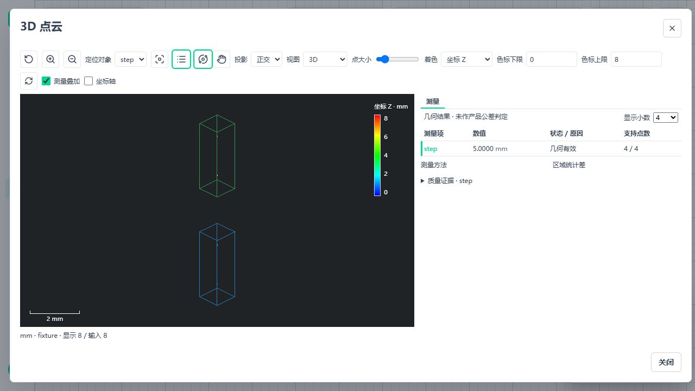
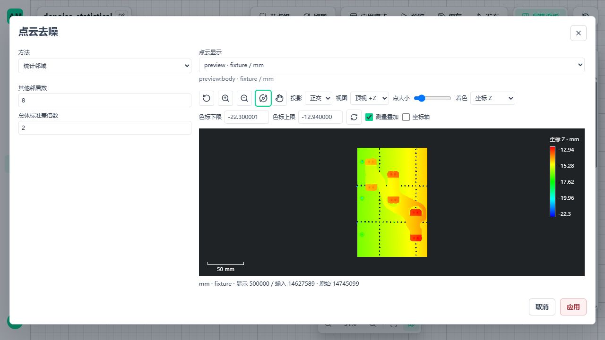

# 代表页面、分角色资源与去噪

日期：2026-11-04。基于 `01587765` 及前序未提交修改，本轮不提交 Git、不覆盖前序变更。按 A08 → A09 → A01 一轮对照 → B01 执行；B02/B03 不冒称已实现。

## A08 代表页面

Windows 隔离 API/UI 使用 5620/5621。非工件方法使用解析几何配方，完整工件仍使用原 111 节点配方，不改工件来凑方法覆盖。

| 方法/状态 | 本次实际验证 |
| --- | --- |
| 最小面积矩形 | 解析矩形 8 × 3 mm；切换稳健剖面后必须重新提供边界来源/剖面参数，取消不改原参数 |
| 有限边段拟线 | 实际左右段选择；清空段 ID 禁止应用，不自动选最长段 |
| 有符号/绝对边距 | 原顺序 +4 mm，交换输入 -4 mm；绝对值模式保存重开为 4 mm |
| 支持域外 | 查询移出有限线段后为 `outside_support`、无数值，不保留旧 4 mm |
| 三基准面原点 | x=1、y=2、z=3，变换平移为 (-1,-2,-3)；三面模式锁定主次面交线 |
| ROI 统计高差 | mean/median/quantile 均为 5 mm、两侧各4点；非法分位概率禁止应用，方法切换清除互斥参数 |
| 单位/字段错误 | 非法 inch 配置明确拒绝；缺失 z 映射为 `WorkflowInputError` / `workflow_input_point_cloud_field_mapping_invalid`；修正后可保存发布 |

发现并修复：`query-display.ts` 在分辨 `roi-statistic` 前强制读取 `query`，导致合法统计结果无法显示。统计模式没有唯一查询线，现改为先处理统计分支，只画两侧真实支持区域，不虚构测量端点。前端回归直接读取本次后端生成的三份显示正文，同时拒绝伪造的 query_resolution。

已有资产、显示故障、语言主题和窄屏代表矩阵见前序记录，不机械重跑。当前代表方法页为中文亮色桌面；不宣称每个方法在所有语言/主题组合均人工覆盖。Ubuntu 验证算法/真实发布，不冒称 Ubuntu GUI 验证。

其他证据：[矩形](assets/metrology-method-pages/rectangle.png)、[有符号边距](assets/metrology-method-pages/edge-signed.png)、[支持域外](assets/metrology-method-pages/edge-outside.png)、[三基准面](assets/metrology-method-pages/three-planes.png)。

## A09 分角色资源

使用已有 ResourceGate、正式同机 Python 客户端、真实发布 WorkflowAppRuntime 和 LocalBufferBroker。外部调用方为独立进程，不再与 API 编排器共用 PID。每平台两次完整 14,745,099 点、176,941,188 B 数组输入；50 项结果及保存内容按既有绝对 1e-7 mm 比较，全部一致，租约/准入许可为0，客户端、worker、Broker 均停止回收。

第一次 Ubuntu 采样发现同一 PID 的墙钟换算 `create_time` 改变，导致角色被拆散。修正验收记录复用项目已有 `read_process_birth_identity`（Linux boot ID/start ticks），不新建身份或进程管理机制；出生身份与墙钟显示字段分别保存。回归覆盖 PID 复用、不完整样本和墙钟变化。

| Windows 角色 | 采样 RSS 峰值 MiB | 私有提交峰值 MiB | 线程峰值 |
| --- | ---: | ---: | ---: |
| API 与测试编排器 | 401.10 | 1623.60 | 78 |
| 测量 worker | 712.05 | 579.75 | 12 |
| Broker | 39.06 | 27.02 | 4 |
| 外部客户端第1次 | 236.01 | 81.04 | 7 |
| 外部客户端第2次 | 92.29 | 76.27 | 7 |

采样间隔0.25秒。各角色峰值不同步，不能相加作整机峰值；RSS 含共享映射，不是最低物理内存。Linux 的 private 列为已有 RSS 回退统计，不是 USS。API 角色包含测试编排器与导入依赖，不是纯净发行 API 基线。浏览器沿前序 WebGL/几何账本验收，不在此进程树中。本轮没有设置增长门禁，状态是 **observed**，不等于长期稳定性或工业认证。首次错误归属记录不作为最终角色报告。

最终报告：[Windows](assets/metrology-method-resources/roles-windows.json)、[Ubuntu](assets/metrology-method-resources/roles-linux.json)。既有精确1 GB、磁盘不足、客户端异常退出与索引容量证据不重复执行。

## A01 一轮对照

Windows 当前正式图单次诊断为 **9.844秒**，诊断开启，不能当正式十秒通过。50项、判定、保存、发布身份和资源释放正确。两半圆节点为1.722/1.935秒；局部插桩表明全量 Delaunay 分别约1.361/1.409秒，占建面主要成本。

钢片候选只比较精确全邻域计数：现有 `count_neighbors` 与分块 `query_ball_point(return_length=True)`。十二组冻结局部输入交替三轮，完整邻域计数全部一致；平均时间之和为 **0.766 → 1.504秒**，候选更慢，因此未合入生产算法。未改 Qhull、点数、拓扑、距离/质量门槛、串行调度或现有配方。无收益候选不触发六次整图刷分。

本轮正式计时没有重新执行，Ubuntu 未重跑 A01 计时；既有正式候选的十秒未通过状态保留，不阻塞 B 项。报告：[正式图诊断](assets/metrology-method-resources/compute-diagnostic-windows.json)、[拒绝的计数候选](assets/metrology-method-resources/neighbor-count-rejected.json)。

## B01 实现边界

节点包更新为 `0.1.21`，新增实际执行节点 `custom.metrology3d.denoise-cloud`，共19节点。契约仍为开发 v1，不新增资源/发布系统、不引入新依赖。

- 统计法：精确3D欧氏距离，取 K 个其他点的平均距离；保留 `mean_distance <= 全云均值 + std_ratio × 总体标准差(ddof=0)`。K 必须小于点数，不隐式缩小 K。
- 半径法：闭球内其他点数量至少 `min_neighbors`；查询点本身不计入，重复坐标的其他原始行仍各自计数。半径使用输入已确认单位。
- 参数必须显式配置，UI 不填生产阈值；切换方法清除互斥字段，取消/节点或来源切换不修改配方。
- 参数表复用现有 GeometryFields 和 MetrologyWorkspace，不另建数值输入解析；Windows真实页面完成统计5/6点、半径3/6点、零半径拒绝、方法切换必填、保存刷新重开与再次Preview。解析样本用于精确操作真值，不冒充完整工件。
- 输出 `cloud`、`removed` 是互不重叠且覆盖全部输入的只读子集；原始行号、所有属性和精度不变，保存派生资产后仍可恢复。方法追溯区分 kept/removed。
- `summary` 输出计数及实际统计阈值；这不是产品 OK/NG。统计稀疏结构可能是真实结构，平台不在读取或尺寸节点中自动去噪。
- 复用 SciPy cKDTree（eps=0、workers=1）、既有物化/预算、CloudRuntime 子集、Scope、保存读取和前端工作区。预算不足立即拒绝；原生建树前后及查询块间检查取消，强制停止仍走已有节点超时边界。
- 原工件配方未接入新节点，原50项尺寸与方法不变。当前发行包尚未重新装配本批新节点/前端；部署须同批更新源码与静态资源，并按已有发布指纹流程审核重发受影响三维应用。

## 完整样本与验证

样本 SHA256 为 `ff2b9e0ef2d6c45af02c4bf8d474cd82f77f86ad92bd371a4c0f71b1b90d116b`，输入14745099点，不采样执行去噪。下列参数仅用于本次覆盖，不作为工件推荐值或生产默认。

| 测试方法 | 保留/剔除（双平台一致） | Windows算法秒 | Ubuntu算法秒 |
| --- | --- | ---: | ---: |
| radius=0.1mm，其他邻居至少3 | 14,740,747 / 4,352 | 62.782 | 37.319 |
| K=8，std_ratio=2 | 14,627,589 / 117,510 | 19.515 | 18.285 |

每方法另外选六个原始行，分块遍历全部输入，以独立距离计算核对保留判断。小样本全部行使用独立距离矩阵真值，覆盖重复点、细线、孤点、闭边界、分块、整数属性、来源、保存恢复、取消、预算、失效引用。算法耗时不含读取，不是既有测量配方十秒指标，也不承诺全1 GB任意去噪参数的容量或节拍。

Windows真实页面另完成同一完整文件的统计去噪：K=8、std_ratio=2，保留14,627,589点，剔除117,510点；Cloud Preview显示500,000点，来源总数仍为14,745,099。实际去噪节点31.355秒，显示节点2.384秒，包含节点物化/输出且环境非独占，不与上表纯内核时间或A01正式节拍混用。该配置通过真实页面保存并发布为隔离应用的第2个发布版本；这是既有AppVersion序号，三维数据契约仍为v1。未对原工件图自动去噪。首次使用小方法环境128 MiB工作预算时，节点在物化前明确拒绝预计2,831,059,008 B请求；随后通过既有`--point-cloud-policy`入口使用已批准的4 GiB工作/1 GiB活跃数组测试配置，通过后保留预算拒绝证据，不修改业务配置。

证据：[Windows完整云](assets/metrology-method-resources/denoise-windows.json)、[Ubuntu完整云](assets/metrology-method-resources/denoise-linux.json)。Windows 受影响后端组合107项通过；去噪真实发布/算法/准入15项在两平台均通过（其中8项无关方法未选择），完整云各1项通过。后补闭球边界、失效引用及第二输出失败回收后，Windows去噪12项、Ubuntu去噪/角色/采样组合40项通过；第二分支故障释放两分支存储，父云仍可读。A08 方法与几何/角色回归 Ubuntu13项通过；最终前端统计显示、去噪及测量/尺寸编辑器组合25项通过，Vue类型检查通过。这些是分批受影响验证，不相加冒充一次冻结全量结果。

Ubuntu 为24.04 x64 WSL2，运行数据在原生 `/home/am`，源码/样本只读挂载Windows盘；本轮单独准备核定三维依赖和libusb，不修改系统Python。它是源码验收环境，不是重装/重验A12发行包。

前端生产构建通过；仍有现有大chunk警告，未提高构建警告阈值。页面启动曾误用普通Vite入口，仓库运行配置覆盖环境变量而连接5600；当时只登录和读取列表，未改配方或执行任务/部署。已停止该测试前端，改用既有`published_ui.mjs 5621 5620`并核对运行配置；后续所有编辑/发布/Preview均在隔离5620空库。原5600/5601业务服务未主动启停。

## 下一步固定顺序

1. B02：规则行间隔采样与体素重采样。先收口“保留原点”与“生成质心”的独立方法和属性规则；原点沿现有子集保存完整字段，生成点必须能保存1:N来源，不能用一个假源行号或静默平均整数/类别。沿既有 CloudRuntime/资产扩展，不另建资源系统。
2. B02 同批完成参数编辑、原云/采样云对比、来源/保存/导出、预算与取消、解析网格/旋转/单位/大整数属性、完整样本与双平台真实发布。未经验证不改当前尺寸配方的支持点。
3. B03：局部邻域法向估计及显式定向，复用 Open3D/SciPy。冻结邻域尺度、方向来源、退化/方向歧义及既有法向字段冲突规则；平面、球面、边缘、缺口、噪声独立真值验证。不得用默认Z方向掩盖退化。
4. B03 同批完成每点法向有效性、来源/单位/旋转、保存与显示，参数防错和双平台发布回收。当前只传递/旋转已有法向，不计为法向估计完成。
5. 后续 B04–B23 沿剩余清单原顺序推进；A01另有证据时优化，A04外部计量证据不伪造，A13随真正发行维护，不作为B项开工条件。

B02/B03 当前尚无公开节点、无空壳注册；上述是下一步规格收口与交付步骤，不作为已实现能力计数。

## 结束核对

本轮隔离API、Preview worker、Broker与Vite已退出，5620/5621无监听；原5600/5601继续运行，未主动启停业务进程。只保留本页引用的精简JSON与截图证据，仓库`.tmp/`已清空；WSL原生`/home/am/amvision-a08-run`及本轮`amvision-a08-env`隔离依赖环境已删除，没有修改系统Python或其他WSL发行版。未提交Git；前序未提交修改保持原有归属。
