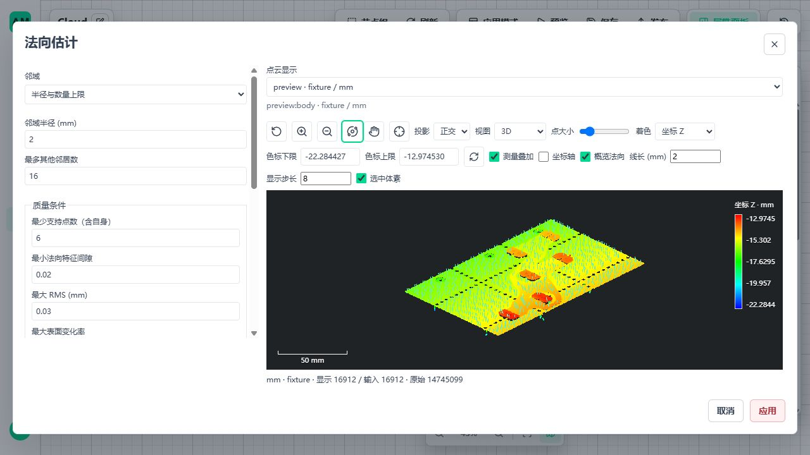
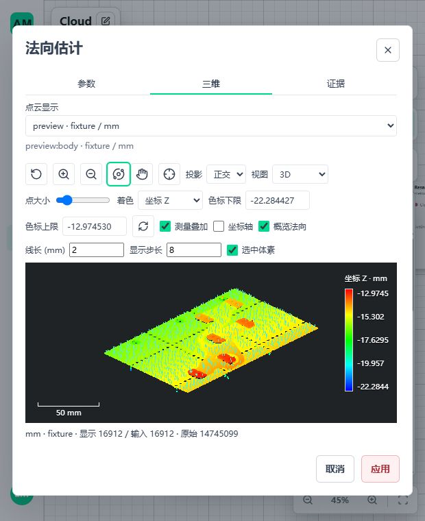

# B03 法向节点、显示与完整样本验证

## 1. 交付位置

日期：2026-11-04。基点 `436927cf`；本轮源码包 `0.1.24`，正式注册二十一个节点。B01 去噪、B02 重采样和 B03 法向估计已接通。之前的 B03 内核、字段、所有权与存读沿用，不新建资源或发布系统。

原工件仍为 111 节点、317 边、50 项测量，不自动加入三个预处理节点，不改变尺寸算法、质量门禁或三态规则。本轮没有重跑原工件十秒、S2 历史诊断或长稳测试。全部三维契约保持 v1。

## 2. 本轮实现

| 范围 | 实现及边界 |
| --- | --- |
| 正式节点 | `custom.metrology3d.estimate-normals`，输入/输出 `cloud: point-cloud-ref.v1`，另输出 `summary: value.v1`；handler 使用既有 Runtime、Scope、取消及错误分派 |
| 参数 | 复用 EstimateNormalsParameters，节点只增加 `settings` 编辑封装；没有第二份算法 DTO，也没有物理尺度/质量默认值 |
| 方法 | 精确 kNN、全半径、半径加最多邻居三种显式选择；PCA 使用 SciPy 精确空间索引和 NumPy eigh，不做近似邻居或质量回退 |
| 定向 | 无符号、显式参考方向、观测点朝向/背向；零方向、坐标不符、支持数超过容量均明确拒绝 |
| 来源 | 位置/行数/原字段不变，保留原始行号；体素、surface 和 grid-profile 生成来源保持原身份，计算法向不把生成点变成实测点 |
| 状态 | normal_valid 与 normal_oriented 分开；失败法向零占位必须伴随原因，不能读成有效单位方向；位置有效性不被修改 |
| 持久化 | 沿用 normal_info、已有字段流和资产校验；补 surface/grid-profile 存读、去噪后原始行号及 uint64 属性精度回归 |
| 前端参数 | 复用 Settings 编辑分发、MetrologyWorkspace、CloudPreviewSelector 和同一 Three 查看器；应用/取消、来源切换、晚返回、卸载保护沿既有模式 |
| 法向显示 | “概览法向”默认关闭，长度必须显式填写，步长只影响显示；定向为箭头、无符号为对称轴、无效不画；复用 CPU/GPU 账本，关闭/替换/失败/卸载释放 |

法向线段使用有界概览中的真实计算字段，**不是全部原始叶块的法向线段**；显示不重新计算法向，不改变算法邻域或测量结果。原始细节已有的逐点法向/状态拾取继续可用。全局 MST 一致传播、自动闭合曲面朝外、任意密度/半径下的全容量性能，不属于本批三个显式定向方法的声明。

## 3. 等距邻域计算优化

完整原云发现大量等距截断邻域。原实现正确取得完整壳层、稳定选取后，对每个这样的点独立调用 PCA，重复的小数组与特征分解调用成本较高。

修正仍逐行取得完整壳层并按距离/稳定身份选择，只将选定邻居写回块内数组，与其他同长度支持集一并 PCA。没有减少邻居、跳过不利点、改变协方差顺序、并行、加队列或改变质量条件。

- 新回归比较稠密等距数据的单行/批量结果，kNN/hybrid 的全部字段逐位一致。
- Windows 完整样本优化前后点数据文件均为 634,039,260 字节，SHA-256 均为 `82449186986ba0aebd8665b1b4cca484ca5aa449b904765edb4ac2cd9af51219`。
- 原始行号文件均为 58,980,396 字节，SHA-256 均为 `f2125459531003cbdaea04457e3154e48d670ba3e0c661aba936484ec7bca895`。
- 非独占环境的内核计算段：Windows 229.277 → 110.464 秒；最终 WSL Ubuntu 89.896 秒。各为单次诊断，不是稳定性能承诺，更不是原工件十秒门禁通过。

## 4. 完整点云与正式发布

输入为已有完整 ASCII PLY：14,745,099 点、479,677,235 字节，SHA-256 `ff2b9e0ef2d6c45af02c4bf8d474cd82f77f86ad92bd371a4c0f71b1b90d116b`。全部 float32 XYZ 参与原云方法，不用显示抽样或体素替代此验证。

### 4.1 完整原云 kNN

测试配方显式值：其他邻居 16、支持距离 unrestricted、最少支持点 6、normal_gap ≥ 0.02、RMS ≤ 0.03 mm、surface_variation ≤ 0.1；+Z 定向、最小绝对对齐余弦 0.1，diagnostics=true。这些是工程验证值，不宣称行业通用质量标准。

| 指标 | Windows | WSL Ubuntu 24.04 |
| --- | --- | --- |
| 输入数 | 14,745,099 | 14,745,099 |
| 有效无符号法向 | 14,698,999 | 14,698,999 |
| 成功定向 | 14,696,432 | 14,696,432 |
| 质量不满足 | 46,100 | 46,100 |
| 方向歧义 | 2,567 | 2,567 |
| 独立检查 | 固定五行全云穷举邻域 + SVD；全量保存重读/字段与来源检查 | 相同检查通过 |
| 正式发布 | 完整原云 AppVersion → 独立 worker → invoke → 显示响应 → 回收/停止通过 | 相同正式准入与路径通过 |

原云完整回归总时间 Windows 488.92 秒、WSL 362.05 秒，包含读取、保存、重读及独立全云对照，不能作为节点计算耗时。正式原云发布调用沿现有 180 秒节点/请求时限通过，没有提高超时或使用测试替代节点。

**容量区别：** 原云法向测试显式使用工作预算 8 GiB、活跃数组 2 GiB。原本机工程配置仍为工作预算 4 GiB、活跃数组 1 GiB，没有自动扩容；不足时拒绝。上述预算不是整个进程 RSS 硬上限，也不是最低机器内存认证。原工件数值配方没有因此增加内存或计算。

### 4.2 B02 → B03 组合

完整输入经显式 1 mm 体素质心产生 16,912 点，再分别执行三个 B03 方法。两平台均正式发布三个版本、停止切版、调用并回收；生成身份保持 voxel-aggregate。

| 邻域 | 有效法向 | 成功定向 | 质量失败 | 支持不足 | 方向歧义 |
| --- | --- | --- | --- | --- | --- |
| kNN 16 | 10,090 | 10,090 | 6,822 | 0 | 0 |
| radius 2 mm | 10,523 | 10,490 | 6,218 | 171 | 33 |
| hybrid 2 mm / 16 | 10,603 | 10,570 | 6,138 | 171 | 33 |

这些计数在两平台一致。这里的质心组合验证与上一节完整原云验证分列；不能把体素后的方法成本当作原始点全量成本，也不要求所有点法向有效后才能成功返回带质量状态的点云。

## 5. 页面与回归

Windows 隔离后端 5620 / 前端 5621，未操作现有 5600/5601 业务服务。真实完整资产接入重采样/法向，完成参数打开、零方向禁用、取消不改值、Preview、预览来源选择、2 mm 显示长度/步长 8、箭头开关、缩放、窄屏单视口切换和发布 v4/切版/同步成功/停止。发布页使用既有调用回执，三维交互在节点同屏工作区验证，不改平台应用页布局。





| 验证 | 本轮结果 |
| --- | --- |
| Windows 受影响 Python 组合 | 504 项通过，覆盖三维契约、Runtime、来源/存读、预算、取消、正式注册和发布 |
| WSL 最终定向组合 | 39 项通过，包含法向真值、运行字段、生成来源、去噪接线、21 节点准入及三方法发布 |
| 双平台完整样本 | 原云完整回归各 1 项通过；另完成原云和三种 B02→B03 的正式发布调用 |
| 可导入示例 | 两平台正式准入及运行通过；首次校验发现示例缺必填 `unit: null`，补齐后仅重验受影响 kNN，均通过；没有修改解析器以容忍坏参数 |
| 前端 6 组 | 39 项通过、1 项既有条件跳过，包含参数防错、生命周期、法向资源及 B02 组合 |
| 静态前端 | Vue 类型检查、Vite 生产构建通过；仍有既有 >500 kB chunk 提示，未提高警告门槛 |

WSL 数据/锁/资源位于 Ubuntu 原生 `/home`，只读输入可来自 Windows 盘；不宣称 Ubuntu 桌面 GUI 验收。运行中强杀、客户端异常及整个协议故障矩阵复用既有平台证据，本轮新增法向取消/释放回归及正常停止/切版，不冒称重做全部故障或长期稳定性认证。

## 6. 使用与复现

可导入示例：[图](../examples/workflows/metrology3d_normals.template.json)、[应用](../examples/workflows/metrology3d_normals.application.json)。两文件放在同一目录，沿现有图/应用导入入口使用，输入绑定 `cloud` 接已上传的文件引用；不包含本机路径或固定资源 ID。示例的 ASCII PLY float32 XYZ/mm/fixture、16 邻居及质量值是上述工程样本定义，不是自动套用到任意外部文件的默认；其他字段/精度须在 Read Cloud 映射中显式保留。应用模式使用现有 preview display，summary 提供全量计数。

完整原云示例要求显式满足上一节测试容量，原配置不足不能绕过准入。可以显式裁剪或重采样后估计，但必须承认输入支持改变，不自动代替原云算法。保存仍接现有 Save Cloud，交换格式字段规则与平台资产来源能力不混同。

```powershell
conda activate amvision
python -m pytest -q tests/test_metrology3d_normal_estimation.py tests/test_metrology3d_normal_runtime.py tests/integration/metrology3d/test_normals_published.py
python -m pytest -q tests/integration/metrology3d/test_normals_full_sample.py --cloud-sample <完整PLY路径>
python -m tests.integration.metrology3d.normal_acceptance --root .tmp/b03-original --sample <完整PLY路径> --original
```

去掉 `--original` 为三个 B02→B03 方法的真实发布对照；仅在需要页面验证时增加 `--serve 5620`。测试根必须不存在，停止标记沿既有隔离服务工具；所有临时输入副本、资产、数据库、环境在验证完成、进程退出后清理，不长期保留 `.tmp`。

## 7. 剩余清单与下一步

| 项目 | 真实剩余，不重新开已完成项 |
| --- | --- |
| B01–B03 | 本批明确的方法与公开链路已交付；完整1 GB任意邻域性能、全局法向一致传播未声明支持；新源码随下一发行装配 |
| B05 | 下一项：复用现有 SE(3)/pose，增加可编排组合/求逆、frame/单位/顺序检查、输入失效传播、来源和前端方向预览；先独立矩阵真值，再发布链路 |
| B04 | B05 后实现参考资源与显式配准方法，验覆盖/残差/多解/遮挡；不得把 Build Frame 当自动定位，不沿用上一件姿态 |
| B06–B23 | 依既定功能组继续：标定输入/高度图 → 边缘/几何/关系 → 正式形位/缺陷 → 面积体积/参考比较/报告SPC；具体差距见统一清单 |
| A01 | 正式工件十秒仍待达标，本轮法向优化不能替代；不阻塞后续功能 |
| A04 | 缺独立实物参考和重复扫描，只限制实体认证，不虚构精度 |
| A09 | 已有1 GB链路和索引不重新列待开发；全容量逐角色峰值、最低RAM及长期增长认证仍单列 |
| A13 | 当前 0.1.24 源码与静态前端通过受影响组合；历史 A12 包不自动包含新增三节点，下一交付须重新 assemble-release 并验受影响链路，不重开 A10/A12 架构 |

总表见[完成范围与剩余清单](3d-metrology-remaining.md)。不修改原始样本、业务配置、旧资产、已生成发行目录或生产摆盘机协议。

收尾已确认隔离 runtime 正常停止，5620/5621 服务退出、端口释放，测试页关闭；仓库 `.tmp` 内本轮缓存/报告/数据库/点云副本全部清理，WSL 本轮原生测试目录和隔离依赖环境删除。业务 5600/5601、原始样本和既有系统环境保留。静态检查通过；未自动提交 Git。
