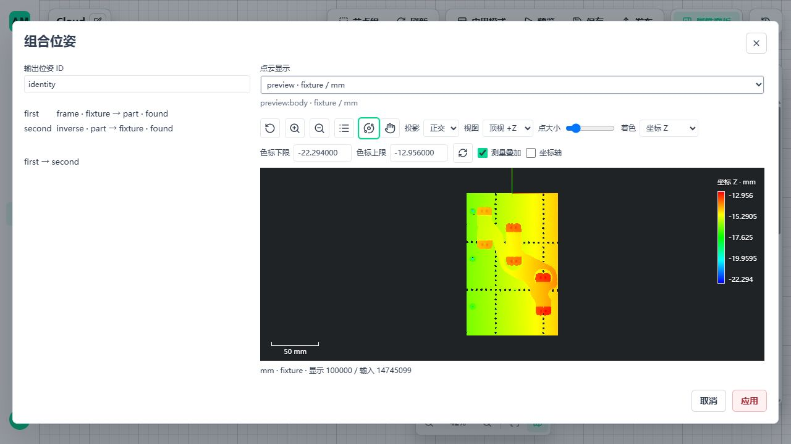
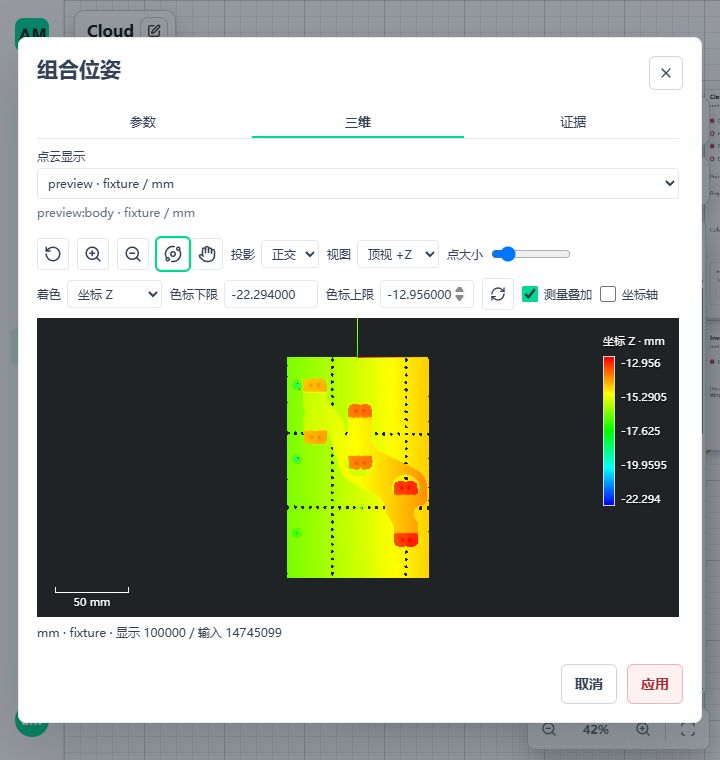
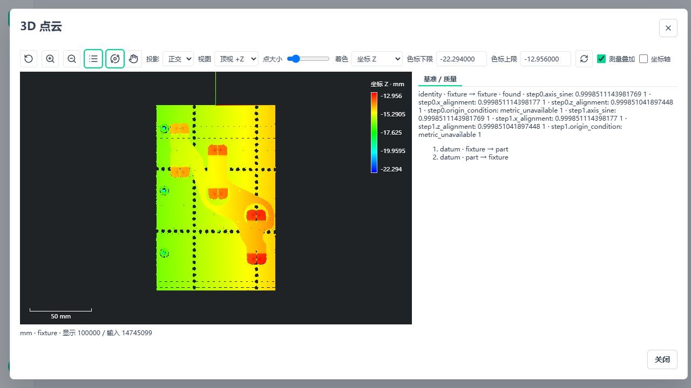

# B05 位姿组合、求逆与完整样本验证

日期：2026-11-04。基点 `436927cf`，工作区同时包含前批 B03；本批不提交 Git。节点包 `0.1.25`，共 23 个公开节点。当前工件原 111 节点、317 条边、50 项测量配方未修改；新增能力不是新的工件验收条件。

2026-11-05 后续：B04 已接通显式初值局部配准，当前包 `0.1.26`、24 节点，见[配准记录](3d-metrology-registration.md)。B05 根证据同时支持基准构建与双输入配准，质量容量按实际指标数量检查；本页以下保留 B05 当批结果，不将历史“B04 待实现”当作当前整项未实现。

## 1. 本批实现

| 范围 | 实现及边界 |
| --- | --- |
| Invert Pose | `custom.metrology3d.invert-pose`；输入 `pose3d.v1`，输出 pose/found；复用刚体旋转转置与平移反解，不采用伪逆、不自动修正非法矩阵 |
| Compose Poses | `custom.metrology3d.compose-pose`；输入 first/second，明确先 first 后 second，列向量矩阵为 `second @ first`；不自动交换 |
| 参数 | 只有必填 `settings.pose_id`；源/目标 frame、单位、观测与 Run 来自实际输入，不提供互相矛盾的手填副本 |
| 身份与失败 | 同 Run、observation、单位，且 first.target 等于 second.source；错线、过期支持或篡改证据为输入错误；上游几何失败传播原状态和 reason，不复用旧矩阵 |
| 同坐标系 | 仅允许实际恒等运算回到相同 frame；非恒等矩阵不能将源/目标命名为同一坐标系 |
| 所有权 | pose 只持有当前 Scope 只读支持；组合与求逆不分配点云数组、不创建新 owner。各根支持仍在自己的源坐标系，不随求逆改写 |
| 原始字段 | 实际点云计算继续由 Transform Cloud 执行；位置、法向的变换规则及整数/浮点属性精度、原始 source_indices/source_point_count 不变 |

契约实现位于 `backend/contracts/workflows/pose3d_operations.py`，共享运行实现位于节点包 `shared/pose_operations.py`。公开 handler 只负责现有参数/端口分发，没有第二套矩阵、发布或资源系统。

## 2. 来源、质量与持久读取

1. 原 Build Frame 位姿保持原方法和质量规则。组合/求逆明确采用不同的方法标识，不伪装为再次拟合。
2. 派生证据展开为有序根位姿快照及每步 inverse 标记，求逆时反转次序并翻转方向。根快照包含稳定 ID、frame、单位、基准方法、原指标与原质量规则；不递归复制整个运算树。
3. 组合只给质量项加 `stepN.` 前缀，不改变限值、required、valid、passed。来源最多 2048 步，来自既有 8192 项质量表的四指标容量，不是生产阈值。
4. 读取时重新验证根方法摘要、质量、方向链及矩阵；运行时再验证 Scope 支持与根特征摘要。持久证据不包含历史运行资源访问权限。
5. Transform Cloud 的持久来源联合类型、点云资产读取、查询证据、三维 frame 显示和前端摘要同批接通。仍使用三维 v1，不增加旧格式兼容分支。
6. Payload Schema 采用项目既有标准 JSON Schema `$defs/$ref` 表达；参数表单仍使用原内联 schema。生成 Catalog 约 1.43 MB，避免将重复来源内联膨胀到数十 MB；嵌套矩阵的类型拒绝有独立 JSON Schema 回归，不以压缩为由丢字段。

固定 U/V 查询允许使用派生坐标，但动态等高来源仍要求真实 Build Frame 的物理主基准。二者不能混同：坐标运算不产生新的基准平面、拟合支持或几何质量。派生位姿误接动态等高时，后端明确拒绝，前端不将其列为可用物理基准。

## 3. 页面与使用

- 两节点沿现有 `settings` 编辑分发打开工作区；左侧只编辑输出 ID，并列出连接节点及成功 Preview 的源/目标 frame；组合顺序固定可见。
- 未运行时只显示配置身份，不编造实际 frame。非法 ID、已知坐标错线禁止应用；任务、输入、禁用状态切换关闭旧编辑；新 Preview 清除旧显示选择。
- 右侧复用 Cloud Preview Selector / CloudViewer，桌面同屏、窄屏沿既有参数/三维/证据页签；不复制 I2 调试几何或引入新查看器。
- [可导入模板](../examples/workflows/metrology3d_pose_ops.template.json)和[应用](../examples/workflows/metrology3d_pose_ops.application.json)使用本次文件输入，复用当前工件五窗台面基准，演示正向、求逆、组合恒等及恢复显示。该实例只适用于当前样本坐标与工程参数，不是通用客户默认值；正式 50 项工件配方保持独立。

## 4. 实际验证

| 验证 | 结果及覆盖 |
| --- | --- |
| Windows 组合 | 77 项通过：位姿独立真值、非交换顺序、求逆、恒等、非法矩阵、错观测/单位/Run、失效支持、取消、存读、原始字段/行号、斜面固定 U/V、动态等高拒绝、原几何/法向与真实发布 |
| WSL Ubuntu 组合 | 同一组合 77 项通过；运行数据和 pytest 临时目录位于 Ubuntu 原生文件系统，源码与样本可读 Windows 挂载盘 |
| 交付 JSON 与目录 | Windows / WSL 各补充 4 项通过：交付模板/应用真实发布准入、正式 Catalog 与生成器一致、缺依赖不可执行、缺接线不能发布；与上述 77 项没有重叠 |
| 前端 | 位姿编辑、法向编辑、动态等高编辑、查看器生命周期最终组合 30 项通过，1 项既有条件跳过；早期子集不重复相加 |
| 静态检查 | 变更 Python Ruff 通过；Vue 类型检查与 Vite 生产构建通过。仍有现有大 chunk 提示，未调大阈值消除警告 |
| 完整实测云 | Windows 和 WSL 均处理 14,745,099 点；逐行恢复核对、source_indices 不变、保存读取、正式 AppVersion → 独立 runtime → invoke → 显示 → 停止/回收 |
| 数值误差 | 双平台最大 float32 正逆写回差均为 `7.62939453125e-06 mm`；这是两次写回舍入，不是物理计量精度 |
| 发布图诊断 | Windows 2.639 秒，WSL 1.717 秒，均为本批十节点位姿演示的单次调用；不是原 111 节点工件图十秒验收 |
| Windows 真实页面 | 完整云 Preview、非法 ID 禁止应用、求逆/组合来源、720px 窄屏、参数保存重开、修改输出 ID 后发布新版本、切版启动和同步调用；应用模式显示本次组合来源与根质量，随后停止成功；Ubuntu 不冒称 GUI 验收 |

源文件 `1-1_0.ply`：479,677,235 字节，SHA-256 `ff2b9e0ef2d6c45af02c4bf8d474cd82f77f86ad92bd371a4c0f71b1b90d116b`。显示为 100,000 点有界概览，算法与逐行验证为完整输入，不用概览点替代测量支持。

环境：Windows 使用既有 amvision conda 环境；Ubuntu 使用隔离 Python 3.12 环境及锁定依赖。Ubuntu 缺失的 Open3D 系统库 libusb 由官方 deb 解压到本轮隔离目录并显式设置加载路径，未安装到系统。此测试补齐不能替代离线发行的系统依赖说明。正式发布仍由 assemble-release 装配同目录 Python，不依赖本机 Conda 隐式状态。

本轮清理已完成：隔离 Runtime 显示 stopped/stopped，5620 API 正常退出，5621 Vite 停止；Windows 进程及监听检查无本轮残留，WSL 无测试进程。本轮 `.tmp` 测试/资产/缓存与 Ubuntu 隔离依赖和运行数据已删除，仓库 `.tmp` 为空。已有 5600/5601 业务进程与数据未修改；仅保留文档截图和交付 JSON。原始点云未删除。`git diff --check` 与 Python Ruff 通过。

## 5. 下一步固定范围

下一项是 B04 自动定位/配准，不重复 B05：

1. 核对现有参考资产、Open3D 配准及法向字段，收口移动云/参考云的身份、参考 frame、初始化来源和允许自由度。参考云的历史 observation 不能被误当成本次 pose 支持；需按当前加载 Scope 建立明确来源。
2. 在已有位姿契约增加明确的配准方法证据，复用 B05 方向链、Transform Cloud、存读与显示。先定初始化、对应距离、迭代/停止、覆盖/残差和退化条件，再实现实际算法，不把固定基准当自动定位。
3. 优先验证有显式初值的局部配准；粗定位作为独立主动选择，不自动回退、不从上一件取 pose。质量参数由配方显式给定，不以当前单个平面样本猜通用生产阈值。
4. 使用已知 SE(3) 独立真值、平移/旋转、非重叠、遮挡、对称多解、退化和坏法向，验证失败不返回可用矩阵；支持/预算/取消沿现有 Runtime。
5. 完整样本做显式变换对照，接保存读取、双平台发布与页面来源/质量展示。合成姿态真值不冒称实体精度认证。

| 剩余项 | 当前边界 |
| --- | --- |
| B01–B03 / B05 | 已完成明确方法与公开链路；不再列作待开发 |
| B04 | 定位/配准仍待实现；本批不宣称支持任意来料姿态 |
| B06–B10 | 标定深度/轮廓输入、高度图、实体边与缺口、完整圆弧量值 |
| B11–B14 | 圆柱/球/圆锥、特征匹配、通用关系、圆角/曲率 |
| B15–B23 | 正式形位公差、偏差/缺陷、面积/体积、参考/CAD、报告/SPC |
| A01 | 原工件十秒门禁未通过；本轮未重复性能试验 |
| A04 | 缺独立实物参考/重复扫描，不阻塞工程使用 |
| A09 / A13 | 分角色短时资源观测不是最大容量峰值或长期认证；新增源码能力尚未重装配为新离线包，正式交付时做受影响冻结组合 |

最新总表见[剩余清单](3d-metrology-remaining.md)。不因这些独立验收继续阻塞后续 B 项。
