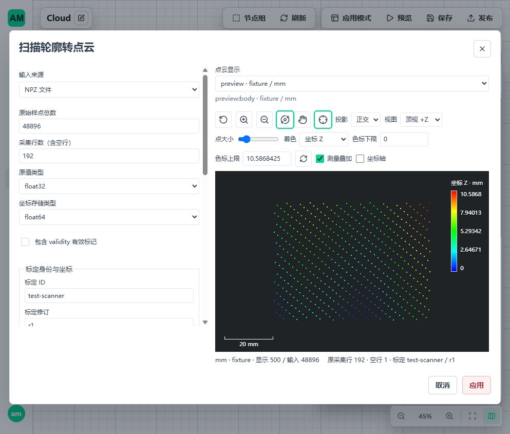
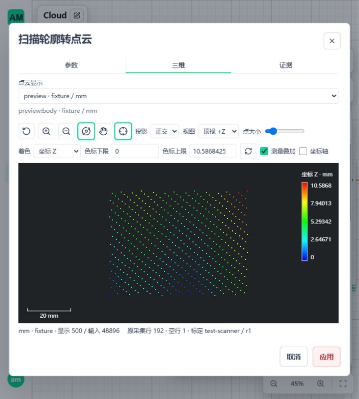
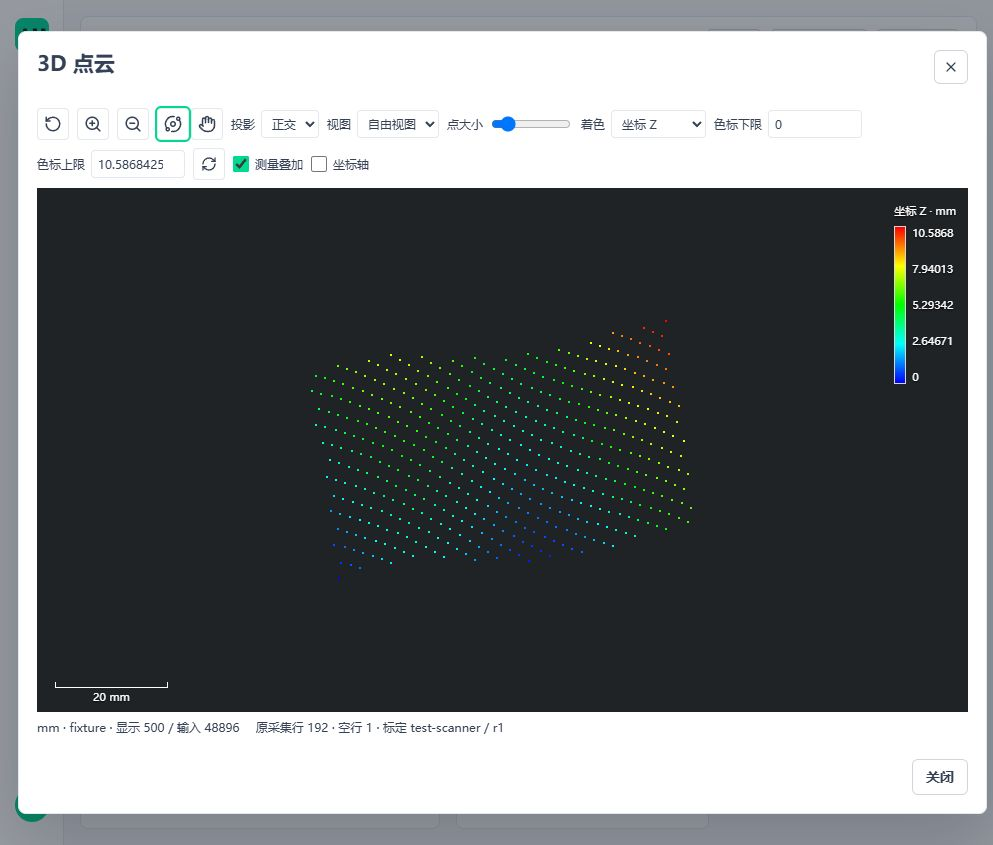

# B07 扫描轮廓输入

## 1. 范围与当前进度

2026-11-06，沿用 B06 修复后的原始观测边界。已确认采用两种显式扫描位移方法、NPZ 文件及同机二进制数组。文件标定由节点参数提供，数组标定由载荷固定。没有相机 SDK、原始激光图标定、逐行任意 SE(3)、自动识别往返、排序或补洞。

已完成输入内核、Runtime/持久资产与公开接线：Profiles to Cloud、NPZ 上传、同机 Trigger、Python/Windows .NET、参数工作区及采集身份显示。源码包为 `0.1.30`、26 节点。第二步历史验收见第 5 节；本轮公开链路、页面发现的问题和最终验证见第 6 节，计数不与历史相加。

B06 的跨代标定保留修复、合并回归及页面验证见 [B06 审计记录](3d-metrology-b06-review.md)。当前工件 111 节点、317 边和 50 项结果未接入 B07，不改变其质量条件、参数或十秒验收状态。

验证包含独立倾斜坐标真值、float32/64 原始位模式、变长/空/缺行、重复或倒向编码器、非法结构、NPZ CRC/截断/多余记录、超预算、取消、持有异常后的别名释放、真实 mmap 撤销和关闭失败的预算保留。还覆盖完整行表、多代资产、三种重采样、基准/刚体变换、真实资源 API 和公开发布输入。没有真实扫描仪 NPZ，不以完整 PLY 的共享链路回归代替扫描采集精度或最大载荷验收。

## 2. 已实现的数据契约

### 2.1 标定与参数

`CalibratedProfiles` 是严格关闭结构，不接受未知键。字段如下：

| 字段 | 含义与约束 |
| --- | --- |
| `format_id` | `amvision.calibrated-profiles.v1` |
| `point_count` / `profile_count` | 原始样点记录总数 N、实际提供的轮廓行表长度 M；均为正整数 |
| `dtype` | 轮廓内 X/高度的原始 float32 或 float64，读入不降低精度 |
| `calibration_id` / `calibration_revision` | 完整标定正文的追溯标签，不是资源访问权限 |
| `spatial` | 输出长度单位、坐标系及轴声明，必须明确单位和右手输出坐标 |
| `origin` | 扫描零位、轮廓 X=0、高度=0 对应的输出位置 |
| `x_direction` / `scan_direction` / `height_direction` | 显式单位正交方向，不自动归一化或翻转 |
| `displacement` | `fixed-step` 或 `encoder-positions`，互斥且不回退 |
| `position_dtype` | 输出位置 float32/float64；中间局部运算使用 float64 |

轮廓内坐标已经是 `spatial.length_unit` 下的物理 X/高度，不再次按灰度或扫描步距缩放。原始非有限值和可选 0/1 有效标记负责说明无效测点，不在此节点内过滤。

固定步距：显式 `origin_line_id`、正 `step`。对原采集行号 k，扫描位移为 `(k-origin_line_id)*step`。扫描正负方向由 `scan_direction` 明确给出。缺少采集行不会把间隔压缩成数组行序号；空轮廓也不补点。

编码器：显式原位置 `dtype`、正 `scale`、零位 `origin`。扫描位移为 `(encoder_position-origin)*scale`。逐行位置可不均匀、倒向或相同，原顺序和数值均保留，不推测往返采集规则。非有限编码器位置使该行已有样点无效，不生成位置。

共同坐标式为 `P = origin + X*x_direction + displacement*scan_direction + H*height_direction`。零高度/负高度合法；有限输入的坐标计算或目标 dtype 溢出是输入错误，不能静默转成无效值。

### 2.2 文件成员与二进制布局

| 顺序/成员 | 形状与类型 | 完整性要求 |
| --- | --- | --- |
| `profiles` | N×2，声明的 float32/float64 | 列序为已标定 X、高度 |
| `line_offsets` | M+1，uint64 | 首项 0、末项 N、非递减；相等表示真实空轮廓 |
| `line_ids` | M，uint64 | 原采集行号严格递增且不超过现有公开整数上限 2^53−1；缺号保留 |
| `encoder_positions` | M，声明的 float32/float64 | 仅编码器方法存在；固定步距输入不接受此多余字段 |
| `validity` | N，uint8 | 按 `has_validity` 显式存在；只允许 0/1 |

NPZ 成员名为上述名称加 `.npy`，不允许重复、未知、缺失成员、对象数组或隐含标定文件。复用 Python ZIP 和 NumPy NPY 1.0/2.0，支持 stored/deflate、C/F 顺序和无损字节序规范化；不自写格式解析器。预检成员类型、形状和精确正文长度，实际读取核对 CRC。头部、中央目录、解码和规范化副本均先按现有预算准入；按块检查取消。

同机 `amvision.profile-buffer.v1` 描述包含 `profiles` 标定、`has_validity`、精确 `content_length`。数组按表中顺序连续 little-endian 拼接，无 padding；总长度包含行表、编码器和有效标记，不能只计算轮廓点数组。提交的文件或同机二进制载荷仍不超过 1,000,000,000 字节。NPZ 解压后数组按显式解码/工作/活跃数组预算另行准入，不把文件 1 GB 限额当作运行内存上限。

### 2.3 点记录与失败规则

最初 `source_indices` 为 0..N−1；过滤后保留最初记录编号，`source_point_count=N`，不以 M 或最大行号替代。转换不产生估计点。每个输出保留 `raw_profile_x`、`raw_profile_height`、`acquisition_line_id`、`profile_sample_index`，后者是在原始单行内的从零样点编号。编码器模式另保留 `raw_encoder_position`，有有效标记时另保留 `input_mask`。

状态按优先级互斥：`valid=0`、`non_finite_profile=1`、`non_finite_encoder=2`、`masked=3`。无效点位置为 NaN、validity=0，原值与身份不删除；后续已有 Filter Valid 显式筛除。摘要来自同次转换计数，不再次扫描整云。

缺字段、错类型、倒置行偏移、重复/倒序采集行号、声明长度错误、非法掩码、超预算和有限数溢出是输入错误。取消保留原异常，不能被标准 ZIP 的 OSError 处理误报为坏文件。此处不是产品 OK/NG/INVALID 公差判定。

## 3. 已实现的所有权与保存

文件借用在退出时清空数组映射并归还预算；同机借用复用现有 reader guard，不持有释放调用方租约的权力。转换输出和完整原始行表分别交给已有 OwnedCloudArrays / ResourceScope，输入释放后输出仍可用。同机 guard 正常退出后才公开运行引用；退出失败时释放转换输出、不留下已发布记录。无法确认输入映射关闭时，沿既有输入适配器保守保留该输入的预算记账，不能虚报全部容量已归还。

### 3.1 原始观测和行表

`ProfileSource.kind=calibrated-profiles` 保留完整 `profiles` 标定、`input_format`、输入长度/摘要、文件名、`has_validity` 及 `row_table_sha256`。运行来源可带已校验文件引用；持久来源剔除运行文件定位，不保存 lease 或进程路径。

行表固定为 little-endian 的 `line_offsets`、`line_ids`、可选 `encoder_positions` 连续块，没有 padding；摘要覆盖完整块，包括空行编码器的非有限原值位模式。点数组不能反推空轮廓，因此首次转换复制并持有完整行表；派生引用沿可信父链借用同一 owner，不另建资源注册表、不每次复制。恢复资产时按当前持久来源重新建立该 owner。

点输出与行表合计进入解码预算及已有活跃数组预算；检查、摘要和持久流使用有界分块并检查取消。登记时核对行表首尾/单调性、原始 N/M、原始记录编号、行内样点编号、逐行编码器原值及有效状态。生成点保留既有生成来源，不伪造唯一原始记录；刚体变换后的 XYZ 属于当前 frame，原标定仍描述采集坐标，不覆盖为当前 frame。

### 3.2 资产、读取和搬运

| 路径 | 保存内容 | 读取与所有权 |
| --- | --- | --- |
| NPZ 原件 | `profiles-original`，原始文件逐字节保存；来源带原标定和行表摘要 | 复用同一严格 NPZ 读取/转换，核对原件与行表摘要后登记 |
| 同机数组、源点子集或派生云 | 既有数组块、可选索引/生成来源块，另含 `profile-rows.bin` | 读取全部字段和原行表，联合预算准入；沿现有 Scope 释放 |
| 三种重采样、多代再次保存 | 原始 N/M、完整原行表、原标定、既有子集或生成来源 | 步进/代表点保留原记录；质心只保留其真实聚合来源，不恢复虚假的采集属性 |
| 资源 ZIP / A10 配方包 | manifest 和最多三个声明块；按确切白名单、长度、摘要和行表结构校验 | 复用现有依赖闭包、项目授权、引用映射与失败回滚；空环境导入已验证 |

行表不内嵌 JSON。所有三维契约仍为 v1；B07 来源分支在本轮首次公开，不迁移或删除业务数据，不增加旧格式读取分支。已有非轮廓资产不增加行表。Read Cloud / Save Cloud 沿既有节点实现工作，无第二套保存系统。

## 4. 固定接线与验证顺序

| 顺序 | 工作 | 验证出口 |
| --- | --- | --- |
| 1，已实现 | 严格契约、双方法内核、NPZ 和 mmap 格式适配 | 独立倾斜真值、空/缺行、编码器倒向及重复位置、dtype、取消、结构拒绝、预算和租约回收 |
| 2，已实现 | Runtime 原始行表所有权和资源保存读取 | 文件/数组、原件/派生、多代保存、过滤/变换/质心、空行、来源篡改和空环境资源包；真实 API 导入及独立发布读取通过 |
| 3，已实现 | `Profiles to Cloud` handler/Catalog；Trigger/Python/.NET | 文件/数组显式互斥、固定描述摘要、真实 PREPARE/调用、客户端退出、停止切版和回收 |
| 4，已实现 | 复用参数工作区、CloudViewer 和输入面板 | 标定来源不可混写；参数防错、取消/卸载、原行/样点拾取和空行摘要 |
| 5，已验证 | 同一候选双平台正式发布 | Windows 页面及发布、WSL 原生存储/独立 Runtime；具体覆盖见第 6 节 |
| 6，下一项 | B08 高度图 | 独立收口投影网格、聚合、空格、多层冲突及来源；不重写 B06 |

当前完整 PLY 可用于确认已有下游功能不受影响，但不是带采集行表的实扫轮廓。NPZ 解析真值不证明实体采集标定精度。十秒节拍、实体精度及最新离线装配仍按 [唯一剩余清单](3d-metrology-remaining.md) 独立记录，不阻塞上述接线。

## 5. 第二步验证与审计（2026-11-05）

### 5.1 修复与风险边界

| 已核实问题 | 修复与回归 |
| --- | --- |
| 行表新增第三个块后，旧 ZIP 成员数上限拒绝合法资产 | 上限改为 manifest 加最多三个块；精确声明白名单仍有效，未开放任意附加文件；A10 空环境导入通过 |
| 转换完成后来源校验/输入关闭失败可能留下输出 | 发布引用前退出输入 guard；异常同时释放点与行表，保留异常对象时检查弱引用释放；关闭失败不虚报输入预算归还 |
| 首次转换与资产恢复的预算口径可能不一致 | 点字段与行表使用联合解码预算，原行表一次持有，分块工作预算不暗中扩大 |
| 保存取消被通用 OSError 包装成持久化故障 | 保留 InterruptedError；实际存储 OSError 继续映射持久化错误；取消/失败后无半成品资源 |
| 真实节点包重载后，B06 组合测试仍修改旧函数别名 | 测试改为针对当前被调用模块；生产加载器不增加测试分支，原组合重新验证 |

### 5.2 最终组合

| 范围 | Windows | WSL Ubuntu 原生文件系统 |
| --- | --- | --- |
| 轮廓输入/Runtime、共享资产/资源 API/A10、B06 Runtime、变换/重采样/启用边界及真实发布组合 | 269 通过，147.10 秒 | 268 通过、1 跳过，90.35 秒；跳过为既有 Windows net472 |
| 完整 PLY 的既有真实发布生命周期 | 1 通过，60.83 秒 | 1 通过，58.74 秒 |

计数不与此前 73/309 项相加。Windows 使用项目 conda 环境；Ubuntu 使用本轮隔离 Python 3.12 和原生目录，受控三维依赖与当前节点包一致。Windows 初次受限进程环境无法建立 asyncio 本机 socketpair，诊断后仅停止对应测试进程，允许本机通信后重跑原组合通过；没有修改生产事件循环或跳过 API 验证。

专项入口为 `tests/test_metrology3d_profile_{conversion,buffer,io,runtime}.py`，公开资产链路为 `tests/integration/metrology3d/test_profile_assets_published.py`。最终组合还包含资产/资源、A10 文件包及 API、B06 Runtime/发布、三维 Runtime/变换/重采样/启用边界；不能只重跑专项后声称整个组合通过。双平台冻结源码快照共 6,182 个文件，Ubuntu 摘要差异为零；验收后仅更新进度文档。Ruff 与 `git diff --check` 通过。

轮廓专项包含 float32/64 文件/数组、原件/派生、多代存读；空/缺行、空行 NaN 编码器位模式；三种重采样与 A10 闭包；独立平面/基准/刚体变换真值；取消、预算、来源篡改、错误项目、资源回滚和借用期间关闭保护。真实资源 API 将轮廓资产导入空项目，再由真实 AppVersion 的独立 worker 使用既有 Read Cloud / Filter Valid / Preview / Save Cloud，连续三代切换保存，原始 N、记录编号和行表摘要不变，许可和租约归零。此项不是尚未接线的原始轮廓 PREPARE 或 Profiles to Cloud 节点验收。

完整 PLY 保持 14,745,099 点、479,677,235 字节，文件 SHA-256 为 `ff2b9e0ef2d6c45af02c4bf8d474cd82f77f86ad92bd371a4c0f71b1b90d116b`，XYZ 摘要为 `956927f058ba4a0170b1c1b93b1411b613fbe21fcbfc278ad0a7fc3cf621a1c6`。正式版本/Trigger 调用、活动期间拒绝切版、停止后旧代拒绝、重启、写入者/调用方异常退出及回收通过。Windows 覆盖 .NET，Ubuntu 覆盖既有 Python 客户端。以上秒数是测试总耗时，不是原工件 50 项检测节拍；本批没有重跑 P99、十秒或长稳测试。

结束时确认本轮测试进程和隔离监听端口退出，清理 Windows `.tmp/` 内本轮缓存/快照，以及 Ubuntu 原生目录中的隔离源码、依赖和输出；Ubuntu 恢复开工前停止状态。既有 5600/5601 业务环境、其他 WSL 发行版、原始样本和业务资产未清理。本批未启动浏览器页面验收或重做前端，相关工作仍在下一步。

### 5.3 当时的下一步（第 6 节已完成）

先将已验证的 `read_profile_reference/read_profile_local` 接到正式 Profiles to Cloud handler，不再实现投影或保存副本；然后扩展既有 Trigger 描述准入、Python 工具和 Windows .NET，将完整行表布局纳入准备请求与调用。节点参数按文件/同机数组模式约束标定来源。随后复用参数工作区、输入面板和 CloudViewer 呈现原采集行号/样点及空行摘要，补齐真实页面、保存重开、公开发布、停止切版和异常回收。完成该公开链路后继续 B08，不以缺少实采 NPZ 或实体认证反复阻塞代码交付，但保留其验证边界。

## 6. 公开链路与页面验收（2026-11-06）

### 6.1 本轮交付

| 边界 | 实现 |
| --- | --- |
| 公开节点 | `custom.metrology3d.profiles-to-cloud`，NPZ 文件与 `calibrated-profiles.v1` 输入显式互斥；输出 cloud 和同次转换摘要。复用既有转换和 Runtime，不重复投影 |
| 同机输入 | `amvision.workflow-trigger-profile-prepare.v1` 固定完整描述与 binding；平台生成 `amvision.workflow-trigger-profile-input.v1`，正文、长度、摘要和本次私有 handoff 共同校验；REQUEST 不能覆盖标定 |
| 客户端 | Python `invoke_profiles` 及 CLI `--input-kind profiles`；Windows .NET `InvokeCalibratedProfiles` 的 byte[]/原位写入重载。复用既有 CLAIM/PREPARE/ACK、租约与异常回收 |
| 文件与资源 | 既有上传、Read Cloud / Save Cloud、资源 ZIP 和发布读取承接完整原行表。没有新增上传服务、资源注册表或兼容分支 |
| 参数界面 | 文件模式填写完整标定；同机数组模式不允许节点覆盖载荷标定；复用 MetrologyWorkspace、几何字段和 CloudViewer，缺参不能应用，取消和过期草稿不写回 |
| 显示来源 | 显示原 N/M、空行数、标定身份；源点保留 uint64 原采集行与行内样点。生成点不伪造这些属性；详情索引显式声明轮廓记录，不能从同名用户字段推断 |

节点包为 `0.1.30`、26 个节点；这是包发布版本，不改变三维契约 v1。其他模型、节点分类、生产配方和平台结果协议没有在本轮改动。

### 6.2 页面发现的实际问题

约 385.8 KB 的合法 NPZ 在页面读取时被误报为“NPZ 元数据读取超过工作预算”。根因是 ZIP 中央目录检查的读取上限被继续用于 NPY 正文读取，正文块超过目录窗口时被拒绝，并非数据损坏或标定错误。

修复仅在中央目录完整校验后允许使用已经预留的 `chunk_bytes` 正文窗口；保留原来的目录、成员长度、CRC、工作预算与取消检查，不扩大生产预算。新增 stored/deflate 与小/大正文块的四种回归，25,000 个 float64 样点逐字节对照，退出后预算归零。修复后的原页面输入成功；以下最终组合均包含该修复。

预览仍执行既有显示点数与正文大小上限。隔离配方使用 500 个显示点，以适配测试策略的 65,536 字节正文限额；48,896 条输入记录仍全部转换。没有为页面验收放宽容量，测试入口已采用同一显式显示配置。

### 6.3 最终验证

| 验证 | 结果与范围 |
| --- | --- |
| Windows 后端组合 | **380 通过，277.55 秒**；轮廓与栅格契约、IO、Runtime、Trigger、资源、显示、启用边界及发布组合 |
| WSL Ubuntu 原生文件系统 | **378 通过、2 跳过，181.07 秒**；两个跳过仅为 Windows net472 轮廓/栅格客户端；Ubuntu 使用正式同机 Python 工具 |
| 前端组合 | **46 通过，9 个测试文件**；轮廓/栅格编辑与显示、输入校验、上传、应用模式；Vue 类型检查通过 |
| Windows .NET | net472 构建与契约程序通过；真实已发布运行的 byte[]、原位写入、写入者异常退出覆盖在后端组合内 |
| 静态审计 | 修改 Python 的 Ruff、差异空白检查通过；未修改算法质量条件、停止边界或原工件配方 |

后端组合使用同一 6,193 文件源码快照，Ubuntu 摘要差异为零。验收后仅更新文档和页面测试入口的显示点数，不再更改被测生产代码。计数不与第 5 节或此前结果相加。

真实发布测试覆盖两种位移方法、float32/64 文件输入、非法文件后恢复、可信标定/绑定、活动期间切版拒绝、停止/重启、写入者和客户端退出、旧代拒绝、租约及所有者回收。原始轮廓 PREPARE 与资源保存后发布读取分别验收，不互相代替。

上述组合还包含完整 **14,745,099 点** PLY 的真实发布生命周期，文件及 XYZ 摘要与第 5 节一致。这证明共享链路回归，不证明现场扫描仪的标定精度，也不是原工件 50 项十秒验收。本轮未重复运行 P99、十秒或长稳测试。

### 6.4 Windows 真实页面

使用隔离 5620/5621 环境和解析真值轮廓：48,896 样点、192 行（含一空行）、一个缺失采集行号。界面实际完成 NPZ 上传、Preview、参数方法切换防错、取消恢复、720×800 窄屏参数/三维分区、保存重开、发布、创建/启动 Runtime、应用模式上传运行、结果显示与停止。轮廓点云显示范围完整，缩放、预设视图和旋转可用；采集摘要与后台结果一致。未改系统显示缩放。

源点行号/行内样点显示经过前后端自动回归；本轮页面没有单独完成每个点的拾取验证。页面数据不是实扫 NPZ，不能以该截图声明实际扫描精度。WSL 覆盖独立 Runtime/API/Trigger，不声称运行了 Ubuntu 桌面浏览器。

结束时页面 Runtime 已停止，隔离后端、worker/Broker 和 Vite 均退出，5620/5621 无监听。本轮 Windows `.tmp/` 测试缓存、快照和隔离数据，以及 Ubuntu 原生目录的源码/依赖/输出均已清理；Ubuntu 恢复停止状态。已有 5600/5601 业务服务、其他 WSL 发行版、原始样本及业务资产不在清理范围内。

### 6.5 下一步与保留项

| 固定顺序 | 下一步工作 | 验证出口 |
| --- | --- | --- |
| B08.1 | 在现有点云/位姿契约上明确投影坐标、网格原点/方向/步距/范围、单位、单元聚合、空格和多层冲突；不把显示网格当计量数据 | 独立倾斜平面、边界点、多个高度层、空格的逐格真值；会改变测量定义的选择先确认 |
| B08.2 | 复用 CloudRuntime、预算和 NumPy，按块构建有界高度图及支持来源；不自动补洞，不新增存储系统 | 源点/生成点来源、dtype、超预算、取消、失败释放与独立真值 |
| B08.3 | 复用资源保存/读取及参数工作区接公开节点、二维高度显示和三维联动 | 保存重开、字段/坐标一致、错误输入和生命周期测试 |
| B08.4 | 同一候选在 Windows/WSL 原生存储上发布调用，真实页面上传、执行、停止，更新进度并清理 | 真实发布与独立客户端；完整云回归，不以局部测试代替公开链路 |

实采 NPZ、外部标定/实体参考、B06/B07 新载荷的最大容量和分角色资源峰值、最新完整离线包仍需分别验证；它们不阻塞 B08。台面内自动粗搜索、B09–B23、十秒节拍和最终组合的状态继续以 [剩余清单](3d-metrology-remaining.md) 为准。
