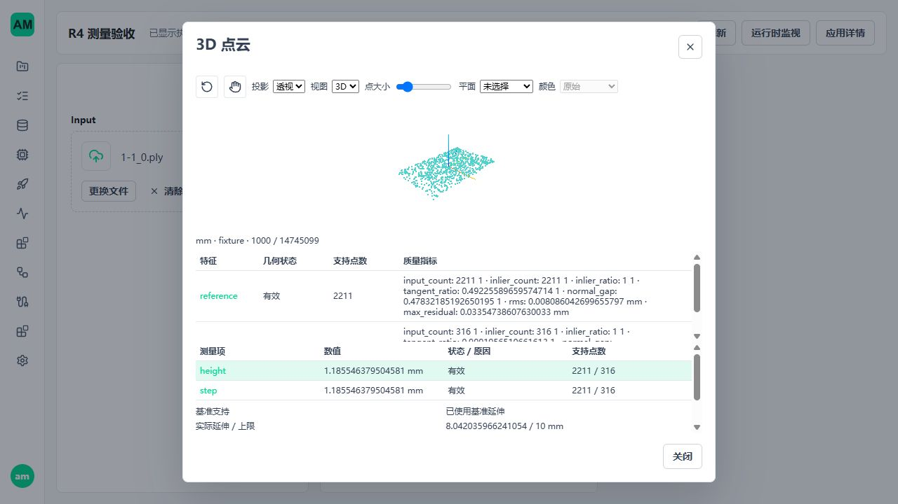

# 3D Metrology R4 基准有限延伸

更新：2026-10-25。实施基点 `57070088`，内部包 `0.1.11`。本批不增加节点或资源系统；扩展既有 height-query、measure-step、Preview 和 Vue 查看器。生产节点仍隐藏，超时、容量、节拍和发行参数仍待确认。

## 当前契约

开发阶段全部三维契约统一 v1：point-cloud-ref、point-cloud-asset、features3d、geometry-preview、point-cloud-preview、measurement-evidence3d 及其方法。资源内容合并到 measurement-resource.v1；二维内容序列化不增加 point_cloud=null，保持既有摘要。NumericTable、Workflow、发布、Trigger/LocalBuffer 协议和 SDK 二进制布局不变。

不保留旧格式执行或降级分支。既有数据不删除、不自动迁移；不符合当前结构的资产只返回经过摘要核验的不可用元数据，并保留父引用保护。使用前重新导入或保存。受影响配方须补齐显式策略并重新发布，仍使用既有依赖指纹和执行身份准入。版本号相同不意味着旧结构可执行，完整字段及方法校验仍必须通过。

本规则替代早期设计中的三维 v2/v3 升级计划；历史验收记录只描述当时构建，不是当前格式规范。

## 参数与判定

height-query 的 settings 和 measure-step 的 directional-planes 均必须携带 reference_policy：

| kind | 字段 | 行为 |
| --- | --- | --- |
| measured-support | 只有 kind | 双方交点要求原实测支持和全部原质量条件 |
| plane-extension | kind、有限正数 max_extension_distance | 仅基准侧允许有限延伸；距离使用 length_unit |

统计高差不接受 reference_policy。前端新草稿选择实测模式，不填写生产数值；切换到延伸后上限为空且禁止应用。回到实测模式移除隐藏上限。

1. 先执行原有基准实测覆盖检查。有覆盖时仍检查原计数、方向、最近距离、三角边长和残差；不能因质量失败转走延伸。
2. 无覆盖且允许延伸时，要求有效基准拟合和方向条件。在有限基准支持全体点上分块扫描最近切平面投影点，保留最初输入行号。同距时选择较小原始行号。
3. 距离是基准交点到最近实测支持点投影的欧氏距离，不是到无限平面、ROI 边框、凸包或局部搜索范围的距离。距离小于等于显式上限才可使用。
4. 延伸路径质量集合为 target 原六项、reference_direction_cosine、reference_extension_distance。适用集合由同一契约函数提供，仍调用现有逐项比较器；不存在的基准覆盖三角形不伪造成通过。
5. 被测面始终要求原实测支持。高度查询仍检查局部全部候选的残差，不能用 RANSAC 剔除另一层后规避被测质量。
6. 缺测/超限输出 value=null、valid=false 和明确原因；坏配置、跨观测、预算/取消、执行异常沿原边界处理。几何有效不等于产品 OK，公开三态仍留 M3.4。

## 有界证据

MeasurementSupport.extension 为显式可空字段，target 和统计模式只能为空。允许延伸的 reference 必须记录：

| 字段 | 规则 |
| --- | --- |
| state | covered / used / limit-exceeded / unavailable |
| used_extension | 仅 used 为 true；表示基准侧采用模型交点，不保证另一侧或整个测量有效 |
| distance_metric | 固定 nearest-projected-support-point |
| distance / max_distance | covered 的延伸距离为 0；unavailable 为 null；上限须等于配方 |
| nearest_support_point / source_index | 扫描所得实际点与最初输入行号；仅 used/limit-exceeded 有值 |
| projected_support_point / datum_point | 上述点在基准平面的投影、查询线与基准面的交点；仅扫描状态有值 |
| endpoint_origin | covered 为 supported，used 为 datum-extension，其他为空 |

严格校验角色、状态、距离上限、来源范围/支持包围范围、方向条件和投影几何；保存恢复后重新验证。原平面方法、质量、摘要和观测身份继续保留。模型交点不伪造采集行号；实际采用延伸时总体 sample_origin=mixed。

数值表仍从同一个证据对象生成。Preview 同时复核适用质量及原平面质量，并继续执行独立的显示正文预算。无需历史原云会话。

## 界面与资源

沿用原测量编辑器、CloudViewer、MeasurementSummary 和几何覆盖层。结果详情显示延伸状态、实际距离/上限、最近支持行号；三维用虚线区分延伸段，超限时显示失败证据但不生成有效测量线。浏览器使用后端提供的投影端点，不重新计算正式量值。

点击有界显示仍只填写查询候选，应用后必须显式 Preview 从完整输入重算。模式切换、取消、节点变化和晚到拾取沿原原子草稿边界。新增虚线缓冲计入 CPU/GPU 预算，清空、替换和卸载统一释放。

新增开销仅为实际需要延伸时的一次有限基准支持扫描，时间 O(N)，工作空间 O(chunk_rows)，不建立全云 KDTree、不增加后台进程、线程或持久缓存。主模型训练/推理和部署代码未修改。本批不做 P99 或长稳承诺。

## 样本边界

完整输入 `1-1_0.ply` 为 479,677,235 字节、14,745,099 个 float32 XYZ 点，SHA-256 为 `ff2b9e0ef2d6c45af02c4bf8d474cd82f77f86ad92bd371a4c0f71b1b90d116b`。

验收查询位置采用手工报告 A_top_L 的 XY，测试原点 Z=-15 mm、方向 +Z。局部被测搜索半径/支持半径 0.3 mm、轴向区间 [-1,1] mm。测试基准为中心 [-29,-26.5,-16]、尺寸 [2,1,2] mm 的显式局部窗口，延伸上限 10 mm。平面残差上限沿用既有完整样本测试 0.05/0.1 mm，目标最近距离 0.1 mm、三角边 0.15 mm。全部是测试参数，不写生产默认。

真实检查发现：手工报告的 [10,3,2] mm 大窗口直接全点 SVD 的最大残差为 0.4521876 mm，原 0.1 mm 门禁正确拒绝；显式 0.03 mm RANSAC 重拟合也出现 refit_residual_exceeds_threshold，未放行。没有为通过验收修改质量阈值或拟合器。局部窗口验收与手工报告的全窗鲁棒测量定义不同，不能据两者差值宣称准确度合格。

## 验证记录

最终组合：Windows **551 passed / 10 deselected**，WSL Ubuntu **549 passed / 2 skipped / 10 deselected**。两项跳过为 Windows 专用 .NET 用例；排除项为单列执行的完整样本测试，不将排除项算通过。范围含全部 metrology3d、point_cloud 单元，资源管理、Trigger 输入能力，以及 integration/metrology3d 非完整样本用例。覆盖原高度/统计、长宽/边距/孔径、原生 Open3D、文件读写、资产/引用/保存恢复、取消和释放；额外证明二维资源序列化及摘要不变。

R4 独立真值 **27 项**包含距离等于上限、超限、完整基准支持超出局部半径、非均匀采样、原始行号、刚体变换、单位与法向反转、已有覆盖但质量失败、目标缺测、平行方向、坏策略/伪造证据及第二扫描块取消。取消用既有异常帧清理和 Scope 释放，不增加回收器。

前端 Workflow **25 文件 / 158 项通过**；Vue 类型检查和 Vite 生产构建通过。构建保留现有大于 500 kB chunk 提示，未修改告警门槛。变更 Python 文件 Ruff 与 `git diff --check` 通过。

测试过程发现并修正测试顺序问题：真实节点包加载会清空 custom_nodes 模块缓存，三项旧故障注入按模块名修改新对象，但先导入的被测函数仍引用旧命名空间。改为向实际被测函数的 globals 注入 solver/Qhull 错误，原异常断言保留；未改几何算法。Windows 受限环境的 API 测试停在标准库 socketpair/事件循环初始化，在允许本地通信后同一用例及组合通过；不把测试环境阻塞改成产品降级。

完整样本发布、页面结果与清理记录见下方；组件测试不替代页面验收。所有验收使用显式测试参数，不能写入生产默认。

### 完整样本与发布

最终 `0.1.11` 候选在 Windows 与 Ubuntu 各通过一项 `test_reference_extension_complete_published_lifecycle`（87.25 s / 94.77 s）。通过真实 WorkflowRuntimeService、发布依赖校验、WorkflowRuntimeWorkerManager 和 LocalBuffer/Trigger；Windows 使用 .NET Fill/Bytes，Ubuntu 使用其支持的同机 Python 协议路径，不把后者写成 .NET 验收。

覆盖运行中切版拒绝、Trigger 未停止时切版拒绝、停止后的调用拒绝、旧路由拒绝、停止后选新版本、写入客户端异常退出、执行客户端异常退出、执行中停止及重启。记录中的 active leases、allocated capacity、pending/active requests 均归零；停止执行的进程退出。完整证据：[Windows](assets/metrology3d-r4/windows-published.json)、[Ubuntu](assets/metrology3d-r4/ubuntu-published.json)。

局部测试配方高度和高差均为 **1.185546379504581 mm**；延伸距离 **8.042035966241054 mm**，显式上限 **10 mm**，最近实测支持原始行号 **2590557**。基准 2,211 点、被测局部支持 316 点。独立真值负责公式正确性，本例负责实际链路、完整输入与两个入口一致性；不把算法自一致性当作物理标准件真值。

### 页面验收

独立后端/前端端口 5620/5621、空数据库和测试预算。基于通过真实发布接口建立的测试图操作，不声称本轮重新从空白画布手工连接七个节点。

1. 编辑有限延伸上限；清空上限时应用禁用，取消不改变配方。完整 PLY 通过页面上传并 Preview。
2. 单独把 height 上限改为 7 mm，重读完整文件后，height 数值为空并显示 `reference_extension_limit_exceeded`；step 的 10 mm 独立配置仍有效。失败详情显示 8.042036 / 7 mm，不沿用旧成功值。
3. 恢复 10 mm，保存/发布；在原应用模式配置中启用 Cloud Preview 面板，再发布并从页面创建/启动 Runtime。App Mode 再次选择完整文件运行，两项量值及延伸证据一致。
4. 桌面 1280×720 与窄屏 390×844 截图检查；高度/高差选择、旋转和布局可用。画布区域分别检测到 4,363 / 4,384 个彩色像素，窄屏旋转改变 8,156 像素，非空白且可交互；控制台未记录 error。没有新增查看器或原云常驻会话。

页面中的发布序号 v2/v3 是既有 Workflow 的不可变版本记录，并非三维数据契约；平台发布版本管理不改。

[超限失败页面](assets/metrology3d-r4/limit-exceeded.png)、[窄屏](assets/metrology3d-r4/mobile.png)、[旋转后](assets/metrology3d-r4/mobile-rotated.png)。

### 影响与清理

准确率边界：不改变被测面拟合、支持域、原有质量限值或有符号距离公式；新增的是经确认的基准定义。已经存在覆盖而质量失败时仍失败。长宽/边距/孔径、统计高差公式未修改。

性能/稳定性边界：延伸时额外扫描有限基准支持，受既有分块工作预算与取消约束；未增加全云副本、索引常驻服务或后台线程。验证覆盖释放、停止和客户端异常，但不替代长期运行或节拍验收；未重跑 P99/长稳。

开发环境：Windows 使用已确认的 amvision Python 3.12.13 建立系统包可见的隔离环境，本机 Conda 激活命令失败，未改系统安装。WSL 使用 Ubuntu Python 3.12.3 的独立环境；Open3D 所需 libusb 只解包到本轮原生测试目录，未安装到系统。受控 I/O wheels 与 Open3D 仅用于本轮环境，生产依赖及 profile 不变。

测试报告和截图保留于文档资产目录。页面 Runtime 已确认 stopped/stopped，本轮 5620/5621 监听与测试进程均清零；`.tmp/` 已清空，WSL `/home/am/.cache/amvision-r4` 已删除，包括临时环境、数据库、上传副本和运行目录。清理检查期间的一次 shell 引号错误意外启动空 Python 交互进程，已核对父进程并停止，无业务改动。原始 PLY 摘要再次核对不变；现有业务 5600/5601、三维旧资产和手工测量文件不修改。

## 后续限制

- R5 仍需收口与手工报告相同定义的基准/目标窗口，核对十二钢片和两半圆，不能靠扩大门禁凑齐成功项。
- 工业准确度需要标准件、标定、重复性与现场验收；本样本和数学真值不是计量认证。
- M3.4 公开三态、M3.5 配方交付、生产容量和离线发行未完成。
- Windows 与 WSL Ubuntu 按实际支持范围验证；Ubuntu 运行目录限定原生文件系统，源码/输入可来自 Windows 挂载盘。
