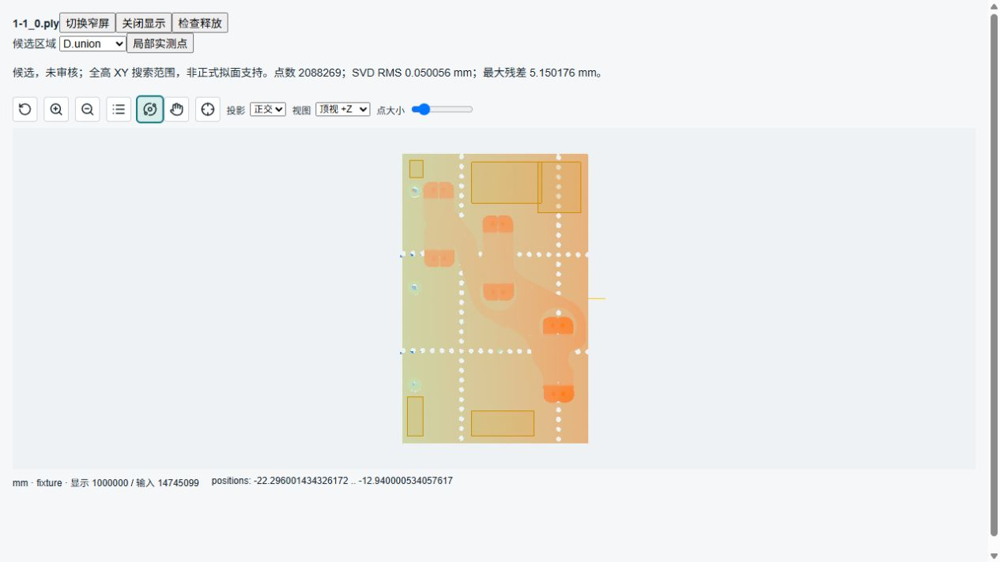
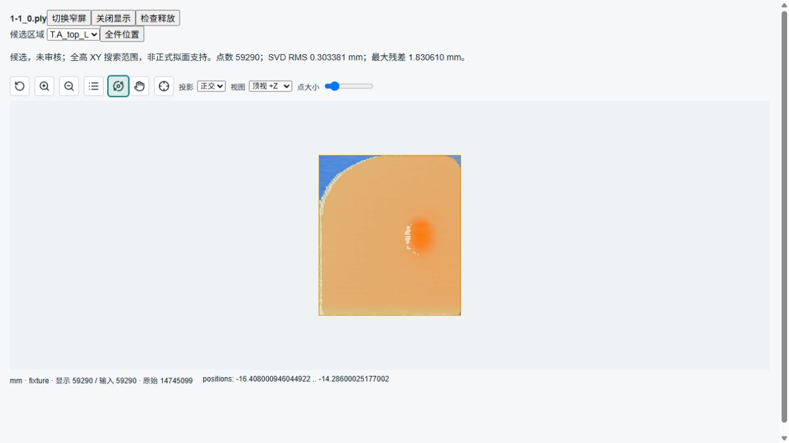
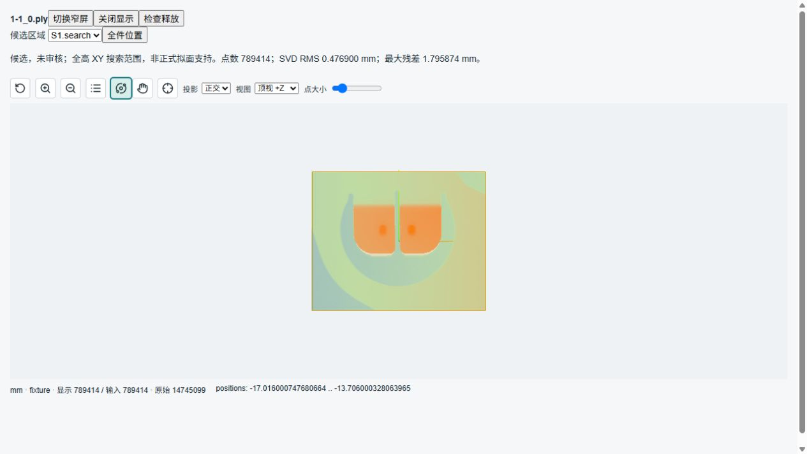

# R5 D0 修复与 D1 候选审核

日期：2026-10-26。承接 [D/E 实施计划](3d-metrology-r5-de-plan.md)。基点 `9040bc0a`，保留工作区已有 R5 C 修改，内部包仍为 `0.1.14`、十八节点、生产隐藏。本批不改计量算法、生产参数、质量门禁或三维 v1 契约。

**状态：D0 视角修复及本批双平台复验完成；D1 候选证据已整理，工程支持尚未批准。** 本轮确认仅整理 A_top_L/S1 候选图、逐区指标和待填表，不填写未知参数，不冻结量值。D2–D4/E 未执行，不将组件页面当作空白 Workflow 至发布运行验收。

后续状态：以上为当批历史边界。用户随后授权实施方决定本工件参数，代表支持、质量、测试容量及真实量值验证见 [D2 实施记录](3d-metrology-r5-d2.md)；不再等待用户填写本工件数字，也不将后续结果倒填为本批已完成。

## 1. 已修复的问题

### 1.1 相机旋转后的错误标签

原实现只在下拉框选择/复位时改 axis，OrbitControls 的 change 仅重绘，因此旋转后的斜视仍标顶视。

修复复用现有 [renderer](../../frontend/web-ui/src/workflows/workflow-editor/point-cloud/renderer.ts) 与 [CloudViewer](../../frontend/web-ui/src/workflows/workflow-editor/point-cloud/CloudViewer.vue)：

- renderer 依据相机旋转同时核对视线和画面上方向，反馈七个既有预设或自由视图；不按相机位置判断方向。
- 下拉框显示真实状态，选择预设仍是命令；自由视图不是新预设。旋转后可再次选择同一顶视。
- 平移、缩放及投影切换保持方向标签；仅状态改变时回调。四元数差 `1e-12` 只容纳控件极轴浮点偏移，不是计量容差。
- 控件重建和关闭先解绑 change，再 dispose；保持按需重绘，无常驻渲染循环、逐点遍历或新的控制器。

### 1.2 旧查看器错误回调

原失败回调直接 release，缺少拾取回调已有的 generation/abort/payload 检查。换云后旧实例迟到的错误可能关闭新实例。失败及视角回调现在均校验同一身份；旧实例回调或卸载后的回调不改变新画面。

类型检查为仓库外置前端测试补齐 Three.js addons 路径，沿用既有 tsconfig/Vitest alias；没有增加依赖、类型空壳或降级实现。

## 2. 验证范围

| 项目 | 本次结果 | 范围限制 |
| --- | --- | --- |
| 相机、查看器生命周期、预览、边界显示、测量显示、ROI 并集 | 6 文件、36 项通过 | 使用真实 OrbitControls/相机，WebGL 单测为替身；真实 WebGL 另验 |
| Vue 类型检查与生产构建 | `npm run build` 通过 | 仍有已有大分块警告，不扩大为构建优化任务 |
| Windows 完整样本与新增审核附件 | 1 项通过，66.92 s | 内含 21 区逐行/独立数值断言，不是 21 个 pytest 用例 |
| WSL Ubuntu 原生目录、同一用例 | 1 项通过，46.58 s | 不代表原生 Ubuntu 桌面、Open3D RANSAC 或完整发行验收 |
| 双平台比较 | 文件/XYZ/21 区行号摘要、点数、失败类型和预算结论一致 | 拟面/分位统计最大差异 `3.9968028886505635e-15`，小于既有 `1e-9` 数值断言 |
| Scope 回收 | 两平台 errors=[]、live_array_bytes=0 | 不把计费归零等同于系统 RSS 归零 |
| 真实浏览器组件 | 全云百万点显示，顶视→旋转→自由视图、重新顶视、平移、缩放、正交切换、390 px 容器、关闭重开通过 | 是真实组件/数据，不是正式业务发布验收或手机设备验收 |

截图：[自由视图](assets/r5-d0/free-view.png)、[平移后顶视](assets/r5-d0/top-pan.png)、[窄容器](assets/r5-d0/narrow.png)、[关闭后计费归零](assets/r5-d0/released.png)、[候选页释放](assets/r5-d1-candidates/released.png)。对截图画布区域核对非空点云像素，桌面自由/顶视分别为 24,480 / 77,753，窄容器为 25,352；旋转前后 85,455 像素发生变化。该检查证明实际渲染与交互画面变化，不代表计量精度测试。

测试页热更新时一度出现旧服务尚未提供新候选路由造成的 HTML/JSON 解析错误；重启隔离测试服务后完成本节验收，后续未出现新的 error/warn。没有以此修改业务网络或 DOM 实现。此前静态 iframe 独立复现的问题仍见[原审计](3d-metrology-audit-20261026.md#5-显示与异常隔离)，本批不重复排查。

## 3. 输入与环境身份

- 原文件 `1-1_0.ply`，479,677,235 字节，14,745,099 点，float32 XYZ；文件 SHA256 `ff2b9e0ef2d6c45af02c4bf8d474cd82f77f86ad92bd371a4c0f71b1b90d116b`，XYZ SHA256 `956927f058ba4a0170b1c1b93b1411b613fbe21fcbfc278ad0a7fc3cf621a1c6`。
- 窗口来自既有 `measurement_config.json`、`dimensions.json` 与 R5 的 S1 搜索候选；本轮不修改原云、手工报告或运行其测量脚本。
- Windows Python 3.12.13；WSL Ubuntu Python 3.12.3，glibc 2.39。平台完整标识在附件环境字段。
- 同版 NumPy 2.4.4、SciPy 1.18.0、trimesh 5.1.1+amvision.2、pypcd4 1.5.1+amvision.2、Pydantic 2.13.4、pytest 8.4.2。
- 受控 trimesh wheel SHA256 `1f71a37601d7a38139a5fba1336618a0ffcdbb785f32d550e64362ee0c18c6c1`；pypcd4 wheel SHA256 `7464babfbb6eda2be687c48f092159dd7f166ae8817e096fa00209350944909a`。
- Windows 使用 amvision 派生的临时环境安装已有受控 wheel；Ubuntu 在独立原生目录建 venv，缺失的 pip 从已有官方 Python ensurepip wheel 引导，只安装测试依赖，不修改系统 Python。该过程解决原审计的环境缺口，不等于修改项目发行配置。
- 原生环境目录 `/home/am/.cache/amvision-r5-d0-20261026`；Ubuntu 运行数据与 pytest cache 均在该目录。源码和输入可从挂载盘只读；不在 DrvFS 上测试控制文件替换。

本轮完整记录：[Windows](assets/r5-d1-candidates/windows.json)、[Ubuntu](assets/r5-d1-candidates/ubuntu.json)。原始行摘要按小端 uint64 顺序计算，先独立逐行核对裁剪结果，再计算摘要；记录原始总点数，不把子集序号当原始行号。

## 4. 代表区域候选证据

所有坐标为源 `fixture`、mm。当前候选均只按源 XY 选择全高点；测试盒的 Z 取完整输入高度并留边界余量，**不是工程拟面 Z 范围**。下表实际 Z 范围是数据统计，不是建议阈值。颜色为各显示数据的原始 Z，有界全件图与局部图色标不同，不是台面法向高度，不凭颜色计算尺寸。

| 候选 | 完整支持点数 | 实际 Z 最小 / 最大 | 全支持 SVD RMS / 最大残差 mm | 用途与待核对点 |
| --- | ---: | --- | --- | --- |
| D.union | 2,088,269 | -20.26400185 / -14.86400032 | 0.05005608 / 5.15017560 | 保留五窗联合；最大残差点位于 D3 窗，需物理支持审核，不能自动删除 |
| B.A_top | 33,300 | -16.23000145 / -15.66200066 | 0.04453042 / 0.45218762 | 相邻基体候选；局部有较低区域，尚未批准拟面范围 |
| T.A_top_L | 59,290 | -16.40800095 / -14.28600025 | 0.30338099 / 1.83061013 | 原钢片外包框包含不同高度区域，不是纯顶面支持 |
| S1.search | 789,414 | -17.01600075 / -13.70600033 | 0.47690005 / 1.79587414 | 搜索区包含基体/钢片/弧边；平面统计仅诊断，不是拟圆质量 |

上述 RMS 不是产品误差或计量精度结论。SVD 与独立协方差特征分解一致，证明该支持上的计算一致；不能证明该支持符合工程测量定义。附件 `quality_policy` 沿用显式测试门槛，`geometry_quality_failed` 不代表生产公差判定。

### 4.1 D 五窗

| 成员 | X 范围 | Y 范围 | 工程 Z / 排除区 |
| --- | --- | --- | --- |
| D1 | [-45, -37] | [-145, -125] | 待审核 |
| D2 | [-12, 20] | [-145, -132] | 待审核 |
| D3 | [22, 44] | [-30, -4] | 待审核 |
| D4 | [-12, 24] | [-25, -4] | 待审核 |
| D5 | [-44, -37] | [-12, -3] | 待审核 |

五窗逐行 OR 去重，不能把重叠 D3/D4 点重复计权。联合最大残差点为 `[34.27200317,-22.32000160,-20.26400185]`，仅作定位线索，不据此决定它是应删除的坏点还是实物结构。



[联合支持单独显示](assets/r5-d1-candidates/datum-local.png)。D 显示 1,000,000 / 2,088,269 点；计算使用全部支持。

### 4.2 基体与钢片

`B.A_top` 候选 X=[-34,-24]、Y=[-28,-25]。`T.A_top_L` 候选 X=[-36.705,-29.719175221099093]、Y=[-22.365,-14.448676980326052]；完整精度以 JSON 原字段为准。

| 区域 | 绝对残差 P50 / P90 / P99 / 最大，mm | 解释边界 |
| --- | --- | --- |
| D.union | 0.012088 / 0.030812 / 0.059429 / 5.150176 | 不用分位数自动截掉大残差点 |
| B.A_top | 0.008826 / 0.022964 / 0.275523 / 0.452188 | 需审核较低区域是否属于拟面物理支持 |
| T.A_top_L | 0.121624 / 0.271718 / 1.251781 / 1.830610 | 需区分顶面、侧缘和邻近较低表面 |

[基体全件位置](assets/r5-d1-candidates/body-context.png)、[基体全部局部点](assets/r5-d1-candidates/body-local.png)、[钢片全件位置](assets/r5-d1-candidates/steel-context.png)。B/T 局部图分别显示全部 33,300 / 59,290 点，未从显示抽样推导算法支持。



### 4.3 S1 搜索区

X=[-13,17]、Y=[-85,-61]，尚未冻结有限 Z、搜索支持、连续弧段选择或质量参数。已确认的等高定义仍为本次有效台面以上 0.25 mm，不从本图原始 Z 色彩提取该等高线。

[全件位置](assets/r5-d1-candidates/semicircle-context.png)。局部图显示全部 789,414 点：



### 4.4 容量含义

现有边界预检按 `N*12544` 估算，显式测试上限为 512 MiB。A_top_L 候选需求 743,733,760 B；S1 为 9,902,409,216 B，均在分配前拒绝。B.A_top 的 417,715,200 B 仅通过该预检，不表示可提取有效边界。D 联合窗口用于拟面，不计划整组做边界提取，其大估算只是审计对照。

本批未改估算公式、增大上限、抽稀输入或执行大规模 Qhull，不能将估算称为实测 RSS。实际边界搜索支持需单独审核，不自动套用顶面拟合窗口。D2 才核定容量与必要优化。

## 5. 待填审核表与下一步

| 配方项 | 已知内容 | 尚待审核，不填写默认值 |
| --- | --- | --- |
| D 五窗 | 五个 XY 候选，联合去重 | 每窗有限 Z/排除区/物理理由；拟合方法、必要稳健参数、质量条件 |
| B.A_top / T.A_top_L | 上述候选与原始行摘要 | 实际拟面 XYZ、排除理由、方法和质量条件 |
| 本次 pose | 源原点投影、源 +X 投影为 U、源 +Z 定正法向 | D 有效后核对方向和原点，不使用无效 D 提前冻结数值 |
| A_top_L 查询 | 同一次 pose、同一固定 U/V | U、V 的工程位置；不能自动取质心或照抄源 XY |
| H / Z 基准 | H: B→T；Z: D→T；被测 T 必须有实测支持 | 各基准支持/延伸模式、最大延伸距离、实际覆盖与质量条件 |
| 钢片等高 | 本次有效 B/T 同线交点中间值，比例 0.5、target-above | 有限边界搜索区、连接条件、数值容差、连续目标段和 L/W 轴映射 |
| S1 等高 / 直径 | D 上方 0.25 mm，fit-circle→measure-hole(open-arc) | 搜索区、连续弧、半径范围、拟合参数、角覆盖/最大空弧/残差与可辨识性 |
| D2 显式测试容量 | 当前审计有固定测试值，不能套为生产 | 实际支持所需内存、时限和取消宽限；需增大时另行确认 |
| 生产 | 当前节点隐藏 | RAM、并行数、节拍、公差、timeout、发行 profile 均未确认 |

审核顺序为 D → B/T → 有效 pose 下固定 U/V → 边界搜索/目标段 → S1。审核记录须说明实际物理表面及排除依据，不能以“调到手工报告相同”反推支持或门槛。该表收口后才继续 D2 容量/质量、D3 A_top_L H/Z/L/W、D4 S1.D，再扩展 E；本批不输出伪成功量值。

## 6. 复验与清理

复用 [完整样本审核脚本](../../tests/integration/metrology3d/test_recipe_candidates_full_sample.py)，新增环境、裁剪参数、实际边界、分位数、原始行 SHA256 和四份候选显示。候选显示调用现有 build_cloud_preview/attach_geometry，不另写裁剪/拟面/显示算法。文件保存在 pytest 临时目录，source_indices 与原云首/中/末点核对，最终 Scope 必须归零。

开发态先 `conda activate amvision`，使用已装受控 wheel 的隔离环境，设置 `AMVISION_METROLOGY_REPORTS=<报告目录>`，运行：

```text
python -m pytest tests/integration/metrology3d/test_recipe_candidates_full_sample.py --cloud-sample <完整PLY> --basetemp=.tmp/<本轮目录> -q -s
node tests/integration/metrology3d/full_cloud_viewer.mjs <临时目录>/real-preview.json 5625 <临时目录>/recipe-candidates.json
```

Ubuntu 的 basetemp/cache 必须改成原生目录。测试查看器可在完整件和四个候选间切换，显示实际点与全件位置；它是开发审核入口，不是第二套生产查看器或配方发布入口。普通已有验证不提供第三个 report 参数时保持原全云页面。

最终核对：Ruff、测试查看器 JavaScript 语法检查、git diff --check 通过；八份本批文档的 294 个本地链接有效。再次审阅生产差异及所有 createCloudRenderer 调用方，没有改变拟合、尺寸算法、支持选择、精度、质量或容量门禁。保留原工作区 R5 C，不将前序全部改动冒充本批修复。

已停止 5625 测试服务并确认无监听、无本轮 Python/Node/Ubuntu 测试进程；关闭本轮浏览器标签，仓库 `.tmp/` 清空，Ubuntu 本轮原生临时环境删除。仅保留小型审核 JSON 和截图，完整预览及复制输入未保留。未启动业务 backend/worker，未操作业务 5600/5601、原始输入、手工报告和用户 CloudCompare 进程；未提交 Git，未重复 P99 或长稳测试。
