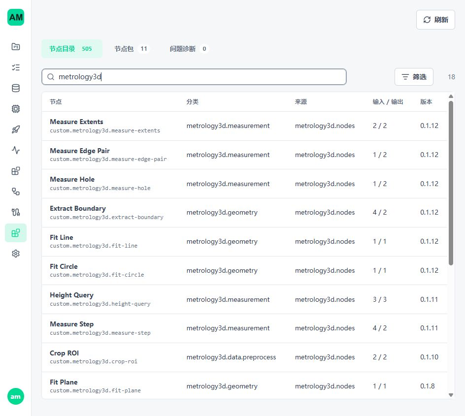
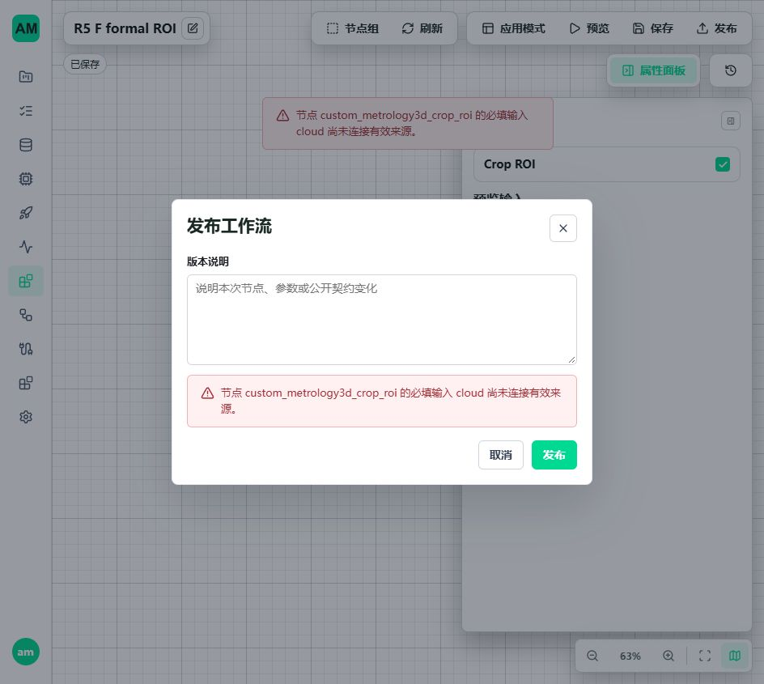

# R5 F 实施与验收

日期：2026-10-28 至 2026-10-29。起点：`de644f8b`。实施基线见 [R5 F 计划](3d-metrology-r5-f-plan.md)。本记录是分批实现进度，不是 R5 F 全部完成报告。

## 1. 当前状态

| 项目 | 状态与边界 |
| --- | --- |
| F0 计时 | 已区分文件读取、不可变输入准备和完整数值图；同方法完整样本结果一致 |
| F1 正式入口 | 十八节点通过真实 manifest/Catalog 注册；本机工程配置已明确，Windows/Ubuntu 完整输入与发布生命周期通过 |
| F2 计算优化 | 单遍 ROI 原始字段扫描、轴对齐框精确快速路径、Run 内支持摘要复用已实现；空间索引未新增 |
| F3 可见包络 | 尚未实现；不能用现有严格闭合等高环代替已确认的可见投影包络 |
| F4 碎片圆弧/基准应用范围 | 尚未实现；S2、多段稳健拟圆及两项 Z 的工程范围仍需完成 |
| F5 全工件页面 | 本轮只完成正常目录、空白 ROI 参数编辑、保存和错误发布拒绝；不是全工件新方法页面验收 |
| F6 最终验收 | 尚未执行新增方法冻结后的秒级计算及资源验收 |

工件仍为 **50 主项、23 有效、27 无效**。24 项 L/W、两项 Z 和 S2 直径没有填参考值、放宽质量条件或自动回退。基础节点已经可用与具体工件全部测完是两个不同结论。

## 2. 正式节点包与本机启用

实现统一移动到 [metrology3d_nodes](../../custom_nodes/metrology3d_nodes/README.md)，删除内部目录，不维护两套算法。所有 Python 导入、Vue 受信参数编辑器、Vite 路径、脚本与文档链接同步更新。三维契约仍为 v1，不改二维协议或另建版本系统。

- 新增真实 `manifest.json`、生成器及 Catalog，沿现有 NodePackLoader、运行注册器、启用/禁用和发布依赖身份机制工作。
- 正式发布测试不再生成测试 manifest、拼接节点目录或替换运行 handler。算法单元测试仍可直接调用内核，不能冒称正式准入验收。
- manifest 的可选 `compatibility.pythonDistributions` 检查安装元数据。缺包、错误版本保留包状态及具体原因，但不注册可执行节点；不自动安装，不以导入整个 Open3D 进行目录探测。
- 新字段禁止 URL、extras、条件表达式、无版本范围及重复包名。没有声明该字段的其他节点包行为不变。
- 新增 [workstation.example.json](../../custom_nodes/metrology3d_nodes/workstation.example.json)，本机配置写入忽略版本控制的 `config/backend-service.local.json`。

已确认并验证的本机安全上限：Run 活跃数组 1 GiB、算法工作预算 4 GiB、显示 100 万点、节点默认/最大超时 180/180 秒、强制停止宽限 2 秒。这不是计算节拍，也不是整个进程 RSS 硬上限。未改变全局 `point_cloud=None` 默认值，不为未知客户机填写容量。

当前样例另有解码、资产包、Preview 文件和显示字节限制，详见节点包 README；不能把当前配置宣称为任意 1 GB 文件均可运行。容量不足立即拒绝，不增加等待队列。

主开发环境已安装受控 trimesh/pypcd4 和 Open3D；既有 NumPy 2.4.4、SciPy 1.18.0 未变。Windows 与 Ubuntu 使用相同的直接依赖版本。Ubuntu Open3D 的 `libusb-1.0.so.0` 在隔离 sysroot 中验证；正式部署需提供该系统依赖。WSL 数据、数据库、锁与输出在 Ubuntu 原生文件系统，源码和输入允许从 Windows 盘只读访问。

**发行限制：** 本轮没有执行完整 standalone/workstation 离线发行组装。bundled Python 必须安装同一组依赖及传递依赖，不能只复制节点目录。实现路径/文件指纹变化影响旧发布的执行身份；不修改旧快照、不增加兼容分支，需要使用当前代码审核重发。用户业务数据和原始样本未删除。

## 3. 计算优化与正确性

### ROI

原实现对完整原云执行计数和收集两遍扫描。新实现按活跃数组预算预留每点一字节的掩码，只扫描原始字段一次；随后扫描掩码生成精确大小的只读索引。索引仍为父逻辑行，原始 `source_indices` 由既有 Runtime 解析，去重、顺序、所有属性及 `source_point_count` 不变。

轴对齐框只在旋转矩阵精确等于单位阵时使用逐轴比较，继续按 `abs(position-center) <= half_size` 判断，避免改成 `center +/- half_size` 造成浮点边界变化。旋转框和 ROI 并集继续使用原路径。新增单遍计数、逐行独立真值、ULP 边界、掩码预算、取消和释放回归。

### 支持摘要

新增 [support_bounds.py](../../custom_nodes/metrology3d_nodes/shared/support_bounds.py)，由高度/高差与尺寸证据共同使用。仅在既有 Run 的 ResourceScope 内保存六个冻结标量，不保存原云副本，不新增跨调用缓存或资源系统。

命中前仍通过 `runtime.borrow` 验证完整引用；键包含不可变云 ID 与 revision。不同子集、不同 Run、失效引用和取消不复用半成品。Scope 关闭后不保留数据。已有异常堆栈释放测试同步指向新的公共摘要计算位置，继续检查数组弱引用释放，而非删除断言。

### 完整样本计时

同一文件：`1-1_0.ply`，14,745,099 点；文件 SHA-256 为 `ff2b9e0ef2d6c45af02c4bf8d474cd82f77f86ad92bd371a4c0f71b1b90d116b`。完整源输入参与运算；显示支路移除，不改变数值节点、参数、质量规则与输出。沿实际 worker 的算子线程配置使用 1 线程，不新增线程控制器。

| 平台/候选 | 纯计算/秒 | ROI/秒 | 边界/秒 | 高差/秒 |
| --- | ---: | ---: | ---: | ---: |
| Windows 原方法基线 | 36.046 | 15.709 | 16.252 | 3.422 |
| Windows 单遍 ROI | 22.843 | 2.247 | 16.210 | 3.655 |
| Windows 再加摘要复用 | 20.587 | 2.144 | 15.067 | 2.578 |
| WSL Ubuntu 最终同方法 | 17.546 | 1.614 | 13.512 | 1.764 |

这是每个候选的一次有界测量，不是 P99、吞吐或跨平台性能排名。Windows 最终严格读取另计 23.384 秒，Ubuntu 另计 13.602 秒；不把读取排除后的数值直接与旧 105 秒文件图相减宣称同边界提速。当前内核图活跃数组记录约 256 MB，Scope 关闭后释放通过；不等于进程峰值 RSS。

证据：[Windows 基线](assets/r5-f/compute-windows-baseline.json)、[ROI](assets/r5-f/compute-windows-roi.json)、[摘要复用](assets/r5-f/compute-windows-summary.json)、[Ubuntu](assets/r5-f/compute-linux.json)。当前热点仍是严格表面边界计算，后续应完成确认的高度场/可见包络方法，而不是反复调超时或只优化文件读取。**现场秒级目标尚未验收。**

## 4. 真实页面发现与修复

在隔离 5620/5621 空白页面创建单个 Crop ROI 时，发现缺少必填 cloud 输入仍可发布。根因是原发布校验验证已有边和图结构，没有检查必填端口是否存在来源。

修复复用执行器现有输入/边绑定规则：启用节点的必填端口必须有模板输入或启用上游输出；禁用来源不算连接。后端在发布落盘前拒绝，前端发布操作定位节点并给出端口提示。草稿保存仍允许未完成接线，运行时仍检查实际输入值。未引入新的发布服务或改写旧快照。

本轮页面验证：正常目录显示 18 节点；空白图配置 ROI、保存；缺失 cloud 发布被拒绝。后端新逻辑另由真实 API 回归验证。页面进程启动后不热换 Python 内部状态，不将前端提示测试冒称后端 API 已经重新加载。

## 5. 验证记录

| 范围 | 结果 |
| --- | --- |
| Windows 节点、几何、manifest、发布端口定向单元组合 | 281 通过 |
| Windows 三维集成组合 | 254 通过、19 显式完整样本用例跳过、1 条旧测试目录重复注册失败；删除该测试注入后，资产发布、损坏拒绝、正式注册与端口准入共 9 项通过 |
| Windows 发布加固与历史边界定向组合 | 21 通过 |
| Windows 完整同方法计算及 ROI 并集 | 3 通过 |
| WSL ROI、摘要、维度运行与节点准入 | 59 通过 |
| WSL 完整同方法计算、ROI 并集、Open3D 原生几何 | 13 通过 |
| WSL 最终资产发布、正式注册、必填端口准入 | 9 通过，已删除旧测试目录注入 |
| Windows 本机容量完整输入/真实发布生命周期 | 1 通过，.NET byte[]/Span，5 次正常调用及异常路径 |
| WSL 本机容量完整输入/真实发布生命周期 | 1 通过，Python 协议客户端，5 次正常调用及异常路径；不冒称 Linux .NET 客户端验收 |
| Vue 定向回归 | 34 通过，6 文件 |
| Vue 类型检查及正式构建 | 通过；现有 WorkflowEditor/CloudViewer 分块超过 500 kB 的构建提示仍存在，未放宽阈值 |
| 修改 Python 静态检查、差异空白检查、开发环境依赖一致性 | Ruff、git diff --check、pip check 通过 |

不同组合存在交叉，不将上述数字相加为去重用例总数。19 个跳过项要求显式完整样本或外部条件；本轮实际执行的完整样本项目另行列出，不宣称全部历史大样本用例重跑。

生命周期报告：[Windows](assets/r5-f/formal-workstation-windows.json)、[Ubuntu](assets/r5-f/formal-workstation-linux.json)。均覆盖运行中停止、停止后拒绝调用、活动状态拒绝切版、停机切版、旧路由拒绝、writer 退出、执行中客户端退出与恢复调用；最终 active leases、allocated、revoking、quarantined 均归零。未重跑模型 P99 或长稳测试。

## 6. 审计结论与下一步

本轮未改变拟面、截线、圆拟合、测高定义、产品公差或质量限值。已验证的速度改善来自减少重复扫描；原始行号、不可变引用、预算和整组停止边界保留。没有证据据此宣称所有工业场景或长期稳定性已认证。

下一批直接完成 F3，不再将未实现的可见包络解释为工件不满足严格截线门禁：

1. 现有 extract-boundary/measure-extents 增加显式高度场与可见包络方法；收口网格原点、步长、聚合、种子/ROI、分位数及敏感性参数。
2. 同批扩展既有来源、保存和显示读取方。格聚合/估计边界不能伪装源边插值，保留缺测与分辨率证据；不引入第二个 CloudRuntime。
3. 独立倾斜、缺口、飞点、多层真值后验证 A_top_L，再扩展十二片。算法用完整源数据，显示采样不参与测量。
4. F4 接通片段集合与稳健角区拟圆，S1 回归、S2 独立扫描线对照；以台面有限应用区域及留一支持区敏感性核定两项 Z，而非刚好抬高距离上限。
5. 全工件正常页面到真实发布运行验收后，再冻结新方法做纯数值/带显示计算和资源验收。另核对报告的基体 t、直边宽和整体包络，不把 50 主项称为报告所有要求。

本轮尚未进行 F3/F4 实现，未放入空壳节点或未验证的新方法。现有可用节点不再因这些后续缺口而隐藏。

## 7. 测试环境

5620/5621 隔离后端、Vite 和临时浏览器标签页已关闭，端口释放。用户既有 5600/5601、worker 和 inference daemon 未主动重启或终止。

确认本轮进程退出、报告归档后，已删除仓库 `.tmp/r5-f`、`.tmp/pytest-cache`，仓库 `.tmp` 为空；已删除 Ubuntu `/home/am/.cache/amvision-r5-f-20261028` 隔离虚拟环境、运行数据及 sysroot。主开发环境依赖、受控 wheel 本地资产、本机启用配置和文档证据按交付内容保留，原始样本及业务数据未清理。
