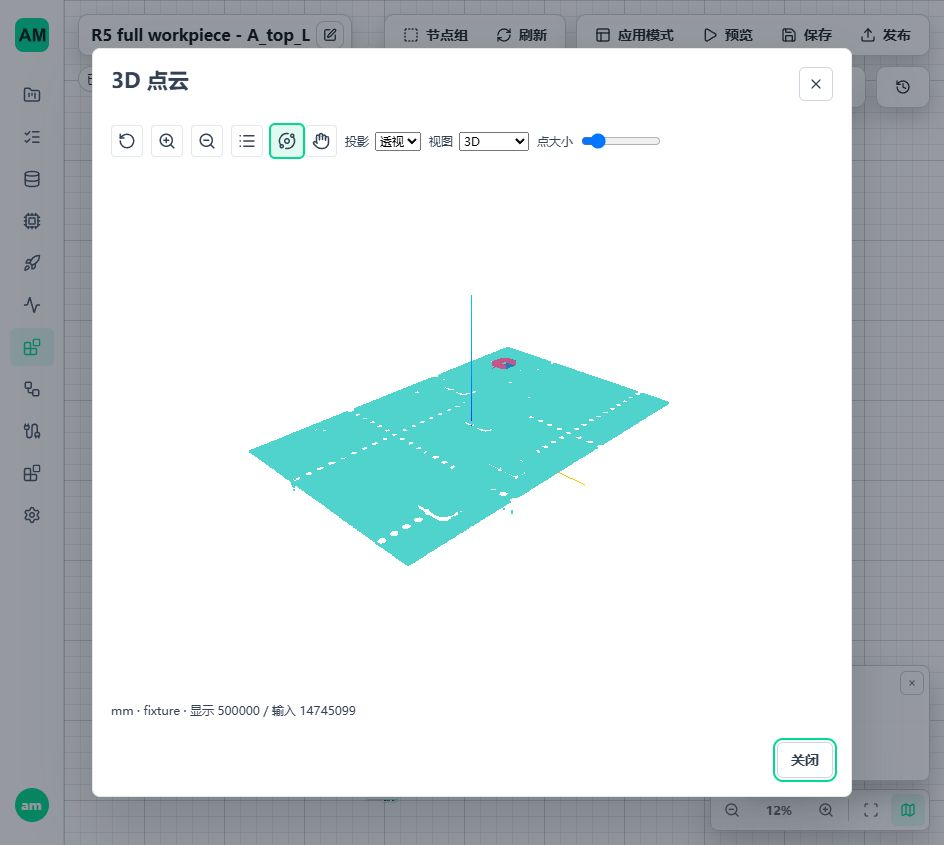
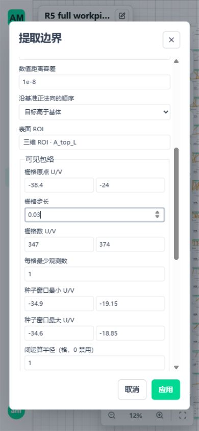
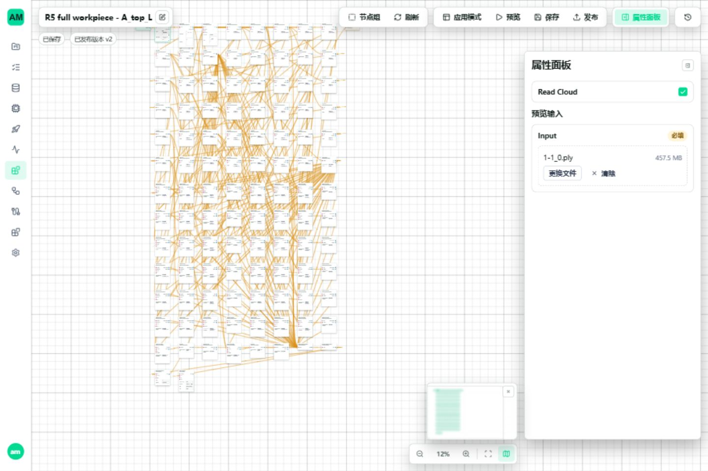

# R5 F3 可见包络实施与验收

日期：2026-10-29。起始提交 `8f817036`。设计依据：[F3 计划](3d-metrology-r5-f3-plan.md)。本轮交付是通用可见包络与稳健剖面跨度，不是工件专用算法、严格截线的降级分支或另一套 Workflow。

## 1. 结论与范围

- 在现有 Extract Boundary / Measure Extents 中完整接通 `visible-envelope` / `robust-profile-spans`，十八节点保持可用，不新增空壳节点。
- 十二钢片 24 项 L/W 均有效。完整样本 50 主项由 23 有效、27 无效变为 **47 有效、3 无效**；H/Z、S1、S2 与原基线逐项一致。
- 剩余 `A_top_R.Z`、`A_bottom_L.Z` 为 `reference_extension_limit_exceeded`，`S2.D` 为 `target_ambiguous`。保留 null 与原因，不抬原门禁、不替换报告值。
- Windows、WSL Ubuntu 原生运行目录通过独立真值、完整样本、真实资产保存恢复及正式发布生命周期。WSL 使用 Python 协议客户端，Windows 使用 .NET byte[]/Span，不混称 Linux .NET 已验收。
- 单次无显示纯计算为 Windows 12.758 秒、WSL 9.557 秒。不是 P99、长期节拍或工业精度认证；正式秒数上限尚未确定，不能据此宣布秒级验收通过。

## 2. 实现边界

| 层 | 实际改动 | 保持复用 |
| --- | --- | --- |
| 参数/证据 | `envelope3d.py`、边界/尺寸联合类型，显式格剖面来源和统计端点 | v1、现有限值规则、输入错误/几何无效分类 |
| 算法 | `envelope_grid.py` 中位栅格与显式种子分区；`envelope_profiles.py` 四侧剖面；`envelope_statistics.py` 线性分位 | NumPy/SciPy、ROI、当前 pose/基准/H 高度解析 |
| 所有权 | 同一 CloudRuntime 增加 `grid-profile` 来源，预算、只读校验、分块重映射 | OwnedCloudArrays、ResourceScope、原始行号语义 |
| 保存读取 | `save-cloud/read-cloud` 保存九个来源数组、方法、拓扑、质量；资产导入严格验证 | 现有资源 API、对象存储、完整性校验 |
| 节点 | 已有 extract-boundary / measure-extents 直接使用新方法并生成 Catalog | Node Pack manifest、正常发布指纹、worker 和 Trigger |
| 前端 | 栅格/种子参数、当前 pose 三维候选、统计方法、断点/孤立站位、估计线型、统计端点 | Vue 3、CloudViewer/Three.js、Preview、保存/发布、晚返回防护 |

没有修改模型训练/推理、全平台进程管理、排队方式或三态消费者。未新增依赖，未自写点云文件解析器；受控 trimesh/pypcd4 和 Open3D 沿既有版本。Windows 主开发环境未升级包；Ubuntu 使用本轮隔离虚拟环境。

## 3. 正式参数与失败规则

`method.kind=visible-envelope` 复用本次 pose、datum、固定高度或测量比例来源；`surface=null`、`targets=[]`，不接受 Delaunay 或闭合段参数。

| 字段 | 语义与校验 |
| --- | --- |
| `envelope.grid.origin` | 评价面左下格角 U/V，显式给定，不按输入极值漂移 |
| `grid.step / shape` | 正步长、U/V 格数；末端可表示、有限；先验证工作预算再分配 |
| `grid.min_cell_count` | 格内最少真实观测数；空格不当零高度 |
| `selection.seed_min / seed_max` | 有面积且位于格阵内的固定种子窗口，选零个目标无效、多个目标歧义 |
| `selection.connectivity` | 显式 4 或 8 邻接，不自动选择最大区域 |
| `selection.closing_radius_cells` | 显式格半径，0 禁用；仅改变分区，不制造观测 |
| `profiles.foreground` | above/below；与测量比例来源的目标顺序一致 |
| `profiles.edge_policy` | cell-edge 或 interpolate-or-cell-edge，属于事先声明的方法，不是失败回退 |
| `profiles.min_observed_length` | 该行/列实际选定占据格数乘步长，不把中间缺格算入 |
| 尺寸 `mode` | robust-profile-spans；低/高分位及 linear 显式配置，继承特征评价面、固定消费四侧 |

参数错误、旧引用、单位/观察身份冲突、预算不足仍走输入/资源错误。种子未命中或歧义、ROI 裁断、支持不足、质量不通过返回明确几何无效，不生成可被误用的部分有效尺寸。

四侧按 `u-min/u-max/v-min/v-max` 排列。站位缺失或轮廓跨格跳跃均断开显示；孤立站位显示为点，不假装一条线。统计端点是分位量，不伪造 `source_index` 或“实测极值点”。

本轮修正了一处新实现中的指标混淆：相邻剖面位置横跳不等于缺测站位。`profile_max_gap` 按 `(相邻站位差-1)*步长` 计算，`profile_max_jump` 单独保存断开处欧氏距离。分析真值、缺口/台阶测试覆盖该差别；没有通过提高原 0.3 mm 缺口上限使结果通过。

## 4. 来源布局与释放

平台资产仍为 v1，`lineage.kind=grid-profile`。设 K 为去重格数，M 为这些格的原始支持总数，N 为生成顶点数，来源数组总字节数为 `32*K + 8 + 8*M + 42*N`，另计坐标和其他既有字段。统一小端、只读、连续数组：

| 数组 | 形状/精度 | 内容 |
| --- | --- | --- |
| cell_indices | K×2 / uint64 | U/V 格号，唯一、字典序、可安全做有符号邻接差 |
| cell_offsets | (K+1)×1 / uint64 | 每格原始支持 CSR 偏移，首 0、末 M、严格递增 |
| cell_sources | M×1 / uint64 | 最初输入原始行号，不是 ROI 或本次生成行号；越界/重复计权拒绝 |
| cell_heights | K×1 / float64 | 相对本次截面零高度的聚合值 |
| profile_cells | N×2 / uint64 | 引用格表行号，不是源点行号 |
| profile_weights | N×2 / float64 | 两格中心插值权重；格边估计固定 (1,0)、同一格 |
| profile_kinds | N×1 / uint8 | 0 格中心插值；1 显式格边；2 邻格缺测；3 邻格不包围阈值 |
| profile_stations | N×1 / uint64 | 对应 U/V 正交站位，和源格互相验证 |
| profile_sides | N×1 / uint8 | 0..3 对应四侧角色 |

原云继续 float32 传递，局部投影和统计使用 float64。格内原始字段不丢弃；生成点只含明确坐标/来源，不暗中插值颜色、法向或强度。任意子集借用重建去重格表并重映射索引，预算失败不能留下半个来源资源。

保存和重读逐数组核对，方法、拓扑、质量和数值不变；新 Run 只重绑定本次观测身份。运行引用不写入有界显示。Scope 关闭、注册中取消、保留异常对象、预算拒绝均有释放回归。校验加固拒绝超出 int64 可验证范围的 uint64 格号，避免邻接差回绕。

普通点云保存不凭空补出 features；PLY/PCD 点交换不承诺完整测量来源往返。既有源点/源边资产保留其严格读取分支，没有旧错误数据兼容或自动迁移。新方法和受影响模块指纹变化后，旧发布须审核重发，不修改旧冻结快照。

## 5. 完整工件结果

输入 `1-1_0.ply`：479,677,235 字节，14,745,099 点。SHA-256：`ff2b9e0ef2d6c45af02c4bf8d474cd82f77f86ad92bd371a4c0f71b1b90d116b`。原文件与手工报告只读。

| 钢片 | W/mm | L/mm |
| --- | ---: | ---: |
| A_top_L | 6.876303 | 7.916130 |
| A_top_R | 6.937725 | 7.886121 |
| B_top_L | 6.950888 | 7.947185 |
| B_top_R | 7.020000 | 7.946733 |
| A_bottom_L | 6.993260 | 8.121079 |
| A_bottom_R | 7.020000 | 8.172618 |
| B_bottom_L | 7.032695 | 8.230250 |
| B_bottom_R | 7.008407 | 8.245953 |
| C_top_L | 7.020000 | 7.947345 |
| C_top_R | 7.110000 | 7.920975 |
| C_bottom_L | 7.097400 | 8.194676 |
| C_bottom_R | 7.140000 | 8.040000 |

完整方法、质量、原 H/Z/S1/S2 对照：[工件结果矩阵](assets/r5-f3/workpiece-matrix.json)。[Ubuntu 来源/保存与独立跨度核对](assets/r5-f3/linux-envelope-checks.json)。独立参考按原始完整 ROI 逐点分箱、中位数、连通区遍历、四侧逐站求值，不调用待测栅格/剖面函数；所有生成点及跨度按 1e-10 绝对容差对照。

本工件配方使用 0.03 mm 格、0.5 本次高度比例、固定 U/V 种子中心 ±0.15 mm、8 邻接、闭运算半径 1、每格至少 1 观测、每剖面实际占据长度 0.30 mm，2%/98% linear。0.03、0.30、分位数有原报告依据；种子和窗口按现有固定装夹配方显式配置，不改通用默认。

本方法质量规则为每侧至少 30 站、相邻观测连线累计长度 1 mm、站位覆盖 90%、最大缺站宽 0.3 mm、格内高度跨度不超过 2 mm。允许格边估计比例至 1 符合确认的可见包络定义，但完整记录实际估计/缺邻比例；这不证明物理精度。原截线、拟面、H/Z、S1/S2 质量规则不变。

### 精度限制必须保留

原报告在源 XY 上作栅格及包络后投影；新方法直接在当前评价 U/V 中分区，且不自动选最大区、不填孔为观测。A_top_L 原报告 W=6.986880 mm、L=7.916371 mm；本轮差值约 -0.110577 mm、-0.000241 mm。未调参数贴合报告。

| A_top_L 对照 | W/mm | L/mm |
| --- | ---: | ---: |
| 0.03 mm、原格相位、比例 0.50 | 6.876303 | 7.916130 |
| 0.06 mm | 7.011007 | 7.911807 |
| 0.03 mm、半格相位 | 6.966305 | 7.916130 |
| 比例 0.35 | 6.882920 | 7.919235 |
| 比例 0.65 | 6.869699 | 7.913025 |

宽度对步长/相位变化达约 0.135/0.090 mm，独立参考重现该变化。格聚合、分区和观测边界定义会改变结果，不是 float32 保存不够或显示采样造成。不能将 0.03 mm 格距当作 ±0.015 mm 精度保证。后续需结合标定量具/物理参考和允许误差核定适用范围；未确定精度验收线，不能宣称工业计量准确率验收通过。

## 6. 页面与真实发布

隔离 5620/5621 使用正式节点目录、正常启用配置、完整工件配方和真实数据库。页面上传完整 457.5 MiB 文件，Preview 返回 50 项结果；显示分支为完整范围 500,000 点，不参与算法输入。校验旋转、平移、放大、复位、俯视、参数编辑、步长 0 禁止应用、合法值应用、保存及发布。桌面和 390×844 窄屏参数布局可操作。944×845 与 1440×960 截图分别有 70,134 和 104,651 个点云色像素，画面非空且交互后视角改变；窄屏本轮检查参数界面，不冒称完整触屏三维操作验收。

统计详情明确显示可见包络方法、分位数、格中心/格边估计和参与统计的逻辑顶点/秩；不是实际源点极值。真实页面发现的未选择项/高度项详情判别边界已补条件分支及回归，不在非尺寸项上解析不存在的尺寸 mode。

页面新建 runtime 绑定刚发布的工作流版本，启动显示 `running/running`，随后停止显示 `stopped/stopped`。此处工作流发布序号 v2 是既有发布系统的第二次发布，不是三维数据契约升级；三维格式仍统一 v1。截图：[启动](assets/r5-f3/runtime-running.jpg)、[停止](assets/r5-f3/runtime-stopped.jpg)。

本轮完整图由既有测试工具通过正式 API 构建，页面实际编辑、运行并发布；没有绕过发布准入。不能将其冒称为从空白页面手工连完全部 106 节点。全部对象逐项定位、现场 App 最终操作及人工空白图配置覆盖仍属于 F5。

发布链路：当前 manifest → WorkflowRuntimeService → WorkflowRuntimeWorkerManager → Trigger → 完整数组输入 → 数值响应。Windows .NET 两种写入方式，正常成功调用 5 次，并覆盖 writer 异常退出、执行中客户端退出、运行中停止、停机准入拒绝、活动版本切换拒绝、停止后切版、旧路由拒绝、恢复调用。Ubuntu 原生目录用 Python 协议客户端覆盖同一生命周期。最终 leases/allocated/revoking/quarantined 归零，详见 [Windows](assets/r5-f3/published-windows.json)、[Ubuntu](assets/r5-f3/published-linux.json)。

## 7. 验证与计算时间

| 最终/定向组合 | 结果 |
| --- | --- |
| Windows：新内核/来源、边界运行、动态资产、尺寸资产、有限段、工作预算等 11 文件 | 67 通过 |
| Ubuntu：同一 11 文件组合，原生临时目录 | 67 通过 |
| 两平台各自完整样本，含独立剖面、保存恢复及代表片敏感性 | 各 1 通过 |
| 两平台各自真实发布生命周期完整样本 | 各 1 通过 |
| 两平台各自无显示计算图 | 各 1 通过 |
| Vue 参数、显示、生命周期 7 文件 | 40 通过 |
| 最后补充统计摘要、原高度显示和点云解码 3 文件 | 25 通过，与上项有交叉 |
| Vue 类型、Vite 正式构建 | 通过；原有 500 kB 分块提示未关闭 |
| Python Ruff、Catalog 生成、差异空白 | 通过 |

不同组合有交叉，不相加宣称去重总数。没有重复模型 P99 或长稳验收。三维画面不是合成小点云；单元真值仍使用小型解析几何，二者不混称。

计时从完整 Cloud 已就绪到无显示的数值输出，不包含文件读取、传输和三维显示。报告为每平台一次直接计算图，不是固定线程、重复冷/热的正式性能验收；不同方法的旧 20.587 秒与新结果不能称为同算法提速。

| 平台 | 纯计算/s | ROI/s | 边界/s | 高差/s | 尺寸/s | 文件读取另计/s |
| --- | ---: | ---: | ---: | ---: | ---: | ---: |
| Windows | 12.758 | 2.308 | 6.586 | 2.885 | 0.400 | 20.398 |
| WSL Ubuntu | 9.557 | 1.464 | 5.546 | 1.701 | 0.174 | 见原始报告 |

Windows 十二钢片包络合计约 0.659 秒；未改的 S1/S2 严格边界约 2.635/3.292 秒，占据主要边界耗时。不能把所有边界时间归到新包络。逐节点记录：[Windows](assets/r5-f3/compute-windows.json)、[Ubuntu](assets/r5-f3/compute-linux.json)。本轮活跃数组约 257.6 MB，Scope 关闭后归零；没有测进程峰值 RSS，不能用数组预算替代 RSS 验收。

## 8. 后续与环境

1. F4：显式片段集合、稳健/角区拟圆，先 S2 并保持 S1 回归；两项 Z 按基准有限应用区和留一支持区敏感性核定，不机械抬距离上限。
2. 精度：对 A_top_L 网格敏感性单独定适用误差；保留已实现可见包络，不重新变回严格闭环要求，也不把值强改为手工报告。
3. F5：从空白配置到全工件现场操作；核对报告另有的六处基体 t、十二直边宽、整体包络，不能只按 50 主项声称全部需求完成。
4. F6：明确测量时间上限后，以固定线程配置、冻结候选完成数值/带显示计算、峰值 RSS 与回收验收；三态消费者和完整离线发行另列，不掩盖缺口。

本轮隔离 runtime 已从页面停止；后端、Vite 与临时浏览器标签页关闭，5620/5621 无监听。进程清单核对无本轮 Python/.NET 测试残留，用户既有 5600/5601 和后台进程未终止。报告归档后清理仓库 `.tmp/f3-*`、测试缓存以及 Ubuntu `/home/am/.cache/amvision-f3-20261029`，仓库 `.tmp` 为空。源码、输入样本、业务数据及既有主环境依赖保留。

初次前端启动发现 runtime-config 覆盖了代理目标，登录/只读列表曾指向 5600，随后改用隔离 5620 配置；未在业务环境执行配方编辑、运行、发布或删除。后续统一复用 `published_ui.mjs`，临时 Vite 包装器已清理、不作为实现交付。
