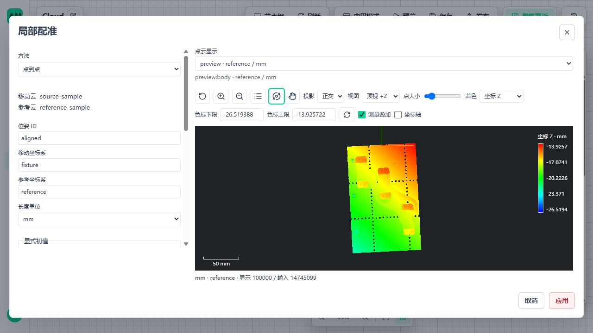
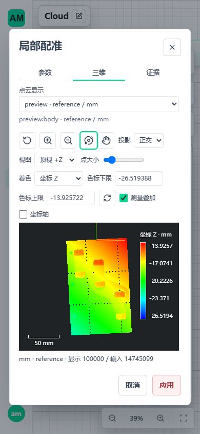
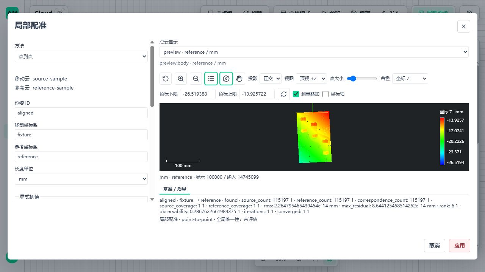

# B04 显式初值局部配准

日期：2026-11-05。实施基点 `436927cf`，包含前批 B03/B05 依赖；按提交范围确认，B03 法向公开链路、B05 位姿运算与本批 B04 局部配准合并提交。包 `0.1.26`，二十四个公开节点。原工件 111 节点、317 条边、50 项测量图未修改。

## 1. 本批交付边界

新增 `custom.metrology3d.register-cloud`，完整实现 Open3D 0.20.0 CPU Tensor ICP 点到点、点到面两种显式方法。输入是当前 Run 的移动云和参考云，输出沿既有 Pose3d、Found、Transform Cloud、位姿组合/求逆、保存读取和 Cloud Preview 消费。不新增资源系统、发布系统、依赖或后台调度器。

本批只证明给定初值附近的 SE(3) 六自由度局部对齐；不允许缩放、镜像，不声明全局唯一定位。自动粗定位、台面约束配准随后以独立方法接入，不自动回退。几何质量不是产品公差，也不是实体精度认证。

## 2. 参数和失败规则

| 参数/输入 | 契约 |
| --- | --- |
| source / reference | 同次 Run，可来自不同 observation；源/参考坐标分别声明，同一长度单位。参考可来自现有固定资产，不增加参考资源类型 |
| pose_id、source_frame_id、target_frame_id | 非空身份，源/目标坐标名必须不同；支持列表保留两云各自 observation、frame、单位、计数和内容摘要 |
| algorithm | point-to-point 或 point-to-plane；点到面要求参考云有完整有效单位法向，不静默丢点、不自动估计法向 |
| initial_translation | 参考坐标中的 XYZ 平移，单位为 length_unit |
| initial_rotation_degrees | 固定外旋 XYZ，矩阵 Rz × Ry × Rx，单位 deg；不是自动粗定位 |
| max_correspondence_distance | 显式正距离，不隐藏下采样或自动放大搜索范围 |
| max_iterations | 显式正整数，迭代到上限不等于已收敛 |
| fitness_change / rmse_change | 相邻迭代覆盖率/RMS 的绝对变化停止阈值；后者采用长度单位 |
| quality_policy | 必填对应数、双向覆盖、可观测性、秩、收敛下限及 RMS/最大残差上限；复用现有逐项限值计算，不设生产默认值 |

零重叠返回 `not_found/no_overlap`，支持不足或六自由度数值退化返回 `underconstrained`，迭代上限/质量失败返回 `insufficient_quality`。失败均不携带可执行矩阵，不复用上一件结果。错线、旧 Run、单位/坐标不符、坏位置/法向、工作预算不足属于输入/执行错误，不伪装成几何测量失败。未识别的原生异常保持执行错误，不被宽泛捕获成成功或低质量结果。

质量记录包括 source_count、reference_count、correspondence_count、source_coverage、reference_coverage、rms、max_residual、rank、observability、iterations、converged。源覆盖为源点有对应的比例；参考覆盖通过反向最近邻独立计算，不使用同一个分母。残差使用所有实际对应的欧氏距离，包括点到面方法。可观测性来自相应残差 Jacobian 的六维法方程，平移中心和旋转尺度归一；点到面不能冒用点到点信息矩阵。它是局部数值条件，不是对称物体全局唯一性证明。

## 3. 精度、来源和生命周期

- 原始 float32/float64 数组及属性不改写；Open3D 工作位置统一 float64。早期 float32 原生迭代在解析真值中产生约 3.48e-5 的矩阵误差，改为局部 double 工作数组后通过原 `2e-6` 真值断言，没有放宽容差。
- 配准仅借用两云，返回小型矩阵/方法/质量证据，不创建新的点云 owner。Transform Cloud 才沿既有资源边界生成变换结果；原始行号、uint64 大整数属性及存储精度继续保留。
- 姿态根证据明确区分 Build Frame 和 Register Cloud；B05 聚合按实际指标数量检查容量，不再假定每个根只有四项。固定 U/V 查询接纳局部配准 pose，但动态等高的物理基准仍必须是 Build Frame，不能将匹配变换冒充基准平面。
- 活体 Pose 支持必须通过当前 Scope、同次 Run 和内容摘要核验。持久资产保存方法与双输入摘要，不保存瞬时资源访问权限；重读复用现有方法证据解析，无兼容降级分支。
- 读取、诊断、原生迭代回调均检查取消；原生索引建立内部无逐行 Python 取消回调，强制停止仍依赖既有 worker 超时/整组停止。工作预算为保守准入，不是整个进程 RSS 硬限。

## 4. 接线与前端

基础：Read Cloud → Filter Valid → Register Cloud(source)，另一路 Read Cloud → Register Cloud(reference)；Pose 接 Transform Cloud，变换后的原云和 Pose 接 Cloud Preview。

点到面在参考支路显式连接 Estimate Normals；无符号但有效单位法向可用于平方距离目标。配准支路需要重采样时，显式放置既有 Resample Cloud，再将 Pose 用于完整原云。该选择会改变配准支持，必须在图中可见，不能由 Register Cloud 自动处理。

复用现有 MetrologyWorkspace、几何数值输入、质量规则编辑、显示选择和 CloudViewer。参数页展示移动/参考接线、方法、坐标与单位、初值、停止条件及质量规则；缺项/非法值禁止应用。切换节点、上游变更、禁用和卸载关闭编辑状态，旧 Preview 不冒充新结果。结果注明局部配准及未评价全局唯一性。

## 5. 验证结果

最终受影响后端组合：Windows **89 项通过**，WSL Ubuntu 原生数据目录 **89 项通过**。包括 Open3D 原生语义、两算法 × 两输入精度、独立椭球真值、无重叠、退化、迭代上限、坏法向、质量拒绝、旧引用、原始行号/大整数、保存重读、位姿求逆、正式注册/发布、启动停止和重启。Windows 首次受限运行停在 API 用例后终止，允许 localhost 子进程通信后原组合通过；不把中断计为通过。

前端配准/位姿/动态等高组合 **12 项通过**；追加查看器组合后 **31 项通过、1 项已有条件跳过**（未提供 I2 外部显示夹具）。Vue 类型检查、Vite 构建通过，保留已有大 chunk 警告。后端消费者补充的配准→求逆/组合→固定 U/V 断言在双平台各 21 项局部套件通过，属于上述 89 项的子集，不重复相加。

Windows 隔离 `5620/5621` 页面完成参数非法值阻止提交、保存重开、发布、切版、启动、同步 invoke 和停止；完整工件 Preview 成功，显示实际 100,000/14,745,099 点、参考坐标和配准质量。桌面/390×844 窄屏切换、缩放、3D 标准视角与证据可读性已验。修复查看器色标固定高度在证据展开后溢出画布的问题，改为受当前画布高度约束；不影响计算或点数。未修改系统显示缩放。Ubuntu 覆盖后端/原生库/发布，不冒称 Ubuntu GUI 验收。

本测试图公开 `body` 而非 HTTP Response 节点的 `http_response.body`，应用详情页按既有合同显示成功回执 JSON；三维交互在图编辑 Cloud Preview/参数工作区验收，不将其写成详情页自动渲染。初次 Vite 模板覆盖测试端口，发现后仅设置本轮临时 local 配置再进入测试；没有修改业务应用。







色标复核的真实 DOM 边界：画布 Y=273.156–453.156，色标 Y=289.156–437.156，五项刻度均在画布内。该项为真实浏览器布局检查，jsdom 回归不冒充 WebGL 布局证据。

完整样本为 14,745,099 点、479,677,235 字节 ASCII PLY，SHA-256 `ff2b9e0ef2d6c45af02c4bf8d474cd82f77f86ad92bd371a4c0f71b1b90d116b`。参考由独立 SciPy Rotation 按 `[2,-1,3] deg` 与 `[0.1,-0.12,0.08] mm` 生成，保留 double 参考坐标。完整样本使用已知精确初值验证全量链路；非精确初值的恢复另由解析椭球测试证明，不能混为同一验证。

| 正式发布对照 | Windows | WSL Ubuntu | 范围 |
| --- | --- | --- | --- |
| 两云各 14,745,099 点全量配准、完整变换 | 31.286 s，矩阵最大误差 4.26e-14 | 25.349 s，5.68e-14 | 对应半径 0.0001 mm，16 GiB 工作/2 GiB 活跃数组显式测试配置 |
| 两路显式 stride=128 配准，完整原云变换 | 2.717 s，7.15e-15 | 2.022 s，1.42e-14 | 各 115,197 点参与配准，4 GiB 工作/2 GiB 活跃数组；早期对应半径 0.8 mm |

两种完整样本对照使用点到点方法，通过实际 AppVersion → WorkflowAppRuntime → worker，并核对输出仍为 14,745,099 点、质量、租约回收及停止；点到面本轮以独立解析法向和两输入精度验证，未冒称完整实测法向场的性能结论。上述为单次含资源读取/显示的发布调用诊断，**不是原 50 项工件图十秒验收**，不能外推未知初值性能。概览显示 100,000 点不参与算法采样。

保留失败：Windows 双云全量、对应半径 0.8 mm 的尝试在 180 秒请求窗口超时；没有把成功的紧半径或显式重采样替换成该次通过。完整双云工作预留超过本机 4 GiB 生产配置，测试只调整隔离配置，业务默认仍为 1/4 GiB。尚无大范围姿态变化、多次真实采集与遮挡情况下的完整样本定位验收。

## 6. 复验与后续固定范围

```powershell
conda activate amvision
python -m pytest tests/integration/metrology3d/test_registration_native.py tests/test_metrology3d_registration.py tests/test_metrology3d_pose_operations.py tests/integration/metrology3d/test_formal_pack.py tests/test_metrology3d_activation_boundary.py tests/test_metrology3d_pose_query.py tests/test_metrology3d_transform.py tests/integration/metrology3d/test_registration_published.py
python -m tests.integration.metrology3d.registration_acceptance --root .tmp/b04-full --sample <完整样本路径>
```

WSL 临时数据、数据库、锁和 mmap 必须使用 Ubuntu 原生文件系统；源码/只读样本可在 Windows 挂载盘。完整验收脚本的 `--registration-stride 128` 表示在图中增加既有 Resample Cloud 节点，不是算法内部降采样；测试预算不能照搬为客户配置。

下一步依次：B04 自动粗定位的候选/多解与质量契约 → 独立变换、对称/遮挡真值和现有配准精化 → 台面约束独立方法 → 完整数据、存读、真实页面及双平台发布。复用当前 Pose/Scope/参考资产/B05，不重写局部 ICP，不改现有 50 项图。再按剩余清单推进 B06–B23。A01 十秒、A04 实物参考和 A13 新离线装配保持独立状态，不阻塞功能。

实施完成检查：本轮 API/Vite、测试 worker/Broker 已退出，5620/5621 无监听；未停止 5600/5601 业务服务。本轮 `.tmp/b04-*`、pytest 缓存、WSL 独立环境/数据、前端临时 local 配置及构建复制件均已清理，仓库 `.tmp` 无剩余条目。仅保留源码、回归、文档和页面截图；未修改系统缩放、生产容量或已发行包。Ruff 与 `git diff --check` 通过。

### 提交范围复核

2026-11-05 经确认合并 B03/B05/B04：三批共用 Pose 契约、正式 Catalog、handler、查看器、回归和总览文档，不拆出未经验证的中间版本。只纳入相关源码、测试、可导入示例、截图与文档；不纳入临时配置、点云测试数据或发行目录。提交前 Windows 定向回归 85 项通过，包含三批内核/运行来源、原生配准及目录生成一致性；变更 Python 文件 Ruff 通过。这是提交前补验，不与上文历史组合数量相加，不冒称重跑 WSL、性能或长稳。

自动粗定位、台面约束独立方法仍未实现；原工件十秒节拍尚未验收通过，实体精度仍缺独立实物参考和重复采集证据。当前源码能力尚未重装配并完成最终离线发行验收；本次提交不将这些限制标记为完成。

## 7. 上游证据

- [Open3D 0.20.0 Registration.cpp](https://github.com/isl-org/Open3D/blob/v0.20.0/cpp/open3d/t/pipelines/registration/Registration.cpp)：对应、零重叠、收敛和迭代实现；`relative_*` 命名实际按相邻绝对变化比较。
- [Open3D 0.20.0 Registration.h](https://github.com/isl-org/Open3D/blob/v0.20.0/cpp/open3d/t/pipelines/registration/Registration.h)：结果与参数接口。
- [Tensor ICP 文档](https://www.open3d.org/docs/latest/python_api/open3d.t.pipelines.registration.icp.html)：迭代回调、点到面法向、`voxel_size=-1`。实现以锁定 0.20.0 源码及本地原生回归为准，不从 latest 文档推断当前库行为。
