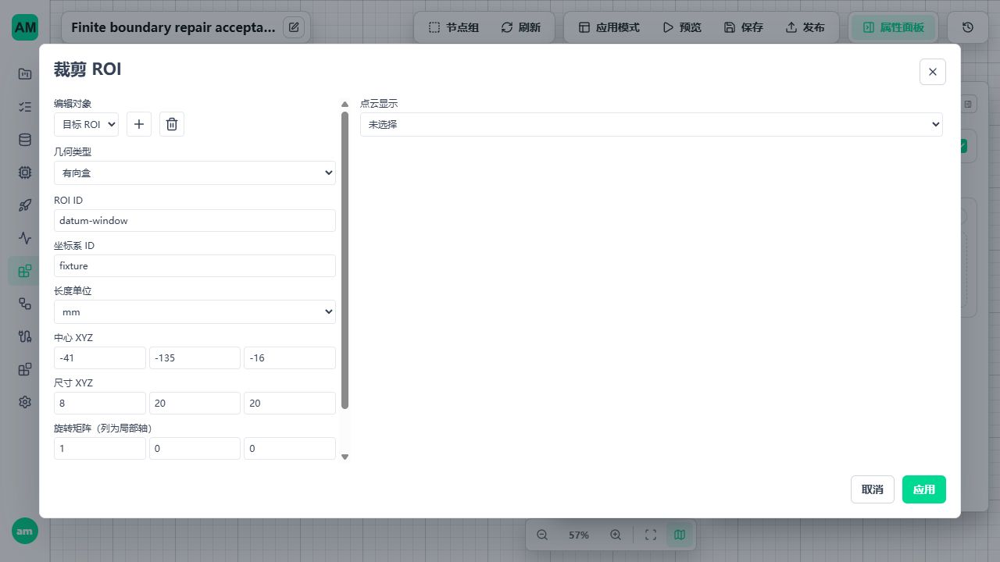
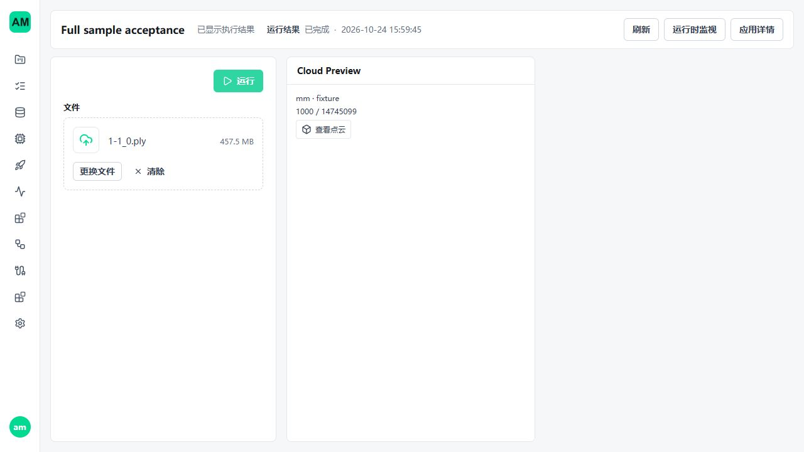
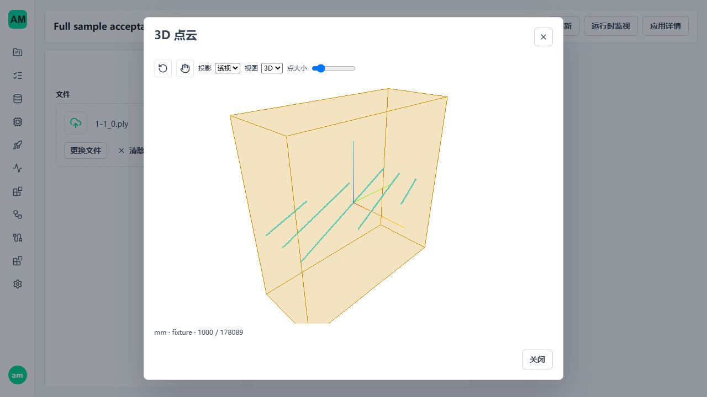

# 3D Metrology 参数与有限边段修复

## 1. 范围和结论

本记录承接 [真实工件审计](3d-metrology-audit-20261024.md)，不覆盖或改写该次只读审计的历史结果。
R1 公共参数分发、R2 输入错误分类、R3 有限边段选择已实现；2026-10-25 R4 基准有限延伸已内部实现，精确范围及结果见 [R4 记录](3d-metrology-r4.md)。
内部节点包版本为 `0.1.10`，仍位于 `_metrology3d_nodes`，未新增生产 manifest 或启用节点。
未改变受控 wheel、点云输入精度、模型训练/推理、调度、准入、队列或进程管理。

本次工程验证通过不等于十二钢片和两半圆的现场尺寸验收完成。真实支持不足、测量定义不同、
基准延伸不能靠放宽质量条件转为成功。M3.4 公开三态、M3.5 现场配方、生产容量和发行验收仍待完成。

## 2. R1 公共参数编辑

根因是未知顶层类型被当作字符串，以及标量控件分支遮蔽了已注册的编辑器。修复沿用现有组件：

- trusted editor、显式 `x-ui-widget` 和资源控件先于普通标量分发；没有新增 ROI 编辑器。
- 只展开唯一非空的 `oneOf/anyOf` 分支；复合联合保持结构化 JSON，不猜取首分支。
- nullable 数值保留约束，清空表示 null；可空布尔不以复选框把 null 显示成 false，使用已有 JSON 控件。非空布尔仍用复选框。
- Read Cloud / Save Cloud 未配置来源时显示“请选择”；选择才提交参数，取消资源选择和切换节点不残留旧来源。
- 真实页面发现画布 `overflow:hidden` 允许焦点触发额外滚动，导致工具栏移出视口；改为 `clip`。
  画布仍由既有 transform 平移，检查器保留自己的滚动，不增加第二套视口状态。

回归通过真实 Catalog 导出的 schema、实际分发组件和 composable，不 mock 类型分类器。
覆盖参数/输入 ROI、应用/取消、节点切换和卸载、来源提交、资源选择取消、JSON 对象、nullable 与只读。
保存重开后 ROI 的中心、尺寸、单位及来源与保存前一致。图编辑器舞台 `scrollTop=0`，工具栏保持可见。

## 3. R2 输入错误

只在受控文件解析调用边界翻译 parser 的 ValueError；不修改 GraphExecutor 全局异常策略，不换格式或解析器重试。

| 情况 | 当前结果 |
| --- | --- |
| PLY/PCD 编码与 profile 不一致 | `workflow_input_point_cloud_format_mismatch`，记录预期/实际编码 |
| 坏头部、缺行、截断、非法数据 | `workflow_input_point_cloud_header_invalid` / `data_invalid`，附 profile、阶段和有界 parser 摘要 |
| parser 显式预算拒绝 | `workflow_input_point_cloud_limit_exceeded`，不报坏文件 |
| 字段遗漏/多余或 dtype 不符 | `field_mapping_invalid` / `field_type_mismatch`，错误码带同一 `workflow_input_point_cloud_` 前缀 |
| 缺失或不匹配的受控发行依赖 | ServiceConfigurationError，附期望与实际版本 |
| 取消、超时、系统 I/O、分配失败、内部 RuntimeError | 原异常继续传播，不降级成输入错误 |

解析结果内部布局不符、资源身份不符等现有校验未改成坏文件分类。
预算与 Scope 释放沿用原路径。真实独立 Runtime 连续接收坏文件和正常文件，先返回明确输入错误，再成功执行；
停止后进程为空、租约/准入/容量归零。PLY、PCD ASCII/binary/compressed、XYZ 坏文件均有覆盖。

## 4. R3 有限实测段

2026-10-24 已确认：目标 ROI 选择既有有序边界的连续顶点，跨 ROI 排除点和原拓扑缺口必须断开；
同一目标多段命中返回歧义，不选最长段，不在 ROI 边缘插值新端点。

实现复用 `extract_boundary_array`、`OrderedSegment`、`roi_mask` 和 CloudRuntime：

1. 完整保留闭环时闭合性不变；部分选择为开放段，数组首尾只是存储起点，不能把原环相邻处误切断。
2. 原始断开的候选始终分别处理；无匹配为 `target_not_found`，多段为 `target_ambiguous`，单点为 `insufficient_support`。
3. 同一原轮廓的两个不重叠段可以由两个 target 选择；重复占用顶点为 `target_conflict`。
4. 原始点继续使用原始行号；已生成截面顶点保留原源边/面与权重，不新增 ROI 交点、不插值属性。
5. 目标闭合要求显式保留；开放段不能伪装为闭合孔。取消、预算、Scope、保存恢复继续走现有边界。
6. UI 沿用 BoundarySettingsEditor 和 RoiEditor，显示“连续实测段 ROI”和“要求完整闭环”。

语义变化显式版本化：`extract-boundary.method_version=2`，点云来源、资产内方法、边界特征和前端读取同步。
`fit-line` / `fit-circle` 仍为方法 v1，不能因继承关系被误升为 v2。
旧 extract-boundary v1 资产只保留只读元数据，不执行、自动迁移或删除；按新方法重新提取/保存。
现有 retired resource 路径识别旧方法身份，避免把可保留的历史资源误报为损坏记录。
受影响 Workflow 按现有依赖身份审核重发，不新增版本管理或兼容分支。

独立真值覆盖闭环首尾、开放段、多段、单点、重叠、两个相反边、输入乱序、截面来源权重与取消。
GraphExecutor 中有限段保存、重读后继续 fit-line/fit-circle 通过。完整样本另验证输出顶点等于原边界 ROI 内顶点，
原始行号/精度不变。该窗口不是本工件钢片尺寸真值。

## 5. R4 基准延伸契约

2026-10-25 当前实现及验证见 [R4 记录](3d-metrology-r4.md)。全部三维契约统一 v1，其他平台协议不变；本节及第 8 节旧升级计划由该记录替代。

### 5.1 已确认的边界

只用于 `height-query` 和 `measure-step` 的双平面方向测距；统计高差不允许携带本策略。
两种显式模式如下，均无隐式生产默认值：

| 模式 | 参数与约束 |
| --- | --- |
| `measured-support` | 基准交点与被测交点都需现有实测覆盖；不携带最大延伸距离 |
| `plane-extension` | 配方必须给出有限正数 `max_extension_distance`；只允许 reference 平面延伸，被测面仍需完整覆盖 |

字段名为 `reference_policy`，按 `kind` 判别；其余查询位置、单位方向、特征 ID、单位与坐标校验复用现有契约。
不得通过去掉 `reference_covered` 一条规则开启延伸。开启延伸不代表可以使用质量失败、退化、错坐标或错观测的基准面。
被测面和已有覆盖的质量规则继续执行；仅显式允许且无覆盖的基准侧进入延伸检查。

### 5.2 距离定义与评价

延伸距离沿用现有支持距离的切平面度量：交点到**实际基准支持点投影**的最小欧氏距离。
不是到无限平面的距离（恒为零），不是到 ROI 包围盒/质心的距离，也不把显示降采样点作为支持。
在现有有限基准支持中按块扫描取得最近点及其原始行号，不对整云建立新的全局三角网。
该距离是到观测点的保守度量，不称为到连续支持域边界的精确距离；采样间距影响必须显示在证据中。
实现前的独立真值必须核对这一数学定义，不可偷偷换成凸包距离。

- 先计算现有覆盖；覆盖成立仍执行现有覆盖质量，`used_extension=false`，延伸距离为 0。
- 覆盖不成立且显式允许延伸时，基准自身拟合质量、方向余弦及完整来源身份仍须通过；
  按上述度量计算距离，`distance <= max_extension_distance` 才允许使用模型交点。
- 被测面所有局部三角形、边长、残差、方向与来源检查原样保留。没有被测支持仍返回无效。
- 延伸路径有独立的必需质量项集合；现有基准交点的实测三角形质量不伪造为通过。
  参数 schema、结果 validator 和已有 geometry_quality 必须共同核验适用集合，不新增限值算法。
- 空支持、无效基准、方向近乎平行、预算/取消、非有限结果分别走现有失败边界；超过最大距离返回明确无效，量值 null。

### 5.3 证据与所有读取方

在现有 reference support 增加显式延伸证据，不修改被测支持的真实来源：

| 字段 | 含义 |
| --- | --- |
| `used_extension` | 本次是否实际使用模型延伸交点，不等于配方允许延伸 |
| `distance_metric` | 固定 `nearest-projected-support-point`，不混用边界/质心距离 |
| `distance` / `max_distance` | 实际延伸距离与配方上限，使用测量 length_unit；未能计算时距离为 null |
| `nearest_support_point` / `source_index` | 全精度支持点和最初输入行号；不能引用显示点索引 |
| `endpoint_origin` | `supported` 或 `datum-extension`，不能把模型交点标成采集点 |

继续保留平面参数、拟合方法、质量、支持 bounds、完整内容摘要和观测身份。原 coverage 可以为 false，
不得补假三角形、假原始行号或将 extrapolated 改成 measured。总体来源结合双方角色表达为 mixed，
其含义由逐侧证据限定，不把被测面也称为外推。

当前测量证据和方法统一 v1；长宽/边距/孔径公式不变。
同批核对 contracts validators、Catalog ports、measurement_result/support、cloud-preview 与资产内证据、
frontend measurement-display、共享 CloudViewer/MeasurementSettingsEditor、Preview、App Mode、历史结果和 SDK 样例/测试。
所有生产者和读取方同步当前 v1 严格结构；旧受影响发布审核重发，既有数据保留并明确拒绝旧格式，不维持旧算法分支。

前端两种模式显式选择，延伸模式才出现必填距离上限。三维标注用不同线型标出基准延伸交点与支持，
同时显示实际距离/上限与失败原因；原始基准 ROI 不移动到查询位置。点击有界预览只改候选查询，仍须显式 Preview 重算。

### 5.4 下一步实施验收

1. 先加逐字段契约和拒绝测试：错误角色/模式、缺少距离、统计模式携带策略、旧版本、虚假覆盖和伪造原始行号。
2. 独立解析平面覆盖域内、域外、上限恰等/略超、法向反转、刚性变换、单位转换、非均匀采样、无被测支持和近乎平行。
3. 复用分块最近点查询和 geometry_quality 实现，不改 CloudRuntime 生命周期，不新增查询会话或后台缓存。
4. 同批升级上述所有证据读取方；用保存恢复、只读历史和 Preview/发布 Runtime 验证没有语义混用。
5. 对完整工件建立与手工报告相同定义的基准/钢片中心配方，再比较有效量值；不复用宽松测试质量条件作现场阈值。
6. Windows/WSL 原生数据目录、坏输入、取消/停止与回收通过后，再推进公开三态与现场整套配方。

## 6. 本轮验证

| 范围 | 结果 |
| --- | --- |
| Windows 组合 | 501 passed，9 deselected，105.72 秒 |
| WSL Ubuntu 原生目录组合 | 499 passed，2 skipped，9 deselected，225.04 秒 |
| Windows 完整样本与真实发布生命周期 | 2 passed，110.75 秒 |
| Ubuntu 坏文件 Runtime 恢复及完整样本/真实发布生命周期 | 3 passed，135.91 秒；坏文件项与组合重合 |
| 最终前端工作流/参数集合 | 33 文件、209 passed，包含真实分发与生命周期回归 |
| 静态检查 | Vue 类型检查、23 个变更/新增 Python 文件 Ruff 检查及格式检查、git diff --check、6 份文档本地链接检查通过 |

组合选取 `tests/test_(metrology3d|point_cloud|retired_cloud)*.py` 与 `tests/integration/metrology3d`，
排除名称中的 `full_sample` / `complete_sample`，完整样本另行执行。
Ubuntu 跳过的是 .NET net472 Windows 的 bytes/fill 两项；Ubuntu 使用实际 Python 协议覆盖，不声称 .NET Ubuntu 已验收。
Windows 完整发布链使用 .NET fill/bytes，Ubuntu 使用同机协议；均覆盖停止中调用、旧 generation 拒绝、
停机切版、writer/client 异常退出和重新调用，核对准入、租约、容量回收。
结构化证据：[Windows](assets/metrology3d-repair-20261024/boundary-windows.json)、[Ubuntu](assets/metrology3d-repair-20261024/boundary-ubuntu.json)。
这些通过数量不与逐步定向回归重复累计。

完整样本为 `1-1_0.ply`，479,677,235 字节、14,745,099 float32 XYZ 点。
文件 SHA256 为 `ff2b9e0ef2d6c45af02c4bf8d474cd82f77f86ad92bd371a4c0f71b1b90d116b`；
XYZ 数组 SHA256 为 `956927f058ba4a0170b1c1b93b1411b613fbe21fcbfc278ad0a7fc3cf621a1c6`。

### 6.1 页面实际步骤

1. 隔离空库创建应用，页面添加文件入口、Read Cloud、Crop ROI、Cloud Preview，实际连线并公开输出。
2. 显式选择文件来源、填写现有格式映射、使用 ROI 编辑器配置中心 `[-41,-135,-16]`、尺寸 `[8,20,20]`、mm/fixture。
3. 上传完整原文件，Preview 成功；ROI 得到 178,089 点，原始总点数保持 14,745,099，显示限额 1,000。
4. 保存、离开并重开，核对参数；发布 v1，通过正式 API 创建的 Runtime 上传原文件成功。
5. 页面配置现有 App Mode 面板、发布 v2，先停止 Runtime 再切版/启动；App Mode 再次选择原文件并运行成功。
6. 打开三维视图，核对点数、单位和 ROI，切换正交/Z 视图可见变化；页面控制台无 error/warn。

页面建立的 v1 调用与最终 stopped/PID 空状态见[精简运行记录](assets/metrology3d-repair-20261024/blank-page-run.json)；
v2 的实际 App Mode 文件调用完成状态和显示见下方截图。

上述 ROI 与显示限额是显式测试配置，不是生产默认或钢片尺寸真值。结果摘要分母是原始总点数，
三维窗口分母是当前 ROI 点数，两者不能混作输入丢点证据。1,000 点显示为均匀逻辑索引抽样，测量不使用该显示样本。
此页面链验证公共编辑和完整文件运行；有限段的保存拟合/完整样本由前述真实 Graph/Runtime 回归覆盖，
未声称已经从页面配齐十二钢片和两半圆的所有有效测量。

## 7. 审计与收尾边界

几何公式和输入 dtype 未改变；有限段选择是明确授权的语义变化，不能把其新输出与旧整条候选混用。
新增选择只处理已有有限候选和索引，沿用既有工作预算及取消，不引入全云副本、常驻缓存或等待队列。
本轮没有 P99、长稳或工业计量认证结论。源码测试与实际文件链路覆盖不等于任意工件、1 GB 任意布局、
最低内存或长期资源门禁已经通过；标定、不确定度、重复性和最终现场公差仍需单独验证。

测试环境使用独立 5620/5621，未修改既有 5600/5601 服务或业务数据。收尾已由页面停止 Runtime，
正式 API 确认 stopped/stopped、worker_process_id=null；本轮 API/Vite 退出，5620/5621 无监听。
Windows 按命令与父进程核对无测试残留，WSL 无本轮 Python/worker 活动。
证据保留后，仓库 `.tmp` 与 `/home/am/.cache/amvision-metrology-repair` 已删除并确认不存在。
原始 PLY 清理后 SHA256 与第 6 节一致；原始点云、手工测量产物、CloudCompare 窗口及历史业务资产均保留。

## 8. 2026-10-25 进度与下一批实施

### 8.1 当前代码基点

核对基点为 `57070088`。R1/R2/R3 已提交，第 6 节仍为 2026-10-24 的验收记录，不是本次重新执行的测试。
R4 内部包为 `0.1.11`，十八节点及其前端已接入，生产 manifest 仍不存在；本节原规划按本轮确认同步，实际验证单列于 R4 记录。

| 阶段 | 已有节点 | 当前边界 |
| --- | --- | --- |
| M1 | read-cloud、normalize-units、filter-valid、save-cloud、export-cloud、cloud-preview | 文件/同机数组、资源保存导出、有界显示及运行释放已内部接通；filter-valid 不是去噪 |
| M2 | crop-roi、fit-plane、build-frame、transform-cloud | 有限 ROI、SVD/RANSAC-SVD、显式基准坐标、刚性变换；不从单样本推断生产阈值 |
| M3.1 | height-query、measure-step | 高度/双平面方向距离与 ROI 统计差；方向测距显式选择实测基准或有限延伸，被测面必须实测支持 |
| M3.2 | extract-boundary、fit-line、fit-circle | 投影/截面/等高边界、有限连续实测段、直线和圆拟合；全部三维方法统一 v1 |
| M3.3 | measure-extents、measure-edge-pair、measure-hole | 轴向/最小矩形尺寸、有限支持边间距、消费 CircleFeature 的孔/圆弧尺寸；不重复拟合 |

R4 内部实现后完成 R5 的真实测量定义与配方验证，之后进入 M3.4 共享判定升级和 M3.5 最终交付。
不能把“十八节点有实现”写成“十二钢片及两半圆已准确测量”，也不能直接跳过已发现的测量定义差异。

### 8.2 R4 的实际修改边界

| 现有源码 | R4 前的行为 | R4 实施边界 |
| --- | --- | --- |
| [measurement3d_parameters.py](../../backend/contracts/workflows/measurement3d_parameters.py) | 方向测距双方使用相同必需指标，covered 下限必须为 1 | 第 5 节的 reference_policy；实测与延伸路径的质量项、单位和适用条件显式区分，统计差不接受策略 |
| [measurement_support.py](../../custom_nodes/_metrology3d_nodes/shared/measurement_support.py) | 在 support_radius 内统计邻点、残差并建立三角覆盖；现有 nearest_distance 不是全基准支持上的最近距离 | 复用分块借用与切平面投影，补有限基准支持的最近点/原始行号；不能直接拿现有局部 nearest_distance 作延伸距离 |
| [measurement_result.py](../../custom_nodes/_metrology3d_nodes/shared/measurement_result.py) | 双方都走 plane_coverage，固定覆盖质量决定 valid | 只给 reference 增加已确认模式；沿原交点和有符号距离公式计算，不重写高度算法或放松 target |
| [measurement3d_evidence.py](../../backend/contracts/workflows/measurement3d_evidence.py) | 有效结果必须双方 covered；支持、指标、参数摘要严格相符 | 方法与证据统一 v1，增加逐侧延伸证据；校验器和计算使用同一适用质量定义，拒绝假三角形/假原始行号 |
| [measurement_preview.py](../../custom_nodes/_metrology3d_nodes/shared/measurement_preview.py) | 显示前重新核验配置质量，不能只信 usable | 同步适用质量集合，避免计算成功但 Preview 按旧实测规则拒绝，或反向放行错误证据 |
| [catalog_builder.py](../../custom_nodes/_metrology3d_nodes/workflow/catalog_builder.py)、dimension_runtime | 五类尺寸共用 MeasurementEvidence3d 与端口 | 同批更新证据封装/端口，回归长宽、边距、孔径；它们的数值公式及方法版本不因封装升级而变更 |
| [MeasurementSettingsEditor.vue](../../custom_nodes/_metrology3d_nodes/frontend/MeasurementSettingsEditor.vue)、measurement-form、[measurement-display.ts](../../frontend/web-ui/src/workflows/workflow-editor/point-cloud/measurement-display.ts) | 已有原子草稿、候选拾取和三维显示 | 原编辑器增加两种基准模式、单位化距离上限、适用质量及延伸标识；同批更新共享查看器和所有实际读取方 |

继续使用 CloudRuntime、Scope、既有质量比较器、Workflow 发布和 Runtime。只增加本次必要的契约与计算分支，不新增节点、原云常驻会话、Broker、队列、发布管理器或依赖包。
本轮确认覆盖全部三维契约：普通点云、边界资产、特征、显示、测量证据及方法统一 v1。二维序列化/摘要不变，旧三维文件保留但不符合新结构的内容拒绝执行，重新导入/保存；不自动迁移数据。
SDK 通用 JSON 透传不等于必须新增测量专用 SDK API；核对实际字段读取、示例与输出一致性，不改无关数组传输 ABI。

### 8.3 R4 分步实施与检查

| 顺序 | 实施内容 | 进入下一步的条件 |
| --- | --- | --- |
| R4.1 契约 | 按第 5 节定义两种显式策略、距离、逐侧来源、失败证据和适用质量；固定状态与 null 规则 | schema/validator 拒绝缺上限、非有限值、错误角色、统计模式混用、质量项缺失和旧版本；不填生产数值 |
| R4.2 基准支持 | 复用切平面基和分块只读扫描，取得全基准支持最近点及其原始行号，沿现有预算和取消机制 | 独立解析真值覆盖距离边界、法向反转、刚性变换、单位转换、非均匀采样；释放与身份校验正确 |
| R4.3 高度与高差 | 先 height-query，再复用同一方向测距逻辑接 measure-step；统计分支不改公式 | 双节点真值和失败路径通过；无 target 支持仍无效，有基准覆盖但覆盖质量失败时不得改走延伸以规避门禁 |
| R4.4 全部读取方 | 同一交付批次统一三维 v1、Catalog、显示/结果持久化和实际 SDK 读取；分步提交测试不能造成半升级可运行状态 | 数值表与证据一致、保存关闭重读一致、旧数据不被新语义默读；长宽/边距/孔径及普通云资产回归通过 |
| R4.5 前端 | 扩展现有参数编辑器、质量表与共享三维覆盖层 | 模式切换不残留隐藏参数；应用/取消、节点切换、晚返回、卸载和只读历史正确；从空白图实际配置可完成 |
| R4.6 发布运行 | 用新配方经真实发布、Runtime、文件/同机输入运行；覆盖切版、恢复、停止、异常退出及回收 | 新发布可运行，受影响旧发布/旧资源被正确拒绝或只读，无关发布不受影响；Windows/WSL 原生目录验证通过 |

R4.1 先列分支真值表：实测覆盖通过、实测覆盖存在但质量失败、无覆盖且未允许延伸、无覆盖且上限内/超限、基准拟合失败、target 缺测、方向近平行。
只有“无基准覆盖且显式允许、基准自身质量通过、距离上限内、target 全部质量通过”可使用延伸交点。
被测支持、方向条件、原始内容/观测身份、异常与取消均不能被延伸分支绕过。

延伸模式的适用指标解析由参数、计算、证据和显示共享一个定义，限值计算继续使用原比较器。
有覆盖路径保留原来的计数/最近距离/三角边长/残差检查；延伸路径不把不存在的三角支持指标伪造为零或通过。
证据须区分“允许延伸”“尝试但超限”“实际使用延伸”“另一侧失败导致整体无效”，不得只用一个最终 valid 隐藏原因。
字段如何表达这些状态在 R4.1 中完成严格验证，不增加第二套任务状态。

发布保护先复用并验证当前冻结依赖、定义/包版本、worker 校验及选版准入。
新增契约是否被所有启动、切版、恢复入口执行，由真实正反用例证明；只修复实际缺口，不能因文档的早期描述就重写现有发布系统。
实现代码身份与冻结文件指纹分别核对，不把“文件未改”当成“仍执行旧算法”的证明。

### 8.4 工程师与现场交互

1. 工程师在原高度/高差编辑器选择“基准需实测支持”或“基准平面延伸”。只有延伸模式显示必填的最大距离及单位，空值禁止应用；统计差不显示该控件。
2. 原基准特征选择、查询位置、方向、目标搜索范围与质量编辑保留。切换策略后既有结果失效；拾取只填候选，仍需显式 Preview，不随鼠标操作自动测量。
3. 结果表显示数值/无效原因；详情显示基准模式、是否实际延伸、延伸距离与上限、双方质量及来源。沿用当前选择测量项联动三维的路径。
4. 三维区分实际基准支持、延伸模型交点和被测实测支持，使用线型与文字，不只依赖颜色。原始 ROI 不挪到交点处，不给模型交点伪造采集点标记。
5. App Mode 只读取发布配置及结果，不向现场人员暴露内部阈值。未保留原云的历史结果仍只能看有界证据，不新增历史重测会话。

### 8.5 R5 真实工件与后续阶段

2026-10-25 后续核对已细化为 [R5 真实工件配方设计](3d-metrology-r5.md)，以已提交 R4 `23ed5f47` 为基点。该文列出逐对象 ROI、报告实际算法、现有接线能力和待确认定义；下表保留阶段顺序，不表示配方已全部可执行或本轮完成实测。

| 顺序 | 具体工作 | 完成依据 |
| --- | --- | --- |
| R5.1 一个代表性测量项 | 完整原文件读取；选明确基准/一个钢片目标 ROI，走 height-query 和双方拟面 measure-step；分别检查点数、基准、坐标和量值 | 与独立解析用例及手工报告的测量定义对齐；仅在同定义下比较数值，不把中值差当中心高度 |
| R5.2 扩展到十二钢片 | 复用同一通用图结构、稳定 item_id 和不同显式 ROI/评价位置；逐项记录支持、有效值或具体拒绝原因 | 每项均可追溯到输入摘要、配方和质量；不能只报告成功项或靠宽松条件凑齐十二项 |
| R5.3 长宽及两半圆 | 有限连续实测段接 fit-line/measure-edge-pair；包络尺寸明确标名；圆弧接 fit-circle/measure-hole | 实测段/缺口/角度支持与定义可核对；孔径不重拟合；无法形成合格边界时保留无效并区分提取、选择和拟合失败 |
| M3.4 共享三态 | 在现有 Check Limits、Result Record 及实际读取方实现 OK/NG/INVALID，沿实施基线 8.4–8.6 | 真值表、二维回归、结果表/历史/HTTP/SDK/PLC/数据库/文件输出与发布审核一致，不增三维判定器 |
| M3.5 最终配方 | 从空白页面完成公开输入、测量、规则、结果显示与交付，发布后由 App Mode/外部系统调用 | 同一发布版本端到端一致；失败、取消、切版、回收、历史查看均通过，并保留测试与生产配置区别 |
| 生产启用 | 按已批准预算和目标 profile 完成 bundled Windows/Ubuntu、依赖/NOTICE、资源及现场准确度验收 | timeout、kill grace、工作/显示容量、机器内存和节拍有明确依据；未确认前节点保持隐藏 |

手工报告、CloudCompare 或探索脚本只能作为定义明确的对照，不能通过调阈值追赶它们的数值。
R5 如证实缺少通用测量能力，例如现有有限表面不能表达所需高度边界，应提交具体失败证据与方法差异再决定扩展，不能自动复制单工件处理脚本或引入填洞近似。
M3.4 的源码清单可以提前核对，但共享行为变更安排在上述几何/配方问题收口后；最终三态验收在 M3.5，不混入 R4 的内部几何有效性。

### 8.6 验证安排与停止条件

每步只跑对应契约/算法/前端定向回归并审计差异；最终冻结一个候选后执行一次影响范围内组合、双平台完整样本及真实发布验收。
Windows 优先，WSL Ubuntu 的运行数据使用原生文件系统，源码与样本可在 Windows 盘；.NET net472 按 Windows 支持范围验证，Ubuntu 不冒称通过未支持的 SDK 路径。
本批不重跑模型 P99，不新增队列或放宽质量门禁，不自动启动长稳。若后续安排三维资源长稳，应另明确输入和预算，自动执行不超过已约定的一小时。

现有功能可用于内部开发，不等于现场准确度已认证。生产公差、标定/重复性、延伸距离和最低部署容量不得从本机或一个样本猜测。
若实现需要改变已确认测量定义、扩大第三方库修复范围或处理现有业务数据，先确认；现有授权足够开始 R4 契约与内部实现，无需反复询问已确认的两种模式。

本次进度规划只核对源码、提交与既有验收记录，并同步文档；没有修改运行代码、安装依赖、启动测试服务或重新执行应用测试。
