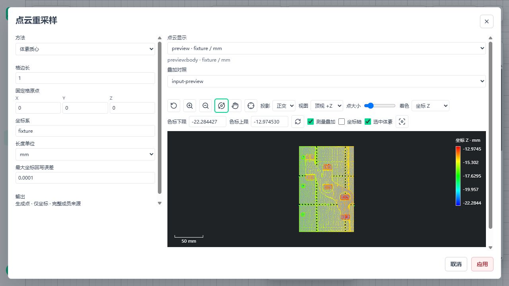
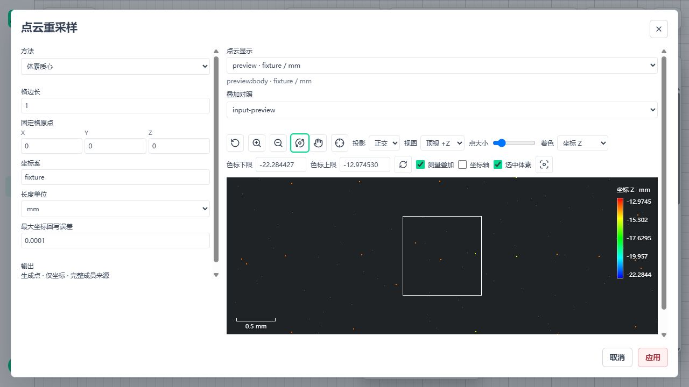
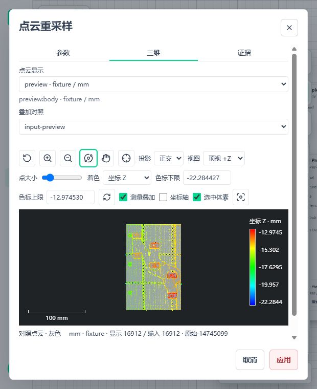

# B02 对照显示与 B03 运行字段

日期：2026-11-04。源码基点 `ac56abd4`，本记录对应其后的工作区；包 `0.1.23`，仍为二十个公开节点。前批三方法及内核记录见[重采样实施](3d-metrology-resample.md)，全局剩余见[剩余清单](3d-metrology-remaining.md)。

## 1. 当前位置

| 范围 | 本批完成 | 保留边界 |
| --- | --- | --- |
| B02 对照 | 同次 Preview 输入/输出叠加、选中体素格框、聚焦、开关；桌面和窄屏共用一个查看器 | 对照只接受相同 run/observation/frame/unit；不是跨运行配准或算法输入 |
| B02 细节 | 资产叶块中的原始格键、成员数和当前坐标格框；单位/刚体变换/子集/保存重读一致 | 叶块不传完整成员 CSR；完整成员仍保存在资产，不塞入浏览器 JSON |
| B03 内部链路 | normal_info、字段所有权、逐点状态、运行注册、保存读取、单位/姿态、导出检查、概览/细节拾取 | 尚无公开 estimate-normals 节点、参数编辑器和法向线段显示，不能视为 B03 完成交付 |
| 原工件 | 111 节点、317 边、50 项测量图不变 | 未插入重采样或法向，未以减点宣称十秒通过；没有改变质量门禁 |
| 发行 | 契约和所有本批读取方同批更新；Catalog 由源码生成 | 未重装配离线包；旧体素开发资产缺 voxel grid 时明确拒绝，保留数据并要求重建 |

## 2. 契约与资源审计

### 2.1 格框不是点坐标包围盒

原 `voxel_aggregation` 保留最初格定义和参数摘要。新增 `voxel_grid` 记录当前空间的原点和三个格边向量：单位换算同时缩放；刚体变换同步旋转和平移；子集不改格索引。格轴校验复用现有 `ORTHOGONAL_TOLERANCE`，没有另设更严格条件拒绝原本合法的近似旋转矩阵。

概览和细节都用原始 int64 格键及 uint64 成员数，当前格框由八角计算。浏览器只接受可安全表达的索引；不把原聚合 frame 标签套在变换后的坐标上。完整成员行号依旧由平台资产的 CSR 保存，生成点不伪造唯一 source_indices。

输入对照沿现有显示传输读取有界 payload，不重新构建 I2 几何。独立叠加层在同一 renderer 中持有 BufferGeometry，统一 CPU/GPU 预算；总显示点预算同时计入主云、对照云和已加载细节。切换、请求晚返回、解码/安装失败和卸载均释放；不改参数或测量结果。聚焦复用既有相机 fit 计算。

### 2.2 法向不是位置有效性

- `normal_info` 保存原方法及参数摘要、原 run/observation/cloud/revision，并另存当前 frame/unit/定向参考。历史身份仅用于追溯，不授予已经结束的 Run 数组访问权。
- 位置和所有非计算属性逐位保留，包含大于 JS 安全整数的 uint64 字段。法向 dtype 与位置一致；诊断 RMS 具有长度单位，单位换算会缩放；方向只旋转，观测点旋转和平移。
- `normal_valid`、`normal_oriented`、`normal_reason` 为独立 uint8 标量。无效法向为零占位且带原因，不能因此删除位置；无符号有效法向不冒充已定向。
- 质量失败、支持不足、退化、数值失败、定向歧义分别保留。注册/读取检查字段配套、有限数值、单位向量、状态一致及诊断范围；不通过重新拟合覆盖原结果。
- 输出、身份数组、邻域工作空间先计预算，复用 OwnedCloudArrays 和 ResourceScope；取消每个检查点均回收，不创建另一套资源系统或等待队列。
- source 保存最初原始行号；体素 generated 保存全部成员与原聚合定义。源边/面和格剖面 generated 的法向组合专项仍需在公开节点交付前补验。
- 平台无损资产保存全部计算说明。PLY/PCD 选择计算法向时必须同时导出三项状态；XYZN 无法存状态，存在无效/未定向法向时在写出前拒绝。交换格式摘要明确 `normal_info_preserved=false`，不冒充平台资产。
- 前端概览/保存资产细节拾取核对同一状态；区分已定向、有效无符号及失败原因。当前只显示选中点向量，不含未实现的法向线段层。

## 3. 验证记录

| 环境 | 范围 | 本批结果 |
| --- | --- | --- |
| Windows | 点云/几何/资产/显示/B01/B02/B03 组合 | 488 项通过；另五项启动器测试被沙箱临时目录权限阻止，原生重跑该文件 9 项全部通过。两组覆盖有重叠，不相加为独立测试数 |
| WSL Ubuntu 24.04 | 重采样、法向内核/运行字段、体素显示契约 | 57 项通过；没有 Ubuntu GUI 验收声明 |
| Windows/WSL | 完整 14,745,099 点三方法、逐行来源、全部成员、存读及 Scope 预算归零 | 各 1 项通过，输出位置 SHA256 与前批一致 |
| Windows | 前端五组：重采样编辑器、对照生命周期、概览/细节、查看器生命周期 | 54 项通过，1 项既有条件跳过；Vue 类型检查通过 |
| Windows | 最终候选正式 AppVersion → Runtime → Trigger → worker，三方法切版及停止 | 三次通过；每次检查租约/许可回收 |
| WSL Ubuntu 原生目录 | 同一最终候选正式发布/worker，三方法切版及停止 | 三次通过；租约/许可回收通过，不修改启动窗口 |
| 静态审计 | 21 个变更 Python 文件、生成 Catalog、前端类型、差异空白 | Ruff 检查/格式检查、Vue 类型和 git diff --check 均通过；无临时测试文件混入源码 |

完整样本仍为 `1-1_0.ply`，479,677,235 字节，SHA256 `ff2b9e0ef2d6c45af02c4bf8d474cd82f77f86ad92bd371a4c0f71b1b90d116b`。stride 输出 4,915,033 点，体素代表和质心各 16,912 点；当前局部耗时不是原工件 A01 正式测量计时。

本批 B03 完整样本扩展使用上述全部质心，检查所有位置和体素 CSR 不变。参数沿用理想平面真值测试：k=8、max_rms=1e-5 mm、max_surface_variation=1e-8；两平台均为 16,912 个 QUALITY_FAILED、无有效法向。这是失败状态与来源链路验证，**不是完整原始 14,745,099 点法向验收，也不是工件法向质量通过**。有效法向的数值正确性由独立倾斜平面/球面及 float32/64 用例验证；真实应用参数/完整原云成本随公开 B03 交付补齐，不反调当前质量门槛。

WSL 初次从挂载盘启动发布超过原启动窗口，随后测试源码与运行数据均放原生目录；没有增加窗口。原生副本先补齐遗漏的仓库 config 和受控 I/O 核验文件，再执行测试。准备失败不计通过。依赖只进入本轮授权隔离环境，未改系统 Python、锁定版本或业务配置。

### 3.1 Windows 页面

隔离端口 5620/5621，完整原始资产 Preview；输入对照 100,000 个有界点、输出全部 16,912 个质心，算法仍使用完整原云。已验证对照选择、拾取、格框显隐/聚焦、关闭取消及 620×760 窄屏参数/三维切换，页面无控制台错误。没有修改系统显示缩放。

选中顶点 8510，原格 `(0,-36,-14)`、fixture/mm、168 个成员；白框为该真实 1 mm 格，聚焦后显示 0.5 mm 比例尺。格距仅属于显式测试配方，不是尺寸算法的降采样。

## 4. 固定下一步

1. B03 参数编辑：复用 GeometryFields/MetrologyWorkspace，邻域三选一、质量必填、定向三选一、显式替换原法向；缺参不能应用，不增生产默认。
2. 法向线段显示：复用当前显示预算和 renderer，只绘制明确选中的有界有效向量；无符号不画定向箭头，保持点/法向状态和拾取一致，验证关闭/晚返回释放。
3. 接真实 handler/Catalog/端口摘要，补源边/面和格剖面 generated 的存读、变换组合；真实原云、B01/B02→B03 配方、双平台发布/停止及 Windows 页面同批验证，通过后才登记第 21 个节点。
4. 后续 B05 变换组合/求逆 → B04 定位配准 → B06–B23，沿剩余清单推进。A01 十秒、A04 实物参考、A09 精确容量分角色认证、A13 最新离线装配继续单列，不阻塞功能。

本批没有重复全工件性能/长稳试验，没有把新代码装入旧发行目录，没有删除业务资产或原样本。

## 5. 环境收尾

本轮后端、Broker、worker、Vite 和测试客户端已退出；Windows 5620/5621 无监听，WSL 本轮进程表无残留。核对身份后清空仓库 `.tmp`，删除 `/home/am/amvision-b02-display-run` 和 `/home/am/amvision-b02-display-env`；业务 5600/5601、原点云、手工报告、既有发行和资产不动。截图保留在本记录 assets 中。未自动提交 Git。
