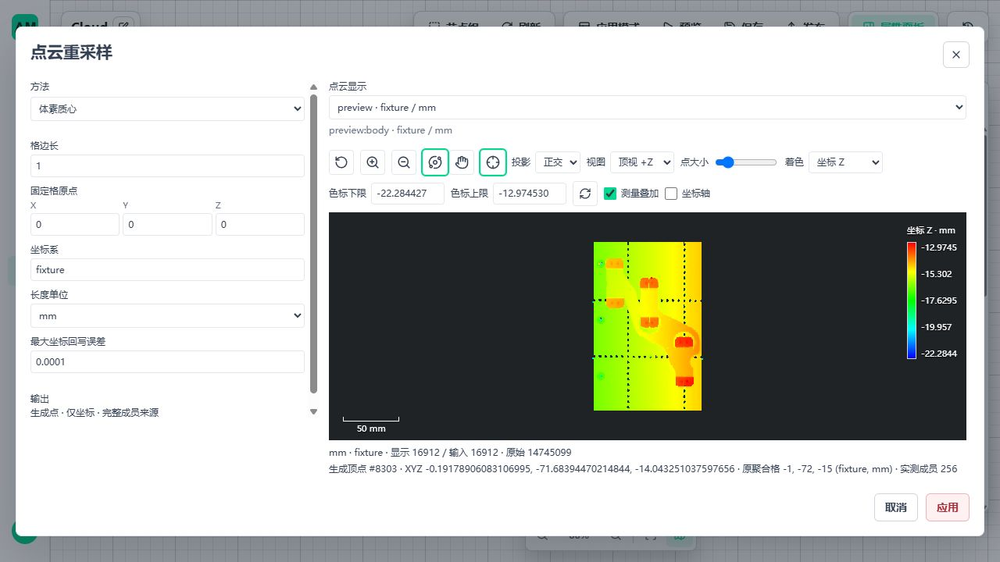

# B02 重采样实施与 B03 内核验证

日期：2026-11-04。基点 `21d73f78`，本记录对应本轮未提交工作区；不是新离线发行证明。规格见[预处理方案](3d-metrology-preprocess-plan.md)，统一剩余范围见[剩余清单](3d-metrology-remaining.md)。

本批已提交为 `ac56abd4`。后续 `0.1.23` 已补输入输出叠加、选中格框/聚焦和资产细节成员拾取，并接通 B03 内部字段/所有权/存读消费者，见[后续实施记录](3d-metrology-resample-display.md)。以下保留 `0.1.22` 的当时状态和验证数字，不作为当前剩余清单。

## 1. 交付位置

| 项目 | 本轮实际完成 | 尚未完成 |
| --- | --- | --- |
| B02 方法 | `stride`、`voxel-representative`、`voxel-centroid`，一个正式 `resample-cloud` 节点，包 `0.1.22`，当前二十节点 | 不含递归体素聚合、隐式属性平均；这两项不是本批方法 |
| B02 来源 | source 保留原始行号；generated 保存体素键、完整原始成员 CSR、原聚合方法；区分 surface/grid-profile/voxel-aggregate | 不把来源行号当成未保存原云的重算权限 |
| B02 资产/链路 | 复用保存读取、ZIP 跨项目映射、正式发布 Runtime/Trigger/worker、停止与版本切换 | 新源码未装配进新离线包；没有本批任意1 GB布局或长稳认证 |
| B02 界面 | 方法互斥参数、合法草稿应用/取消、Preview 切换、原始行/生成顶点及有界体素成员拾取、桌面和窄屏 | 输入输出叠加、选中格框、资产细节叶块的体素成员拾取仍未实现；当前概览拾取提供成员数，不返回完整成员 JSON |
| B03 | 邻域/质量/定向 DTO，精确 kNN/radius/hybrid、PCA、逐点状态及三种定向内核，双平台独立真值 | normal_info 与运行注册、字段所有权、保存/变换/导出消费者、公开 handler/Catalog、参数/法向显示、完整样本发布尚未接通 |

原 111 节点、317 边、50 项工件图未加入去噪或重采样。未修改原测量方法、实体精度门禁、停止机制、恢复准入或调度器；未新增生产参数默认值。A01 十秒与 A04 独立实物证据不作为 B 项开发门槛。

## 2. 算法和来源审计

- 行间隔按当前逻辑行选 `offset + j*k`，使用既有只读子集；大间隔先用 uint64 算中间值，避免 uint32 步长溢出。参数上限服从 JSON 安全整数，不接受 bool、负数或 `offset >= k`。
- 两种体素方法复用 Open3D 0.20.0 `voxel_down_sample_and_trace`，使用完整成员列表，不把八列矩阵当完整 trace。固定格原点、负坐标/半开边界、稳定格排序、原生 int32 成员限制均明确校验。处理块以完整格为边界，不跨块对质心再次等权平均。
- 代表点选择距真实格质心最近的输入点，等距按原始身份；最终按父逻辑行排列。坐标和 uint64、颜色、标签等属性逐位不变。摘要中的代表偏移与质心回写误差分开，不能把内部均值舍入误差说成代表点被修改。
- 质心局部 float64 累加后回写输入 dtype，超过配方 `max_position_error` 拒绝。只生成位置，不自动平均颜色/法向/标签；sample_origin 为 estimated。重复坐标的不同原始行保留；同一原始行重复计权明确拒绝。
- 体素来源布局为 `int64 keys[M,3] + uint64 offsets[M+1] + uint32/64 source_rows[N]`；键、CSR、范围、成员归属和预算严格检查。运行读取校验跨格重复成员；导入流校验结构/范围，完整成员唯一性在运行读取校验，不把两者覆盖范围混写。
- `voxel_aggregation` 单独保留最初固定格和参数摘要。当前最后一步可为 stride/变换，不能覆盖原聚合方法；保存重读和跨项目导入后仍能辨明原格 frame/unit。篡改参数但不更新摘要被拒绝。
- 普通源点、已有 surface 和 grid-profile 来源按明确 kind 分派；不再通过 `estimated` 猜测为格剖面。现有要求真实支持的测量节点没有放开 generated 输入。
- Preview 只传有界格键/成员数，预算同时计算正文副本、编码、索引与扫描块。修正小云按策略最大块计费导致误报容量不足的问题；预览策略不能覆盖更小的 Run 工作预算。
- 平台资产保存完整来源；PLY/PCD/XYZ 仍是交换格式，导出摘要明确 `lineage_preserved=false`，不声称能从交换文件重建成员 CSR。

## 3. 验证结果

### 3.1 自动回归

| 环境 | 已执行范围 | 结果 |
| --- | --- | --- |
| Windows 原生 | 现有点云/几何/来源/资产/显示、B01/B02、B03内核、正式发布、变换保存组合 | 480 项通过 |
| WSL Ubuntu 24.04 x64 | B02/B03、Runtime/lineage/资产/Preview、正式发布及变换保存定向组合 | 109 项通过 |
| Windows/WSL 完整样本 | 三方法全量读取、字段/成员检查、质心保存恢复、Scope预算归零 | 各1项通过；不是缩小样本替代 |
| Windows 前端 | 重采样/去噪编辑器、显示解码、查看器生命周期 | 36 项通过，1 项既有条件跳过；Vue类型检查通过 |
| B02 预算收尾 | 同时约束 Preview/Run 工作预算，相关Preview和重采样用例 | Windows 34项通过，WSL 34项通过 |
| 静态检查 | 变更 Python Ruff、Catalog生成与变更空白检查 | 27个Python文件Ruff检查及格式检查通过；Catalog已按当前契约重新生成；git diff --check通过 |

Windows 沙箱启动组合出现访问限制及真实发布启动未退出；核对无子进程后结束该 pytest，再用同一源码在原生隔离环境完整执行，得到上述480项通过。失败尝试不计为通过，不为沙箱修改生产逻辑或降低门禁。WSL 运行数据、锁和数据库均在 `/home/am/amvision-b02-run`，源码/输入只读来自 Windows 盘；没有 Ubuntu 桌面 GUI 验收声明。

独立真值覆盖：float32/64、uint64 大行号、空输入、负格键、精确格边界及 nextafter、重复点/重复身份、完整成员全集、稳定代表点、分块一致、量化超限、坏CSR/越界/重复、失效引用、每个取消检查点和资源归零。新增“质心 → 刚体变换 → stride → 保存 → 重读”证明原聚合格不丢且不被新坐标系误标。

B03 内核15项测试包含三邻域、两精度、独立距离矩阵/SVD、倾斜平面、球面局部、极大/极小尺度、质量失败、共线/共点/孤点、无符号/方向/观测点定向、等距身份、分块一致、预算与取消。局部协方差先缩放以避免平方上溢/下溢，RMS恢复真实长度量纲；超出精确邻域可表示跨度时明确报错。**这些不是法向公开节点/资产/完整工件验收。**

### 3.2 完整实际点云

样本：`1-1_0.ply`，14,745,099 点、479,677,235 字节。SHA256：`ff2b9e0ef2d6c45af02c4bf8d474cd82f77f86ad92bd371a4c0f71b1b90d116b`。原件未修改。

测试配方显式使用 stride `k=3,offset=1`，体素 `size=1 mm,origin=(0,0,0)`，质心允许回写误差 `0.0001 mm`。这些是来源/数值验证配置，不是本工件测量或所有机器生产默认。

| 方法 | 输出点数 | 输出位置 SHA256，双平台相同 |
| --- | ---: | --- |
| stride | 4,915,033 | `d56add98b390a14fa0306f5f8fff55137b43674908a266ed8e2a5fc8d3df07bc` |
| voxel-representative | 16,912 | `1339cd8d95b8426d7ab0e3c318af34474f96738eefad1a5dd87d492829448a71` |
| voxel-centroid | 16,912 | `031ec9b2826197bcba9cfd95571f0672763484a847aadd52e817e95756fc5a5c` |

完整源行每行恰归一格，成员数为1至1156；质心最大回写误差约 `7.763016e-6 mm`。全输出检查与独立格重算均执行，源数组不变。三种配方均经正式 AppVersion → Runtime → Trigger → worker，使用完整资产，停止后切版再次运行并检查租约/许可归零；不是直接调用内核代替真实准入。

算法局部耗时仅用于观察，不作为 A01 的测量节拍：本轮未把减点后的计算替换到原工件图，也未重复十秒或长稳试验。

### 3.3 页面范围

复用隔离后端5620和 `tests/integration/metrology3d/published_ui.mjs 5621 5620`，不改业务前端运行配置。该启动器覆盖运行配置文件；仅设置低优先级 Vite 环境变量不能确保隔离，验收必须使用既有启动器。

已完成三方法参数切换、缺参/零格距阻止应用、取消、保存重开、完整工件 Preview、生成点/代表原点拾取、相机视图/缩放、620×760窄屏工作区。页面采用现有 MetrologyWorkspace/CloudViewer，不新增应用或节点分类页面；没有更改系统显示缩放。当前显示仍是预算内概览/资产细节，不宣称所有点同时驻留 GPU。

最后一轮页面在最终预算修复后重新执行完整输入 Preview，输出16,912个生成顶点。拾取顶点8303显示原聚合格 `(-1,-72,-15)`、`fixture/mm` 和256个实测成员；页面控制台无错误。该操作验证当前概览身份，不代替尚未接通的资产细节叶块成员拾取。图中的1 mm格距只是显式重采样验证参数，不代表原工件尺寸测量使用该降采样。

## 4. 固定下一步

1. B03 计算字段契约：`normal_info` 记录原估计方法/输入身份与当前坐标说明；valid/oriented/reason 和诊断字段共同校验，不能把零占位当有效方向。
2. 沿 `register_derived`/OwnedCloudArrays 完成只读字段与父 owner 生命周期；source 和三种 generated 来源分别回归，不新增资源系统。
3. 同批更新保存读取、资产校验/搬运、单位归一、刚体变换、PLY/PCD/XYZN 和所有法向读取方；RMS随单位转换，方向/观测点随pose转换。
4. 接真实 handler/Catalog 和现有参数工作区、有界法向显示/拾取；补B02原定的高级对照显示，不重写ROI或I2几何。
5. 完整云和 B02→B03 组合、双平台发布/停止、取消/客户端退出、真实页面验证后，再登记第二十一个节点；不要提前注册空壳。
6. 后续仍为 B05变换组合 → B04定位配准 → B06–B23；A01/A04/A09/A13保持独立证据项，不阻塞以上功能。

本轮依赖仅准备在隔离 WSL 环境；没有变更项目锁定版本、生产容量或系统 Python。收尾已停止本轮后端、worker/Broker、Vite及测试进程，5620/5621均无监听；核对Windows进程及WSL进程表后，清空仓库 `.tmp`，删除 `/home/am/amvision-b02-env` 与 `/home/am/amvision-b02-run`。用户5600/5601业务服务未停止，源样本、手工测量、既有发行和业务数据保留。页面证据保存到本记录的assets目录，不依赖已清理临时路径。
