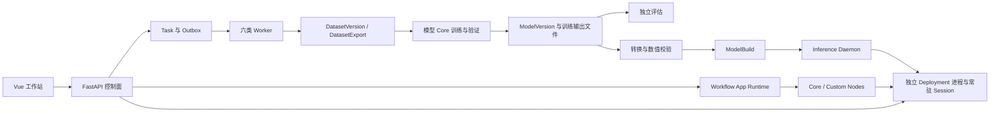

# 代码、模型链路与架构核对（2026-10-13）

## 结论

项目已经具备本地视觉平台的实际主链，并非只有 API、占位 runner 或外部模型命令行包装。数据集版本、异步任务、模型 Core、转换、独立进程 Deployment、Workflow Runtime 和 Vue 工作站均有实现。当前正式支持 18 个模型与任务组合，不是所有模型各自支持五种任务。

本轮 18 组合真实短链首轮为 16 通过、2 失败；对失败组合使用原 ModelVersion 续验后，两项也通过三种后端的独立进程 sync/async 与 Workflow。最终每个支持组合都有完整短链证据，但不能描述为“首轮 18/18 无失败”或“已完成长期稳定性验收”。YOLO26 segmentation 首次数值校验拒绝尚未稳定复现，保留为待查风险。

当前实现适合继续按“模块化单体 + 独立执行器”演进。主要问题是部分大文件混合模型执行与平台任务职责、历史文档及测试未完全跟上实现，以及少量真实的生命周期和输入校验缺陷。本轮已修复后文列出的具体问题；不能由测试通过推导出所有配置、精度、硬件和长期无人值守运行均已验收。

本轮没有更改数据库 schema、公开 API 字段或模型输出协议，无新增迁移。修复针对源码与 conda 开发环境；没有手工覆盖 `release/`，也没有重新组装或验收 bundled Python 发行包。

## 范围和证据标准

- 起始源码提交：`f78c4de3`。最终工作区包括本轮未提交修复。
- 对仓库自有 239 份已跟踪 Markdown（约 3.8 万行，不含本报告）建立文件清单、全文检索并检查本地链接，重点阅读架构、模型、数据格式、API、部署、节点、前端及历史验收文档。第三方 `projectsrc`、生成的 `release` 和依赖包文档不作为平台当前设计事实。文档扫描不等于每个历史陈述都经过本轮实验重新证明。
- 按公开入口追踪到应用服务、任务 runner、Core、runtime adapter 和文件/数据库持久化路径；结合自动化测试、真实小数据集链路及浏览器验证判断可用性。
- 开发环境为 Windows x64、conda `amvision`、Python 3.12、PyTorch `2.12.1+cu126`，本机 CUDA 可用。ONNX、OpenVINO、TensorRT 使用本地实际运行时；不以 mock 转换结果代替真实 artifact 执行。
- 短训练采用 nano、每个 split 最多 4 张图片、1 epoch、固定 batch 1、fp32，未启用矩阵的 `--use-pretrained-warm-start` 选项。它证明调用与产物契约，不证明收敛、业务准确率、全 scale/尺寸/精度覆盖或工业节拍；预训练权重兼容性另由参考专项测试取证。

## 目标、组织与调用关系

项目服务于现场本地视觉处理：管理数据、训练与发布模型、组合传统视觉和模型节点，通过浏览器、工作站和外部系统协议使用。核心平台不承担相机、PLC、IO 的直接控制；确需硬件直连时由可信节点包提供，并声明依赖和生命周期。

| 层级 | 当前职责与真实位置 | 上下游关系 |
| --- | --- | --- |
| 界面 | `frontend/web-ui/src/modules`、`workflows`，Vue 3 / TypeScript / Vite | 通过版本化 REST、WebSocket 和 capability 查询使用后端；构建后本地分发 |
| API | `backend/service/api` | 鉴权、请求校验、公开契约映射；重任务交给应用服务入队 |
| Application | `backend/service/application` | 用例、任务状态、资源登记、部署与流程生命周期 |
| Domain | `backend/service/domain` | 领域记录、不变量、Repository / Unit of Work 协议 |
| Infrastructure | `backend/service/infrastructure` | SQLAlchemy、本地文件对象存储、持久队列、IPC、HTTP 与协议实现 |
| 后台执行 | `backend/workers` | 数据集导入、导出、训练、评估、转换、批量推理的六类 worker profile |
| 模型数值实现 | `application/models/*_core` | 各代网络、head、loss、数据准备、训练/验证、checkpoint、export 和后处理 |
| 发布推理 | `backend/inference_daemon`、`application/runtime` | Deployment 控制、独立子进程、常驻模型 session、sync/async 请求执行 |
| 流程执行 | `application/workflows`、`backend/nodes` | AppVersion、RuntimeRevision、worker generation、图调度、资源与节点执行 |
| 扩展 | `custom_nodes/<pack>` | manifest、catalog、版本、能力、参数、timeout、启用/禁用、回滚和审计 |
| 分发 | `backend/maintenance`、`runtimes`、`launcher`、`sdks` | 生成发行目录、同目录 Python、启动监督、外部系统 SDK |



TaskAttempt fencing、Outbox 和资源登记负责避免旧 worker 覆盖新执行状态；LocalBuffer、mailbox/mmap 承担本机数据传输。Workflow Preview 是内存会话、WebSocket 事件和独立复用 worker，不再是旧的后端进程内同步预览。正式 Runtime 使用发布版本与运行修订，不与编辑草稿混用。

## 模型范围与 full core 的含义

| 模型 | 正式任务 | 不应扩大的承诺 |
| --- | --- | --- |
| YOLOX | detection | 不包含 classification、segmentation、pose、OBB |
| YOLOv8 | detection / classification / segmentation / pose / obb | 本轮不覆盖所有 scale 和上游全部 CLI 选项 |
| YOLO11 | detection / classification / segmentation / pose / obb | 同上 |
| YOLO26 | detection / classification / segmentation / pose / obb | end-to-end TopK、附加几何字段必须按本代语义验证 |
| RF-DETR | detection / segmentation | 不公开 classification、pose、OBB、LoRA/PEFT 或任意 Python optimizer callable |

这些家族有项目内网络、loss、backward、checkpoint、评估和转换执行路径，不能归类为简单轻量占位。`full core` 不意味着复制上游完整产品：本项目采用可序列化参数、单任务单设备、受控文件与任务生命周期。DDP、云训练、在线标注、CoreML、ARM NPU 等未公开能力不能因为长期规划中提到就算已实现。

平台独立评估也不等于上游 validator 全字段复制：segmentation 使用项目 COCO-style AP / mask IoU，OBB 使用 rotated IoU，pose 使用 pycocotools keypoints AP。精度对照须固定 checkpoint、split、预处理、阈值、maxDets、类别与关键点映射。

数据集按任务公开 ImageNet、COCO、VOC、YOLO、DOTA 等已注册格式，导入 zip 后统一存储并生成不可变版本与导出 manifest。RF-DETR 内部 YOLO 读取能力不自动扩大平台当前公开的训练输入格式。

## 本轮修复

| 问题 | 修改与验证 |
| --- | --- |
| YOLOv8 detection warm start 可在严重不匹配时继续训练 | 改用本代 loader 和共享 `0.85` 覆盖率门禁；不兼容权重拒绝，合法类别 head 改变仍允许；保留当前任务类别属性 |
| YOLOX 训练中途保存/暂停时登记 latest 缺少类别名 | 从任务固定 DatasetExport manifest 补齐类别摘要，不依赖尚未生成的最终 TaskResult；真实 API 暂停、恢复、保存回归通过 |
| RF-DETR segmentation 临时 cuDNN flags 可交错恢复 | CUDA forward/backward 使用同一进程锁保护相关作用域，CPU 不更改全局 flags；验证并发异常恢复和真实 CPU 数值/梯度。该锁不约束其他无关代码自行修改全局 flags |
| RF-DETR YOLO YAML 类别字典处理不完整 | 接受整数/数字字符串索引，按索引排序，拒绝重复索引、空表、非数字和缺号 |
| Windows 服务接管误读受保护系统祖先命令行 | 在已确认的 System32 系统宿主边界停止祖先追踪；未知或 Python 祖先仍须核实，不把 AccessDenied 当作已授权接管 |
| 后端非默认端口托管 Vue 时页面误连 5600 | 只有模板回退配置按当前请求来源生成 API / WebSocket；显式配置保持优先，模板不写盘；HTTP/HTTPS 和配置优先级回归通过 |
| 图编辑器小地图遮挡属性表单 | 属性/历史面板打开时导航移到旁边，窄窗口避免覆盖；在 1280×720、1440×1000 实看 |
| 训练详情 telemetry 测试在负载下间歇超时 | 用受控 timer 推进刷新窗口，并在每项结束卸载组件；不增加超时或改变生产刷新逻辑；最终前端全量 668 项通过 |
| 删除旧节点包后缓存目录被误报为损坏包 | loader 忽略仅剩 `__pycache__/*.pyc` 的目录；含源码/资源、空目录或链接仍接受原 manifest 校验；先复现失败再修复 |
| 旧公共 detection builder/loader 与本代实现重复 | 删除旧重复文件；跨 family 构建分发移到 `registry/yolo_builders.py`，测试改用本代正式 checkpoint loader |
| YOLOE 残留“未实现”异常函数 | 删除未使用的过时 helper；不改变已接通的节点执行入口 |
| .NET SDK 项目强制引用未分发的本地配置包 | 使用可选 `Config/*.json` 构建项，移除这些缺失文件带来的构建前提；实际调用仍需生成配置。本轮未单独完成 VS2019/.NET Framework 4.7.2 全量编译验收 |
| TensorRT 构建子进程丢失数值校验 details | 子进程输出结构化错误并保持非零退出；YOLO 构建层保留 `build_error`，不会因为旧 engine 文件存在而判成功 |
| 测试与文档滞后 | 更新原子替换 mock、Alembic head、PreviewSession 事件/删除语义、节点版本与分类、跨平台 schema 摘要；缺少可选开发资产时明确跳过；修正文档旧 Preview 和 connector 状态及失效本地截图引用 |

没有通过放宽转换容差、伪造空推理结果、降级模型结构、把 failed 改成 succeeded 或自动下载权重来获得通过。

## 验证记录

首轮矩阵运行于本地时间 21:51:59—22:55:16，18 个组合全部执行，没有遗漏；16 通过、2 失败。续验于 23:04 完成，未重新训练、替换 ModelVersion 或放宽数值容差。各任务、产物、独立进程和流程运行身份保存在 [机器可读验收摘要](code-audit-20261013-results.json)。

| 模型 | detection | classification | segmentation | pose | obb |
| --- | --- | --- | --- | --- | --- |
| YOLOX | 首轮通过 | 不支持 | 不支持 | 不支持 | 不支持 |
| YOLOv8 | 首轮通过 | 首轮通过 | 首轮通过 | 首轮通过 | 首轮通过 |
| YOLO11 | 首轮通过 | 首轮通过 | 首轮通过 | 首轮通过 | 首轮通过 |
| YOLO26 | 首轮通过 | 首轮通过 | 原模型续验通过 | 首轮通过 | 首轮通过 |
| RF-DETR | 首轮通过 | 不支持 | 原产物续验通过 | 不支持 | 不支持 |

每个“通过”覆盖导入、导出、短训练与验证、独立评估、ONNX/OpenVINO/TensorRT 产物、三后端独立 Deployment 的 sync/async 推理、正式 Workflow 调用及 reset/stop。合计 54 个模型任务与后端组合有执行证据。纳米模型短训练可能产生空检测或接近零的 AP，这不构成业务精度通过；完整 API 与产物契约才是该矩阵的验证目标。

两项首轮失败分别处理如下：

- RF-DETR segmentation：三类转换均完成，TensorRT sync 启动时返回 `409 device_lease_unavailable`。当时全量 pytest 仍在执行，存在 GPU 测试重叠；没有独立确定冲突持有者。其他测试结束后，复用原有三个 ModelBuild，sync/async 和 Workflow 全部通过。资源租约拒绝不能计成首次成功，也没有删除租约或绕过资源检查。
- YOLO26 segmentation：原 TensorRT 任务 `task-ba79b0fbe9a1` 被数值门禁拒绝，旧子进程错误未保留详细比较结果。对同一 optimized ONNX 独立重建，原有 `yolo26-topk-v3` 校验通过，候选数值最大绝对误差 `3.05e-5`、mask proto `7.45e-9`；再通过正式 API 对原 ModelVersion 创建转换任务 `task-653c0c8d5cf8`，转换及三个后端的部署推理/流程全部通过。原失败 engine 未保存，当前证据不能确定原失败根因。本轮修复错误详情跨进程丢失，以便后续失败可定位；没有将后续通过解释为原数值问题已根治。

其他验证记录如下。起始全量测试为 66 失败、4908 通过、65 跳过；失败中既有真实实现问题，也有过时 fixture、mock 与本地资产假设，不能把它们全部称为生产缺陷。

| 验证 | 结果与限制 |
| --- | --- |
| 后端全量 pytest | 4942 通过、106 跳过，31 分 53 秒；服务接管单独验证。多数跳过来自该轮运行时不可读的开发资产；补查资产可读后另行执行下行测试，不改写原始计数 |
| 连接器与计量资产补测 | 6 个文件、100 项通过，使用已有合成图、定位、采样和标定资源；不代表实物计量精度 |
| Vue Vitest | 最终 160 文件、668 项通过，47.38 秒；类型检查、生产构建和浏览器验证通过 |
| Vue 类型与生产构建 | `vue-tsc --noEmit`、Vite build 通过；静态资源无需部署系统 Node |
| 浏览器 | Chrome，11 个主要入口，1440×1000 与图编辑器 1280×720；无空白页、Vite overlay、console/page error 或失败 API。隔离空项目验证，未宣称通过 UI 重做 18 组合训练 |
| 浏览器真实编辑与 Preview | 选择 Hello World 节点，保存新应用，启动预览，经 WebSocket 收到 `node.finished`、`run.finished`、`run.outputs`，界面显示 `Hello, World!` 与 succeeded；无 page error |
| 节点诊断复验 | 487 个节点定义、10 个有效自定义节点包，目录诊断 0；修复前额外 12 个缓存残留目录被误列为失败节点包 |
| 补充回归 | loader、文档链接、前端配置来源、服务接管共 20 项通过 |
| 转换诊断补充回归 | TensorRT 错误跨进程保留、YOLO export 和文档链接共 78 项通过 |
| YOLO 参考数值 | 本地 Ultralytics 快照及 v8.4.176 均 15 通过、1 跳过；覆盖三代五任务的测试集合及 MuSGD，具体通过项以测试为准 |
| YOLOX 参考数值 | nano 图、固定输入与参数，eval forward、训练 loss 和所有参与参数梯度对照通过 |
| supervision 参考几何 | 默认 box IoU 对照本地参考函数，覆盖普通框、空集及零面积框，`rtol=1e-6`、`atol=1e-7` 通过；不代表全部 supervision API 兼容 |
| 单独 YOLOv8 detection 实链 | 导入、导出、1 epoch、评估、ONNX/OpenVINO/TensorRT、各后端 sync/async、Workflow、reset/stop 通过 |
| 静态检查 | `ruff check backend custom_nodes tests --select F,E9` 与 `git diff --check` 通过 |

参考目录只在开发对照中读取，不进入产品 import。当前本地 Ultralytics 声明 `8.4.115`、RF-DETR 声明 `1.8.3`，不能把目录存在理解为上游最新版。此次另核对 [Ultralytics v8.4.176](https://github.com/ultralytics/ultralytics/releases/tag/v8.4.176)；下载包 SHA-256 为 `0b075e3ff34794aef5c29c4585cde876fddcbaa0277d0de2453d97f2161b8a54`。RF-DETR 对照涉及 [官方发布记录](https://github.com/roboflow/rf-detr/releases)与本地源码；未完成全部 RF-DETR 上游版本数值等价证明。

YOLO11 detection 的本地 `m/default/checkpoints/yolo11m.pt` 实为项目训练状态 checkpoint，不是参考测试要求的官方 module checkpoint，因此该项跳过；没有覆盖或伪造该资产。监督工具通过项目 `supervision_compat.py` 保留实际消费的类型和几何能力，不是全量 supervision 产品。对其余上游新增功能不能作“已全部同步最新版”的结论。

关键本地参考文件 SHA-256（这些目录没有可单独使用的上游 Git 提交身份）：

| 文件 | SHA-256 |
| --- | --- |
| `projectsrc/ultralytics/ultralytics/nn/modules/head.py` | `25096c28ded538d8c3b2579d7b7ae289a02b2f111b86d8a988ce8e658d33769d` |
| `projectsrc/YOLOX_2026/yolox/models/yolo_head.py` | `a5715ebdb0ba794ffca0898fd4da0875b4e854641317102cf71daf727dbdf6c4` |
| `projectsrc/rf-detr/src/rfdetr/models/heads/segmentation.py` | `19d844e98d2e9d3f90b901d377d51e45b83d609bdb2cfe7ef83acba98f30a009` |
| `projectsrc/supervision/src/supervision/detection/utils/iou_and_nms.py` | `e9a2c1056f7849ee1a8b362496aff01c5f4ea2cf76f4535ca1103a42a00fb412` |

## 仍需完成或优化的部分

| 优先级 | 当前缺口或风险 | 合适的后续实现/验收 |
| --- | --- | --- |
| 高 | 短链不能证明长期独立服务稳定性 | 固定目标模型与负载，补 24/72 小时 soak、进程崩溃恢复、队列背压、RSS/VRAM/句柄趋势、P95/P99、停止重启与资源归还；历史一小时记录不能代替本轮修复后的验收 |
| 高 | YOLO26 segmentation 首次 TensorRT 数值拒绝未稳定复现 | 保留初次失败与续验分别记录；利用新增结构化 details 固定 checkpoint、ONNX、builder 配置和 GPU 负载复现，不能通过放宽容差掩盖失败 |
| 高 | 模型业务精度与全配置覆盖不足 | 使用真实独立 test 数据与足够 epoch，核对 PyTorch/ORT/OpenVINO/TRT 指标；扩展 scale、输入尺寸、AMP、batch 与关键数据边界 |
| 高 | 发行环境未随源码复测 | 按 profile 重新 assemble-release，在自己的 bundled Python 中核对 GPU wheel/DLL/trtexec 版本、驱动与目标硬件后验收 |
| 高 | E2E harness 仅隔离 DB/queue/IPC，仍复用开发 ObjectStore，worker profile 可覆盖 workspace | 应为下一轮建立独立对象存储和 profile 路径，预训练资产只读引用或受控复制；避免并发验收污染共享工作流文件与训练目录 |
| 中 | 模型训练与平台层仍有反向耦合 | 将 YOLOv8 detection 执行器的平台导入改为输入对象与回调；把 YOLO11/26 外层长训练循环按模型计算、状态控制、产物登记分开 |
| 中 | 公共 YOLO 层仍包含 YOLO26 特例 | 公共 pose loss 与 parser 通过明确注入本代实现解耦；保持 checkpoint key、数值与梯度回归，不另建重复模型 |
| 中 | Workflow 生命周期大文件职责过多 | 将 runtime command/state transition、资源所有权、worker supervision 和响应查询分开；保持 epoch/lease/timeout/取消语义的统一事实来源 |
| 中 | 节点存在与节点可用不能等同 | 为有外部依赖的 Camera/PLC/数据库/MES/YOLOE/SAM3 等补实际资产或设备验收；本轮连接器与计量 100 项合成资产补测通过，仍不能代替现场实物与外部系统验收 |
| 中 | 参考资产可追溯性不足 | 固定上游 tag/commit 与关键文件摘要，区分官方预训练与项目训练输出；让缺资产的参考测试在专项验收中显式列为未完成 |
| 中 | Vue 大页面与语言文件维护成本 | 沿任务输入、资源选择、运行状态、图交互拆 composable/组件；按业务拆语言字典，保留统一 Vue 主栈及离线资源 |

审计时按非空行数观察到的集中点：Workflow runtime service 约 3218 行、Task service 2721 行、Workflow worker manager 2704 行、节点 runtime support 2422 行、WorkflowEditorPage 2387 行、YOLOv8 detection execution 2378 行、Deployment supervisor 2123 行。行数本身不是错误证据，但与上述职责交叉共同表明应继续拆分。拆分应一次覆盖一个可验证边界，避免整仓机械搬文件。

## 复现与完成边界

开发命令先激活环境：

```powershell
conda activate amvision
python -m pytest tests -q --ignore=tests/test_service_takeover.py --basetemp=.tmp/audit-full
python -m pytest tests/test_service_takeover.py tests/test_frontend_runtime_config_origin.py tests/test_local_node_pack_loader.py -q --basetemp=.tmp/audit-supplement
python -m tests.integration.model_task_e2e_matrix --start-processes --run-id audit-full-matrix --batch-mode fixed --batch-size 1 --max-images-per-split 4 --training-precision fp32 --task-timeout-seconds 600 --run-workflow
```

真实矩阵须先检查本地数据/权重与上述对象存储复用边界，不与现场写入流程并发运行。前端沿现有 npm 脚本或项目已安装的工具执行；本机 npm 启动 shim 异常时使用已安装工具的 Node 入口完成检查，未修改系统工具链。

临时日志、参考解压文件、测试缓存不作为交付资产。本报告与 JSON 摘要保留结论、方法、覆盖、身份与限制。本轮测试进程已停止，所属 `.tmp` 临时产物已清理；其他历史任务目录保留。JSON 中的进程 ID 是采样时的运行证据，不表示测试服务仍在运行。
